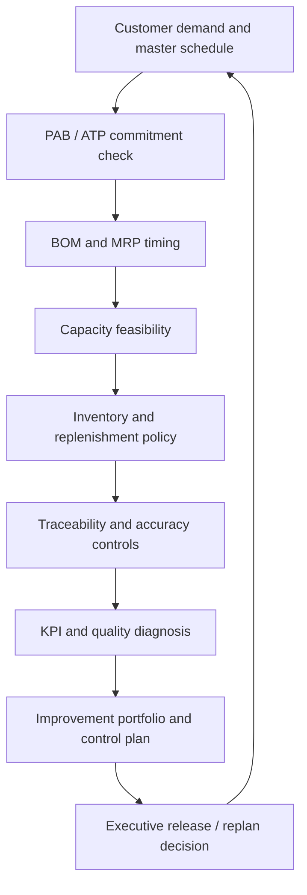

# Pinehaven Q3 Operations Stabilization Decision

## Situation

Pinehaven Motion Systems is entering the second half of Q3 with a master schedule that remains positive on projected inventory, but execution signals are deteriorating. Customer orders are consuming near-term promiseable quantities, several work centers are overloaded, the burn-in test queue is above its action threshold, first-pass yield and incoming quality are below target, inventory accuracy is weak, setup time is high, and inventory turns are below the desired level.

Leadership does not want a collection of local fixes. It wants one integrated stabilization decision connecting **master scheduling, MRP, capacity, inventory, traceability, quality, flow, and continuous improvement**.

All organizations, values, SKUs, and events in this case are fictional and independently created for learning purposes.

## End-to-end decision flow

## Source datasets

Use the locked Pinehaven files rather than inventing replacement numbers:

- [Master schedule](../../assets/data/module-4/master-schedule.csv)
- [BOM structure](../../assets/data/module-4/bom-structure.csv)
- [MRP planning](../../assets/data/module-4/mrp-planning.csv)
- [DRP network](../../assets/data/module-4/drp-network.csv)
- [Capacity plan](../../assets/data/module-4/capacity-plan.csv)
- [Work-center capacity](../../assets/data/module-4/capacity-work-centers.csv)
- [Inventory item master](../../assets/data/module-4/inventory-item-master.csv)
- [Inventory financials](../../assets/data/module-4/inventory-financials.csv)
- [Replenishment models](../../assets/data/module-4/replenishment-models.csv)
- [Traceability and cycle counts](../../assets/data/module-4/traceability-cycle-count.csv)
- [Returns and disposition](../../assets/data/module-4/returns-disposition.csv)
- [Operations KPIs](../../assets/data/module-4/operations-kpis.csv)
- [Quality-tool data](../../assets/data/module-4/quality-tools-data.csv)
- [Lean flow](../../assets/data/module-4/lean-flow.csv)
- [Improvement projects](../../assets/data/module-4/improvement-projects.csv)
- [Internal Operations formula sheet](../../calculations/internal-operations/formula-sheet.md)

## Controlled assumptions

Use the assumptions embedded in the datasets unless you explicitly create and label a sensitivity case.

- PAB uses booked customer orders inside the demand time fence and the greater of forecast or customer orders after it.
- ATP is discrete and noncumulative in this case.
- A planned order release is the planned receipt offset earlier by the stated lead time; lot-sizing can change quantity but not that timing rule.
- Capacity units are standard hours unless the dataset says otherwise. Unused capacity at one work center is **not automatically transferable** to another work center.
- The ABC value class and a policy/criticality class are separate decisions; criticality may justify a control override.
- The Module 4 safety-stock material does not prescribe one universal safety-stock formula. Do not invent one.
- Inventory-count adjustments require verified evidence and authorization; no tolerance policy should be assumed if none is stated.
- Regulatory or safety holds are mandatory gates and override economic ranking of a return or disposition option.
- Correlation is evidence of association, not proof of causation.
- An improvement must show a control owner, threshold, and response; an attractive pilot result is not enough by itself.

## Your assignment

Prepare one integrated decision pack that answers all eight tasks.

1. **Validate the master schedule.** Recalculate the 13-week PAB and every ATP bucket. Pinehaven receives an additional request for **60 PH-SD500 units in Week 4**. State what can be promised from the current schedule without silently borrowing future ATP and what decision is required for the remainder.
2. **Validate component timing.** Reproduce the PH-PWR220 L4L and PH-CNK500 FOQ release logic. Then use the multilevel BOM to calculate the gross component quantities required for a **100-unit PH-SD500 stress scenario**. Keep the stress calculation separate from the approved schedule.
3. **Check execution capacity.** Compare Week-27 load with rated and demonstrated capacity for every work center. Identify the binding issues, state what unused Pack & Label capacity can and cannot prove, and propose an immediate feasible-response package.
4. **Set inventory and replenishment controls.** Explain the value class and control policy for PH-PWR220, PH-CNK500, and PH-FUSE7. Reproduce the relevant EOQ/order-point, periodic-review, and min-max calculations and state the assumptions that could change each choice.
5. **Protect traceability, accuracy, and disposition.** Trace the PWR220 lot associated with serial SD500-SN-27031, disposition the three nonzero cycle-count differences, and explain why return R-1002 cannot be economically ranked while the safety hold remains open.
6. **Diagnose performance and quality.** Identify which KPI action triggers are breached. Use the Pareto, control-chart, scatter, and lean-flow evidence to distinguish priorities, hypotheses, and mandatory follow-up evidence.
7. **Choose the improvement portfolio.** Combine TOC, DMAIC, lean/JIT, and local capacity actions without treating them as interchangeable tools. Run a failure case in which Burn-in Test Week-27 required load rises from **150 to 165 standard hours** after the planned TOC improvement.
8. **Present the stabilization decision.** Produce a 30/60/90-day plan with named owners, decision gates, measures, contingencies, and the conditions that would force Pinehaven to replan rather than continue executing the current assumptions.

## Required decision record

For each major recommendation, state:

| Field | Required content |
|---|---|
| Decision | Clear choice, scope, and accountable owner |
| Evidence | Dataset, calculation, horizon, and material assumptions |
| Alternative | Strongest rejected option and why it is not preferred |
| Operational effect | Customer, flow, capacity, inventory, quality, or financial consequence |
| Risk | Residual exposure and the trigger that would change the decision |
| Control | Measure, threshold, evidence owner, review frequency, and response |

## Submission quality gates

A complete submission must pass all of these gates:

- every quoted number can be reproduced from a linked dataset or a clearly labeled sensitivity assumption;
- PAB is not confused with ATP and inventory availability is not confused with capacity feasibility;
- mandatory safety, regulatory, and data-integrity gates are applied before economic ranking;
- capacity is compared in consistent units and local excess capacity is not treated as automatically fungible;
- inventory policy separates value classification from criticality/service overrides;
- the improvement portfolio links each method to the problem it is best suited to solve; and
- the 90-day plan ends in evidence-based decisions, not merely activity completion.

## Capstone knowledge check

### Question 1

**Question.** Week 4 has a positive PAB of 425 units but ATP of 50 units. A new customer asks for 60 units in Week 4. What is the strongest first response?

A. Promise all 60 because PAB is positive

B. Promise 50 from the current ATP and route the remaining 10 through an approved schedule/reallocation decision

C. Move 10 units from Week 12 ATP without checking any affected commitments

D. Reject the entire order because ATP is below 60

Answer and rationale

**Correct answer: B.** PAB shows projected inventory balance, while ATP limits what the current schedule can promise to additional demand under the stated method. Fifty units are immediately promiseable from the Week-4 bucket; the remaining ten require an explicit decision rather than an invisible borrow from a later bucket.

A confuses inventory projection with customer commitment authority. C changes future availability without checking displaced demand. D throws away the 50 units that are actually promiseable.

### Question 2

**Question.** Final Assembly has 32 standard hours of overload while Pack & Label has spare rated capacity. What can Pinehaven conclude immediately?

A. The spare Pack & Label hours automatically eliminate the assembly shortage

B. The assembly shortage is irrelevant because total plant hours are sufficient

C. The spare capacity is useful only if compatible skills, equipment, routing, and timing prove it can perform the constrained work

D. Capacity planning should ignore work-center identity

Answer and rationale

**Correct answer: C.** Capacity is resource-specific. Spare capacity at another center is only a solution when the work can actually be transferred through an approved alternate route or compatible resource.

A and B treat hours as fungible when they may not be. D removes the resource-level detail needed for CRP and execution control.

### Question 3

**Question.** PH-FUSE7 is Class C by annual monetary value but Class A by policy because it is a critical protection item. What is the best interpretation?

A. ABC value analysis is wrong and must be deleted

B. The value class remains useful, while a documented criticality override justifies tighter control

C. Every Class C item should be converted to Class A

D. Unit cost alone should determine the replenishment decision

Answer and rationale

**Correct answer: B.** ABC analysis and criticality answer different questions. Pinehaven can retain the value-based C classification while applying tighter service and control rules because failure consequence is high.

A discards useful economic information. C removes prioritization. D ignores lead time, service consequence, variability, and policy.

### Question 4

**Question.** Return R-1002 has a positive modeled net recovery but an unresolved safety hold. What should happen?

A. Select the highest-recovery option immediately

B. Quarantine it until the safety/failure-analysis gate is resolved, then evaluate eligible disposition choices

C. Return it to stock because the recovery is positive

D. Average its value with other returns and ignore the hold

Answer and rationale

**Correct answer: B.** The safety gate determines eligibility before economics. A positive modeled recovery cannot make an unsafe or unresolved item eligible for reuse or resale.

A and C rank economics before safety. D destroys the item-level control evidence.

### Question 5

**Question.** The planned TOC action raises Burn-in Test capacity to 154 standard hours per week, but a stress case raises required load to 165. What completes the decision?

A. Declare the constraint solved because capacity improved

B. Release more work upstream so utilization stays high

C. Escalate the remaining 11-standard-hour gap through capacity/load actions and protect the constraint with governed release control

D. Remove the buffer because the improvement project succeeded

Answer and rationale

**Correct answer: C.** Improvement is judged against required load. The stress case still exceeds the improved constraint by 11 standard hours, so the plan needs additional capacity, load movement, schedule change, or demand decision while the constraint remains protected.

A confuses improvement with sufficiency. B would increase WIP ahead of the constraint. D removes a control exactly when the resource remains limiting.

When complete, compare your work with the [worked solution guide](solution-guide.md).
