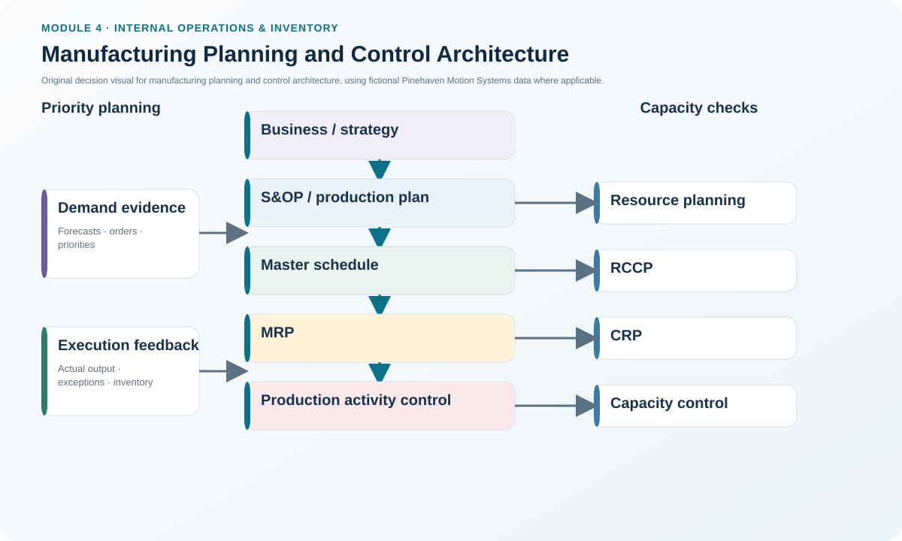
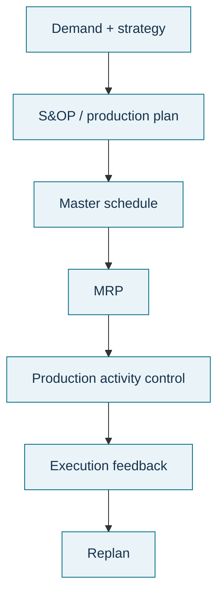

# 1. Manufacturing Planning and Control Architecture

## Learning objectives

After this topic, you should be able to:

- explain how aggregate plans become executable production decisions;
- distinguish priority planning from the matching capacity check at each level;
- identify where master scheduling, MRP, and production activity control fit; and
- recognize when feedback should move a problem back to an earlier planning level.

## Concept in plain English

Manufacturing planning and control is a hierarchy. The organization does not jump from a sales forecast directly to a shop-floor order. It progressively converts a broad supply-and-demand agreement into more detailed commitments.

At the top, sales and operations planning aligns aggregate demand and supply and produces a production plan for product families. Demand-management information is intentionally aggregated for this level and may be expressed in common family measures or monetary terms; it is not passed straight into MRP as component gross demand. Master scheduling then translates that family-level direction into specific items, quantities, and dates. Material requirements planning converts those item-level plans into time-phased component and material requirements. Production activity control executes and monitors the work that has actually been released.

Each priority-planning level has a capacity counterpart. The production plan is checked through resource planning, the master schedule through rough-cut capacity planning, the material plan through capacity requirements planning, and execution through capacity control. A plan that fails its capacity test should be revised rather than pushed downstream as if it were feasible.

## Why it matters

The hierarchy prevents a common operating failure: different functions working from different levels of detail and treating all numbers as equally firm. Sales may be discussing a family-level monthly volume while a buyer needs a dated component release and a supervisor needs a work-center sequence. Those are related decisions, but they are not interchangeable.

A disciplined hierarchy also creates feedback. If a bottleneck cannot support the proposed master schedule, the answer is not to let MRP generate an impossible component plan. The master schedule or capacity assumption needs adjustment first.

## Decision model and workflow

### Evidence retained through the workflow

| Planning layer | Primary decision | Capacity check | Evidence to retain |
|---|---|---|---|
| S&OP / production plan | Family-level volume and timing | Resource planning | Approved family plan, major assumptions, capacity constraints |
| Master schedule | Specific item, quantity, date | RCCP | MPS version, PAB/ATP, bottleneck feasibility |
| MRP | Component quantities and timing | CRP | BOM/version, inventory status, planned orders, exceptions |
| Production activity control | Release, sequence, execute, report | Capacity control | Shop-order status, priorities, queues, output, exceptions |

## Practical process flow

## Original visualization

The architecture visual separates the **priority decision** from the **capacity confirmation**. This is intentional: material availability does not prove capacity feasibility, and capacity availability does not prove the right materials will exist at the right time.

## Realistic example — Pinehaven Motion Systems

Pinehaven plans a family of industrial servo drives. The quarterly family plan establishes the total output needed, but the factory does not release component orders from that family number. The master scheduler first decides when the PH-SD500 will be produced. Those MPS quantities then become the driver for dependent component requirements such as power modules, controller assemblies, fans, connectors, and enclosure materials.

If the electrical test area cannot support the PH-SD500 schedule, Pinehaven has a master-schedule feasibility issue. Changing supplier release dates without revising the infeasible parent schedule would simply move the inconsistency deeper into the system.

All organizations, names, and numerical values in this module are fictional and independently created for learning.

## Applied decision artifact — planning-hierarchy responsibility matrix

Before escalating a shortage or schedule issue, record four fields: **the planning level where the problem was detected, the decision owner, the capacity/material evidence, and the plan that must change if the issue cannot be resolved locally**. This prevents every exception from being treated as a shop-floor emergency.

A useful rule is to correct the problem at the highest level at which the underlying assumption is wrong. A one-day machine interruption may be managed in execution. A recurring bottleneck that makes the MPS infeasible belongs in master scheduling and RCCP. A structural capacity shortfall affecting the whole product family belongs in resource planning and S&OP.

## Decision logic

- Start with the approved aggregate plan; do not invent lower-level volume independently.
- Increase detail only as the decision horizon becomes shorter and commitments become more specific.
- Run the matching capacity check before allowing a plan to drive the next level.
- Use execution feedback to challenge assumptions when actual conditions differ materially from plan.
- Escalate structural problems instead of repeatedly expediting around them.

## Trade-offs

| Tension | Decision implication |
|---|---|
| Stable plans vs. rapid reaction | Protect near-term commitments while preserving controlled feedback for real exceptions. |
| Central coordination vs. local execution knowledge | Set plan boundaries centrally, but use actual work-center and supplier evidence to validate feasibility. |
| Planning detail vs. planning effort | Add detail only where it changes a decision; excessive detail too early creates maintenance without better control. |

## Commonly confused with

**Planning hierarchy** is not the same as a sequence of software screens. An ERP system may support many levels, but the business logic still requires distinct decisions, owners, horizons, and feasibility checks.

## Common mistakes

- Treating the forecast as a shop-floor schedule.
- Running MRP before validating the master schedule at critical resources.
- Assuming that one capacity check is sufficient for every horizon.
- Solving recurring plan infeasibility through expediting rather than correcting the responsible planning level.

## Original knowledge check

**Question.** Pinehaven's draft master schedule exceeds a critical test-cell capacity next month. What should happen before MRP is allowed to drive component orders?

A. Run MRP first and let purchasing absorb the overload

B. Validate and revise the MPS or capacity through rough-cut capacity planning

C. Move the issue directly to cycle counting

D. Convert all component orders to fixed order quantities

Answer and rationale

### Correct answer

**B. Validate and revise the MPS or capacity through rough-cut capacity planning**

### Why it is correct

RCCP is the capacity check paired with the master-scheduling level. If the schedule is not feasible, the organization should correct the schedule or capacity assumption before that schedule drives detailed material requirements.

### Why the other answers are wrong

- **A.** This would propagate an infeasible parent plan into purchasing and production.

- **C.** Cycle counting addresses inventory-record accuracy, not master-schedule feasibility.

- **D.** Lot-sizing policy does not remove a bottleneck-capacity mismatch.

## Practitioner perspective

When planners say that “the system created a bad plan,” first ask which planning level supplied the bad assumption. Good planning systems amplify disciplined logic; they also amplify inconsistent master data, infeasible schedules, and poorly governed changes.

## Related concepts

- [Master Scheduling and the Master Scheduling Grid](./02-master-scheduling-and-the-master-scheduling-grid.md)
- [MRP Logic, Inputs, and Demand Types](./07-mrp-logic-inputs-and-demand-types.md)
- [Section A overview](./README.md)

---

[Previous: Section A overview](./README.md) · [Section overview](./README.md) · [Next: Master Scheduling and the Master Scheduling Grid](./02-master-scheduling-and-the-master-scheduling-grid.md)
