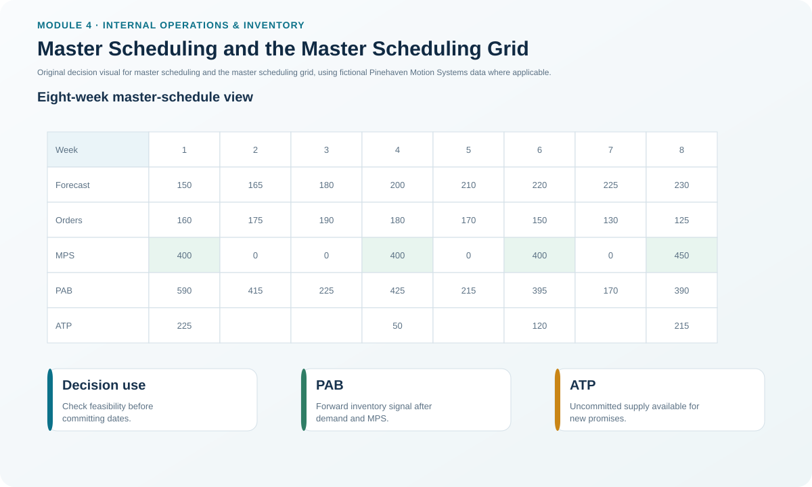
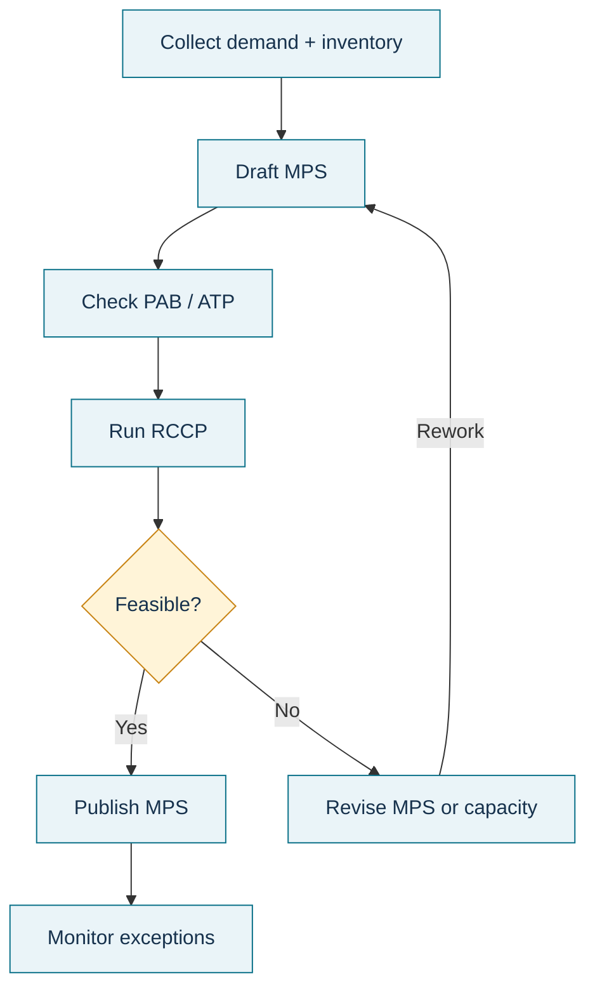

# 2. Master Scheduling and the Master Scheduling Grid

## Learning objectives

After this topic, you should be able to:

- explain the role of master scheduling between the production plan and MRP;
- identify the major rows in a master scheduling grid;
- distinguish a forecast, customer orders, PAB, ATP, and the MPS; and
- describe why a master schedule is a controlled business commitment rather than an automated forecast copy.

## Concept in plain English

Master scheduling turns an aggregate production plan into a time-phased plan for specific master-schedule items. The master production schedule is the build plan: what the organization intends to make, in what quantity, and in which period. It is not the same thing as the forecast. The forecast expresses expected demand; the MPS expresses a production commitment after considering demand, inventory, backlog, material, capacity, and policy.

A master scheduling grid places several related signals in the same time horizon. Typical rows include forecast, customer orders, projected available balance, available-to-promise, and MPS receipts. Seeing them together helps the master scheduler balance market commitments with operational feasibility.

A **master schedule item** does not have to be only a finished good. It can be an end item, important component, pseudo item, or planning BOM when that is the point where management needs direct control. In a make-to-order setting, the master-scheduling focus can move upstream toward raw materials or critical components because finished goods are not built in advance of the customer order.

## Why it matters

Without master scheduling, aggregate monthly plans are too coarse for purchasing, component planning, and customer order promising. At the other extreme, letting an algorithm freely change critical item plans every time demand shifts can destabilize suppliers and production. Master scheduling provides the controlled bridge.

For sales, the schedule creates visibility into when product is expected to be available. For operations, it creates a stable enough statement of intent to plan materials and capacity. For finance and leadership, it exposes where demand and operational commitments are diverging.

## Decision model and workflow

### Evidence retained through the workflow

Retain the demand plan, booked orders, beginning inventory, agreed lot-size rule, MPS proposal, PAB, ATP, time-fence positions, RCCP result, change approvals, and schedule version. The retained record should make it possible to explain why a build was scheduled in a specific week.

## Practical process flow

## Original visualization

The visual uses Pinehaven's 13-week PH-SD500 dataset rather than reproducing a source grid. It makes the relationship between demand, MPS receipts, PAB, ATP, and time-fence zones visible in one place.

## Realistic example — Pinehaven Motion Systems

Pinehaven begins the horizon with 350 PH-SD500 units and schedules an MPS receipt of 400 units in week 1. Customer orders are 160 units. The resulting PAB is 590 units. In weeks 2 and 3, no additional MPS receipt is planned, so PAB falls to 415 and then 225 as booked orders consume supply.

The grid does not tell the planner to produce because a forecast exists. It shows the planner how the planned build, actual booked orders, expected demand, and inventory interact. The schedule must still be checked for critical-resource feasibility before it becomes the driver for MRP.

The working dataset is [`master-schedule.csv`](../../assets/data/module-4/master-schedule.csv).

## Applied decision artifact — MPS input-and-output checklist

Before approving a master schedule, verify:

| Input or output | Control question |
|---|---|
| Production-plan direction | Does the item schedule reconcile to the approved family plan? |
| Forecast and booked orders | Are both current and using consistent units/time buckets? |
| Inventory | Is beginning on-hand reliable and available for this item? |
| MPS receipts | Are quantity and timing deliberate, not merely system-generated? |
| PAB | Does projected supply remain acceptable across the horizon? |
| ATP | Are uncommitted quantities calculated consistently for order promising? |
| RCCP | Can critical resources support the schedule? |
| Time fences | Are changes governed according to the correct zone? |

## Decision logic

- Use the production plan as the boundary for aggregate volume.
- Disaggregate to the item and time bucket where execution requires a commitment.
- Keep demand signals separate from the production decision; do not label a forecast as the MPS.
- Reconcile inventory and existing commitments before adding new production.
- Verify critical capacity before releasing the schedule downstream to MRP.

## Trade-offs

A very stable MPS reduces disruption but can react slowly to genuine market changes. A highly reactive MPS can improve short-term responsiveness while creating nervousness, expediting, setup changes, supplier disruption, and loss of schedule credibility. Time fences and explicit change authority are the mechanism for balancing those needs.

## Commonly confused with

**Forecast:** expected demand. **MPS:** planned production for master-schedule items. **PAB:** projected inventory balance. **ATP:** uncommitted supply that may be promised. These rows interact, but each answers a different question.

## Common mistakes

- Treating the highest forecast period as an automatic MPS quantity.
- Ignoring beginning inventory when evaluating a schedule.
- Assuming an MPS is feasible because the material plan can be calculated.
- Allowing customer promises to consume quantities that were never available-to-promise.

## Original knowledge check

**Question.** Which statement best describes the PH-SD500 MPS row?

A. It is the demand forecast copied into a build plan

B. It is Pinehaven's planned build quantity by period after considering demand, inventory, constraints, and policy

C. It is the list of component purchase orders

D. It is the actual shop-floor output already completed

Answer and rationale

### Correct answer

**B. It is Pinehaven's planned build quantity by period after considering demand, inventory, constraints, and policy**

### Why it is correct

The MPS is a controlled production plan for specific master-schedule items. It considers demand but is not itself a forecast or a record of completed production.

### Why the other answers are wrong

- **A.** Forecast and MPS are different planning signals.

- **C.** Component orders are derived later through MRP.

- **D.** Completed output belongs to execution reporting, not the forward MPS.

## Practitioner perspective

A useful master-schedule review asks two questions separately: “Is this the right commitment?” and “Can we execute it?” The first is a priority decision; the second is a feasibility decision. Combining them too early often hides which assumption needs correction.

## Related concepts

- [Manufacturing Planning and Control Architecture](./01-manufacturing-planning-and-control-architecture.md)
- [Projected Available Balance and MPS Logic](./04-projected-available-balance-and-mps-logic.md)
- [Allocation, Order Promising, and Available-to-Promise](./05-allocation-order-promising-and-available-to-promise.md)

---

[Previous: Manufacturing Planning and Control Architecture](./01-manufacturing-planning-and-control-architecture.md) · [Section overview](./README.md) · [Next: Planning Horizons, Time Fences, and Change Authority](./03-planning-horizons-time-fences-and-change-authority.md)
