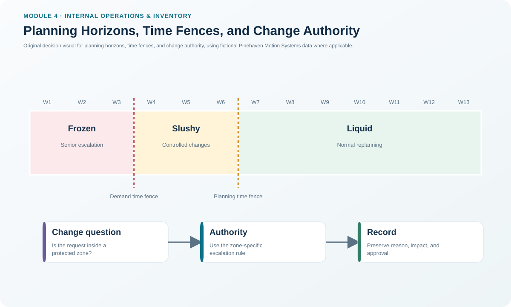
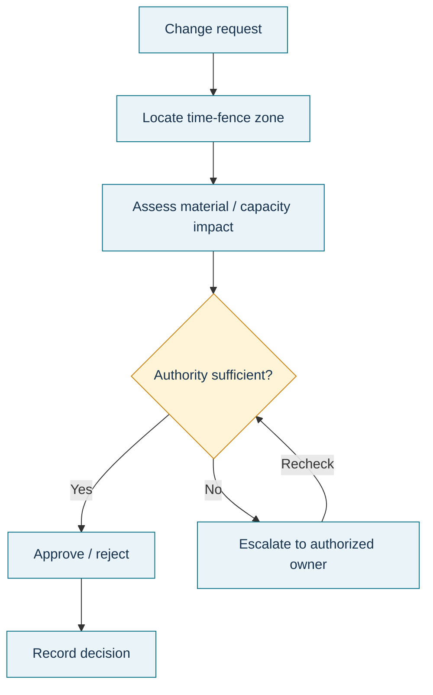

# 3. Planning Horizons, Time Fences, and Change Authority

## Learning objectives

After this topic, you should be able to:

- explain why the planning horizon must cover the relevant cumulative lead time;
- distinguish frozen, slushy, and liquid planning zones;
- identify the different change authority inside each zone; and
- explain how time fences reduce instability without eliminating necessary flexibility.

## Concept in plain English

A planning horizon is how far the plan extends into the future. It needs to extend far enough for the organization to acquire or make what is required. For a multilevel product, that means considering the longest lead-time path through the BOM, not only the final assembly time.

Time fences divide that horizon into zones with different rules. The **demand time fence (DTF)** protects the closest period, where material and capacity are already strongly committed. The **planning time fence (PTF)** marks a second boundary beyond which changes are easier. Together they create three useful zones:

- **Frozen:** near-term commitments are highly protected; changes require senior authority.
- **Slushy:** some commitments exist, but the master scheduler can negotiate trade-offs within policy.
- **Liquid:** later periods can be changed more freely as long as the overall production plan and policy are respected.

Components can also have their own time fences because their procurement and production lead times differ.

## Why it matters

Late changes are not free. A seemingly small priority change may create rescheduling, new setups, rerouting, expediting, overtime, component shortages, or disruption to other orders. Yet a rigid schedule that never changes is unrealistic because customers, equipment, suppliers, and quality conditions can change.

Time fences make the cost of change visible through governance. They do not say “never change.” They say that the closer the request is to execution, the stronger the evidence and authority required.

## Decision model and workflow

### Evidence retained through the workflow

Keep the current DTF and PTF positions, the cumulative-lead-time basis, the requested change, affected orders/materials/capacity, quantified consequence, approving authority, and the final disposition. Repeated exceptions should be trended rather than treated as isolated events.

## Practical process flow

## Original visualization

Pinehaven's working schedule uses week 3 as the end of the frozen zone and week 6 as the end of the slushy zone. Weeks 7–13 are liquid. These are fictional planning settings created for the learning scenario, not universal recommended fence lengths.

## Realistic example — Pinehaven Motion Systems

Suppose a salesperson asks to move a large PH-SD500 order from week 8 to week 5. Week 8 is liquid, but week 5 is slushy. The master scheduler should assess whether material, labor, test capacity, and other customer commitments can absorb the pull-in. The request is not treated as a normal unrestricted change simply because the original order was in the liquid zone; the new requested date determines the execution impact.

A request to change week 2 is more serious because it is inside the frozen zone. Pinehaven should require the higher authority defined in its policy and make the disruption cost visible before approval.

The time-fence assignments are contained in [`master-schedule.csv`](../../assets/data/module-4/master-schedule.csv).

## Applied decision artifact — time-fence change-authority matrix

| Zone | Pinehaven weeks | Typical condition | Change treatment |
|---|---:|---|---|
| Frozen | 1–3 | Materials/capacity committed | Resist; senior approval and explicit impact assessment |
| Slushy | 4–6 | Partial commitments, trade-offs possible | Master scheduler evaluates and negotiates consequences |
| Liquid | 7–13 | Fewer irreversible commitments | Change within production-plan and policy limits |

Add one more field to the matrix: **reason code**. A pattern of “customer expedite,” “supplier miss,” or “quality rework” is valuable evidence of a root problem elsewhere.

## Decision logic

- Set the horizon at least long enough to cover the meaningful cumulative lead time.
- Place fences according to when commitments become costly or difficult to change.
- Evaluate the requested new date, not only the original schedule date.
- Require stronger approval as the request moves closer to execution.
- Distinguish a legitimate exception from chronic schedule instability.

## Trade-offs

Longer protected zones improve stability but reduce responsiveness. Shorter fences increase flexibility but expose operations and suppliers to more late changes. The correct design depends on lead times, product complexity, customer service expectations, and the real cost of replanning.

## Commonly confused with

A **planning horizon** is the full future span covered by the plan. A **time fence** is a governance boundary inside that horizon. **Cumulative lead time** helps determine how far forward the organization needs visibility and protection.

## Common mistakes

- Setting fences once and never reviewing whether actual lead times have changed.
- Treating the liquid zone as permission to violate the aggregate production plan.
- Assuming all components should use the same fences as the finished item.
- Approving frozen-zone changes without recording the true operational consequence.

## Original knowledge check

**Question.** A customer asks Pinehaven to move an SD-500 delivery into week 2, which is inside the frozen zone. What is the best first response?

A. Accept it because customer orders always override the schedule

B. Route the request through the frozen-zone change authority with material and capacity impact evidence

C. Change the MRP component dates without changing the MPS

D. Wait until the order becomes late and then expedite

Answer and rationale

### Correct answer

**B. Route the request through the frozen-zone change authority with material and capacity impact evidence**

### Why it is correct

The frozen zone protects near-term commitments. A change may still be approved, but it requires the higher authority and explicit evaluation of the consequences.

### Why the other answers are wrong

- **A.** Customer importance does not remove the need to evaluate feasibility and disruption.

- **C.** Changing components without the parent commitment creates an inconsistent plan.

- **D.** Delaying the decision converts a controlled exception into an avoidable execution crisis.

## Practitioner perspective

Time fences work only when people believe them. If every request receives an exception, the fence becomes decoration and suppliers learn that the official schedule is not credible. Governance discipline is therefore part of planning accuracy.

## Related concepts

- [Master Scheduling and the Master Scheduling Grid](./02-master-scheduling-and-the-master-scheduling-grid.md)
- [Managing MRP: Nervousness, Pegging, Firming, and Exceptions](./11-managing-mrp-nervousness-pegging-firming-and-exceptions.md)
- [Lead Time, Offsetting, Planned Receipts, and Releases](./10-lead-time-offsetting-planned-receipts-and-releases.md)

---

[Previous: Master Scheduling and the Master Scheduling Grid](./02-master-scheduling-and-the-master-scheduling-grid.md) · [Section overview](./README.md) · [Next: Projected Available Balance and MPS Logic](./04-projected-available-balance-and-mps-logic.md)
