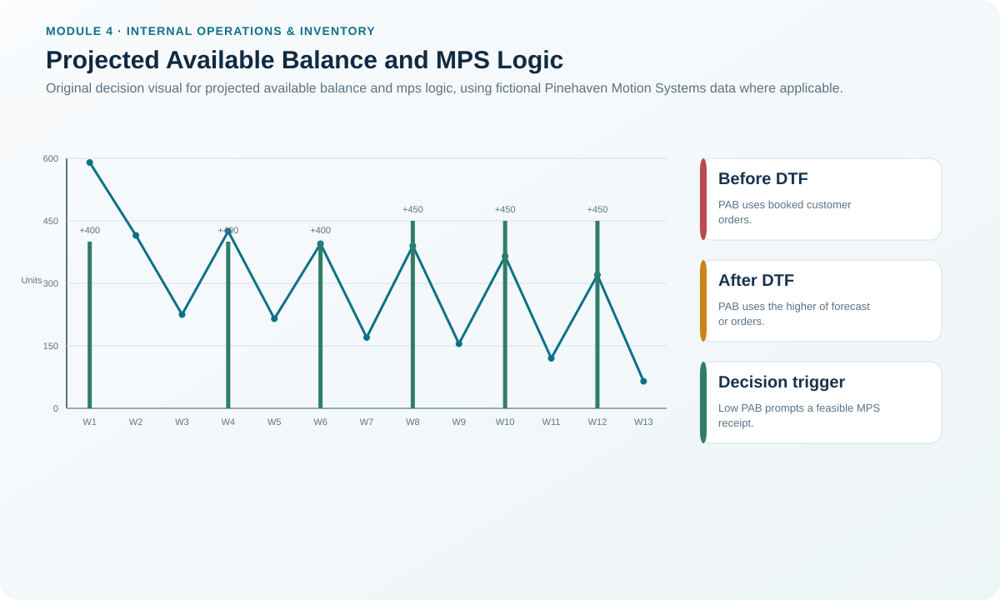
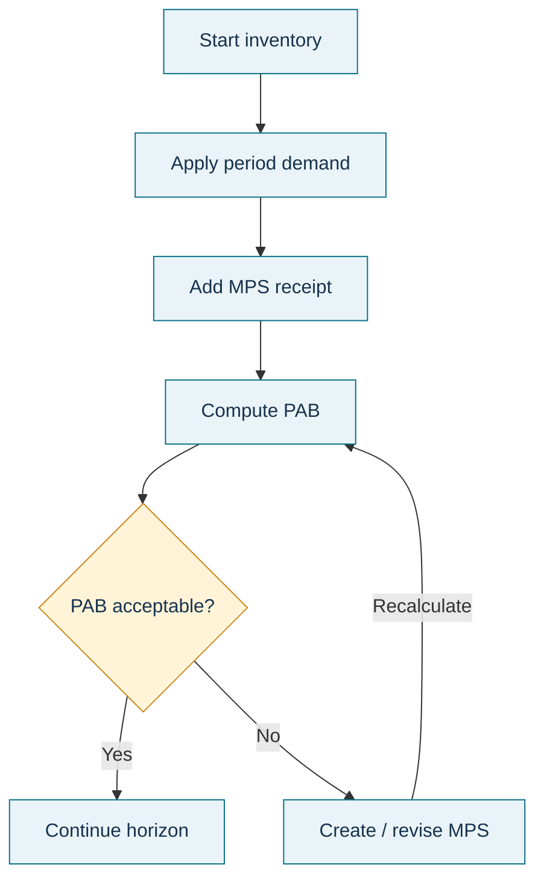

# 4. Projected Available Balance and MPS Logic

## Learning objectives

After this topic, you should be able to:

- calculate projected available balance before and after the demand time fence;
- explain why the demand basis changes after the DTF;
- use PAB to identify where the MPS needs review; and
- interpret PAB as projected inventory, not as available-to-promise.

## Concept in plain English

Projected available balance (PAB) is a running view of how much inventory is expected to remain after planned production and the demand used for that period are considered. It helps the master scheduler see where a build is needed to prevent an unacceptable projected balance.

The demand rule changes at the demand time fence. Inside the DTF, the schedule is close enough to execution that booked customer orders are the known demand signal used in the basic calculation. After the DTF, future booked orders may still be incomplete, so the calculation uses the greater of the forecast or customer orders.

For the convention used in this repository:

```text
Before / through DTF:
PAB(t) = PAB(t-1) + MPS(t) − Customer Orders(t)

After DTF:
PAB(t) = PAB(t-1) + MPS(t) − max(Forecast(t), Customer Orders(t))
```

## Why it matters

A schedule can look reasonable in total volume and still create a shortage in a specific period. PAB makes that timing problem visible. It also prevents a planner from looking only at current inventory and forgetting future demand consumption.

PAB is a planning control, not a customer promise. Some of the projected inventory can already be committed to orders. ATP is the separate measure used for uncommitted supply.

## Decision model and workflow



### Evidence retained through the workflow

Retain beginning inventory, forecast, customer orders, MPS quantities, DTF position, demand basis by period, calculated PAB, safety-stock policy if used, and the reason for any MPS adjustment.

## Practical process flow



## Original visualization

The visual shows the Pinehaven PH-SD500 PAB calculation using the same locked values as the dataset and highlights the change in demand logic after the DTF.

## Realistic example — Pinehaven Motion Systems

Pinehaven begins week 1 with 350 PH-SD500 units and has a 400-unit MPS receipt. Customer orders are 160 units. Because week 1 is inside the DTF:

```text
Week 1 PAB = 350 + 400 − 160 = 590 units
```

Week 2 has no MPS receipt and 175 booked units:

```text
Week 2 PAB = 590 + 0 − 175 = 415 units
```

Week 3 ends the frozen zone:

```text
Week 3 PAB = 415 + 0 − 190 = 225 units
```

Week 4 is beyond the DTF. Forecast is 200 units, customer orders are 180, and the MPS supplies 400. The higher demand signal is 200:

```text
Week 4 PAB = 225 + 400 − 200 = 425 units
```

The complete working data are in [`master-schedule.csv`](../../assets/data/module-4/master-schedule.csv), and the formulas are summarized in the [internal operations formula sheet](../../calculations/internal-operations/formula-sheet.md).

## Applied decision artifact — worked PAB grid

| Week | Demand rule | Demand used | MPS | Ending PAB |
|---:|---|---:|---:|---:|
| 1 | Customer orders | 160 | 400 | 590 |
| 2 | Customer orders | 175 | 0 | 415 |
| 3 | Customer orders | 190 | 0 | 225 |
| 4 | Greater of forecast/orders | 200 | 400 | 425 |
| 5 | Greater of forecast/orders | 210 | 0 | 215 |
| 6 | Greater of forecast/orders | 220 | 400 | 395 |

The artifact should include an exception threshold. If PAB becomes negative or violates the organization's required buffer policy, the planner reviews the MPS rather than merely noting the shortage.

## Decision logic

- Confirm the DTF before choosing the demand basis.
- Start from the prior period PAB, not from original beginning inventory every period.
- Add MPS receipts in the period they are expected to become available.
- After the DTF, use the greater of forecast or booked orders under this method.
- Treat an unacceptable PAB as a signal to review the schedule and then recheck capacity.

## Trade-offs

Adding MPS quantity earlier can protect future PAB but may raise inventory and use scarce capacity sooner. Deferring production reduces inventory exposure but leaves less recovery time if demand rises or supply is disrupted. PAB shows the quantity effect; it does not decide the trade-off by itself.

## Commonly confused with

**PAB** is projected inventory after planned supply and demand. **ATP** is the uncommitted part of inventory and planned production that can support new customer promises. A healthy PAB does not automatically mean the same quantity is available to promise.

## Common mistakes

- Using forecast inside the frozen side of the DTF when the method calls for booked orders.
- Using only booked orders after the DTF even when forecast is higher.
- Forgetting the MPS receipt in the relevant week.
- Treating a negative PAB as a purchasing-only problem without checking the parent schedule.

## Original knowledge check

**Question.** Pinehaven's prior PAB is 225 units. In week 4, beyond the DTF, forecast is 200, booked orders are 180, and MPS is 400. What PAB should the planner calculate?

A. 245 units

B. 405 units

C. 425 units

D. 445 units

<details>
<summary>Answer and rationale</summary>

### Correct answer

**C. 425 units**

### Why it is correct

Beyond the DTF, this method uses the greater of forecast or customer orders: 225 + 400 − 200 = 425 units.

### Why the other answers are wrong

- **A.** This subtracts an incorrect demand amount.

- **B.** This does not use the locked period inputs correctly.

- **D.** This effectively uses the lower booked-order quantity instead of the higher forecast.

</details>

## Practitioner perspective

When PAB repeatedly forces last-minute MPS additions, do not only adjust the grid. Investigate whether the demand plan, lot-size policy, capacity assumption, or time-fence discipline is creating the recurring pattern.

## Related concepts

- [Master Scheduling and the Master Scheduling Grid](./02-master-scheduling-and-the-master-scheduling-grid.md)
- [Allocation, Order Promising, and Available-to-Promise](./05-allocation-order-promising-and-available-to-promise.md)
- [Planning Horizons, Time Fences, and Change Authority](./03-planning-horizons-time-fences-and-change-authority.md)

---

[Previous: Planning Horizons, Time Fences, and Change Authority](./03-planning-horizons-time-fences-and-change-authority.md) · [Section overview](./README.md) · [Next: Allocation, Order Promising, and Available-to-Promise](./05-allocation-order-promising-and-available-to-promise.md)
