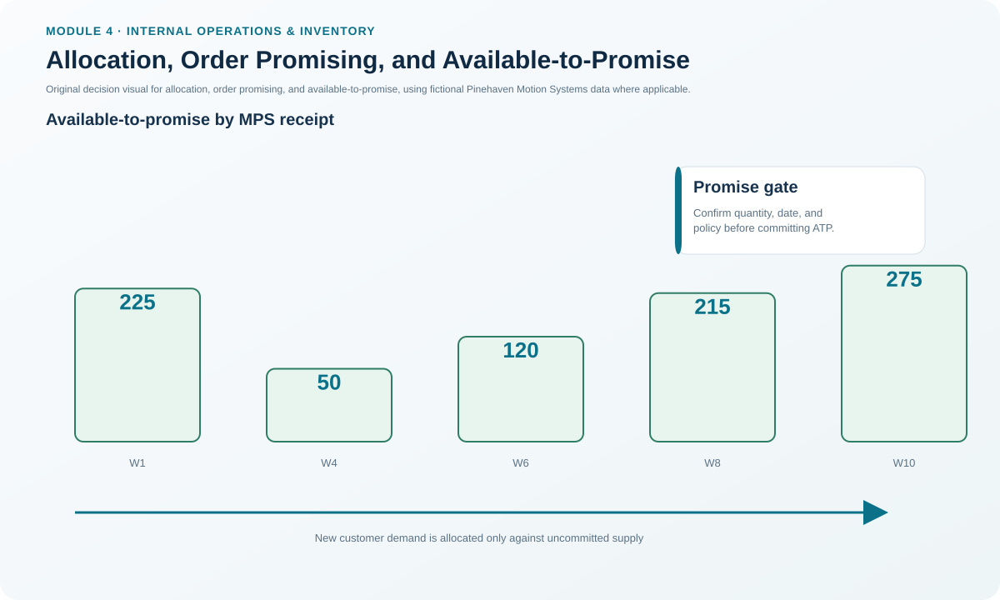
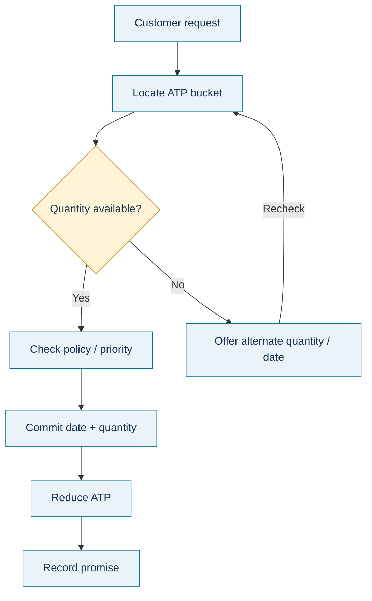

# 5. Allocation, Order Promising, and Available-to-Promise

## Learning objectives

After this topic, you should be able to:

- distinguish allocation, order promising, PAB, and available-to-promise;
- calculate discrete ATP for the first MPS bucket and later MPS buckets;
- use ATP to support a customer promise without double-counting committed supply; and
- recognize when a request needs an alternate date, quantity, or priority decision.

## Concept in plain English

Available-to-promise (ATP) answers a practical question: **How much uncommitted supply can we still promise to a new customer?** It is built from inventory and planned production in the master schedule, then reduced by customer orders already consuming that supply.

Allocation is related but broader. It can mean assigning a quantity to a specific order or deciding how scarce material should be distributed among competing needs. Order promising is the business act of committing a customer to a delivery date and quantity. ATP is evidence used to make that commitment.

This section uses a noncumulative, discrete ATP method. In the first period, beginning inventory is included. In later periods, ATP is calculated only in periods with an MPS receipt.

```text
First ATP bucket = Beginning inventory + MPS receipt − customer orders until the next MPS receipt
Later ATP bucket = MPS receipt − customer orders until the next MPS receipt
```

## Why it matters

A promise made without checking uncommitted supply can create an avoidable service failure. Conversely, refusing an order merely because current on-hand inventory is low can miss supply that is already planned and not committed.

ATP also creates discipline between sales and operations. It converts the production plan into a quantity that can support customer commitments while protecting supply already reserved for existing orders.

## Decision model and workflow



### Evidence retained through the workflow

Retain the requested item/quantity/date, ATP bucket used, existing committed orders included in the calculation, priority or allocation policy, alternative date/quantity offered if needed, and the final promise made to the customer.

## Practical process flow



## Original visualization

The ATP waterfall is built from Pinehaven's locked master-schedule dataset and deliberately separates the ATP calculation from the PAB line.

## Realistic example — Pinehaven Motion Systems

For PH-SD500, Pinehaven begins week 1 with 350 units and receives 400 units through the MPS. The next MPS receipt is in week 4. Customer orders for weeks 1–3 are 160, 175, and 190 units.

```text
Week 1 ATP = 350 + 400 − (160 + 175 + 190)
           = 225 units
```

Week 4 contains the next 400-unit MPS receipt. The next MPS receipt is in week 6, so week 4 ATP deducts customer orders in weeks 4 and 5:

```text
Week 4 ATP = 400 − (180 + 170)
           = 50 units
```

Week 6 ATP is:

```text
Week 6 ATP = 400 − (150 + 130) = 120 units
```

The values are in [`master-schedule.csv`](../../assets/data/module-4/master-schedule.csv).

## Applied decision artifact — ATP order-promise worksheet

For each promise request, record:

| Field | Example control |
|---|---|
| Requested date / quantity | Week 6 / 140 units |
| ATP in target bucket | 120 units |
| Existing allocation priority | Standard industrial customer |
| Feasible promise | 120 in week 6, remaining 20 later unless reallocated |
| Alternative evaluated | Next MPS bucket or approved reprioritization |
| Final commitment | Quantity/date entered into customer order |

A salesperson should not silently take 20 units from another customer's committed quantity to make the 140-unit promise fit.

## Decision logic

- Locate the correct ATP bucket for the requested delivery period.
- Confirm that prior promises are included and not double-counted.
- If ATP is sufficient, make the promise and reduce the remaining uncommitted amount.
- If ATP is insufficient, offer an alternate quantity/date or invoke the approved allocation-priority process.
- For make-to-order environments, also verify uncommitted material and capacity as required by the operating model.

## Trade-offs

Holding ATP back protects strategic customers or uncertainty but may reduce near-term sales. Promising aggressively improves immediate acceptance but increases service risk if the schedule changes. Allocation policy should therefore be explicit rather than improvised during a shortage.

## Commonly confused with

PAB can include inventory that is already committed. ATP is specifically concerned with the uncommitted amount available for additional promises. Allocation assigns scarce or reserved supply; ATP alone does not define which customer deserves priority.

## Common mistakes

- Treating every positive PAB unit as ATP.
- Subtracting forecast from ATP instead of the committed customer orders used by this method.
- Reusing an ATP quantity after it has already been promised.
- Making a promise outside normal ATP rules without recording the allocation exception.

## Original knowledge check

**Question.** Pinehaven has 120 units of ATP for the relevant bucket and receives a new request for 140 units. What is the best response?

A. Promise all 140 because PAB is positive

B. Promise 120 and evaluate an alternate date, quantity, or approved allocation for the remaining 20

C. Delete 20 units from another customer's order

D. Increase the forecast by 20 and treat that as available supply

<details>
<summary>Answer and rationale</summary>

### Correct answer

**B. Promise 120 and evaluate an alternate date, quantity, or approved allocation for the remaining 20**

### Why it is correct

ATP represents the uncommitted supply that can support a new promise. A request above ATP needs an explicit alternative or prioritization decision rather than an unsupported commitment.

### Why the other answers are wrong

- **A.** Positive PAB is not the same as uncommitted ATP.

- **C.** Reallocating committed supply requires an approved priority decision; it cannot be done silently.

- **D.** Changing a forecast does not create physical or planned supply.

</details>

## Practitioner perspective

The best ATP process leaves an audit trail from the sales promise back to the master schedule. If planners cannot explain how a promise consumed supply, customer service problems become arguments about ownership instead of solvable planning exceptions.

## Related concepts

- [Projected Available Balance and MPS Logic](./04-projected-available-balance-and-mps-logic.md)
- [Master Scheduling and the Master Scheduling Grid](./02-master-scheduling-and-the-master-scheduling-grid.md)
- [Disaggregation and Commitment Decision Points](./06-disaggregation-and-commitment-decision-points.md)

---

[Previous: Projected Available Balance and MPS Logic](./04-projected-available-balance-and-mps-logic.md) · [Section overview](./README.md) · [Next: Disaggregation and Commitment Decision Points](./06-disaggregation-and-commitment-decision-points.md)
