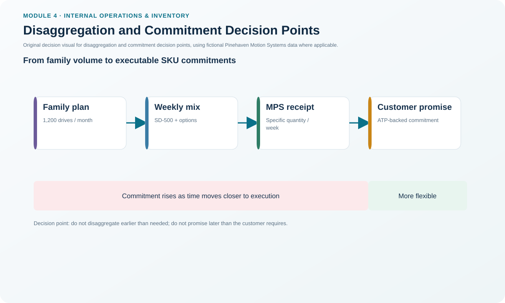
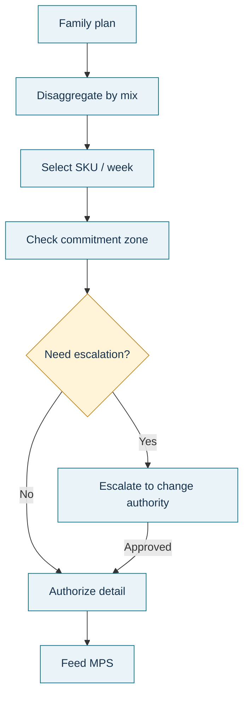

# 6. Disaggregation and Commitment Decision Points

## Learning objectives

After this topic, you should be able to:

- explain how a product-family plan becomes item-level weekly commitments;
- distinguish planning visibility from a contractual purchasing commitment;
- use decision points to create different commitment zones with a supplier; and
- align commitments with lead time, flexibility, and relationship governance.

## Concept in plain English

S&OP plans at an aggregate level because leadership needs to balance families, resources, and financial objectives. Execution needs much more detail. **Disaggregation** converts the family plan into specific item quantities and dates that can be master scheduled.

The same idea applies to information shared with suppliers. A long-range demand signal is useful for capacity preparation, but it does not always mean that the buyer has made a firm purchase commitment. Decision points clarify when information changes from visibility, to volume commitment, to firm dated orders.

Without that distinction, a supplier can invest in capacity or inventory believing that a forecast is a firm request, while the buyer believes it was merely planning information. The reverse can also happen: a buyer expects readiness even though the supplier never received a binding volume commitment.

## Why it matters

Disaggregation is where aggregate intent becomes operational responsibility. Poor disaggregation can create the right family total but the wrong item mix or timing. Poor commitment governance can damage supplier trust and encourage both parties to protect themselves with excess inventory or capacity.

A good design therefore answers two questions: **What detailed schedule does the operation need?** and **At what point does shared demand become a commitment that another party may reasonably act on?**

## Decision model and workflow

### Evidence retained through the workflow

Retain the aggregate family plan, mix assumptions, SKU-level disaggregation, item/week MPS, supplier visibility horizon, each commitment decision point, permitted changes inside each zone, and named approval authority.

## Practical process flow

## Original visualization

The timeline separates three concepts that are often mixed together: family-level planning, item-level scheduling, and external commitment strength.

## Realistic example — Pinehaven Motion Systems

Pinehaven expects continued demand for its servo-drive family, but a key power-module supplier needs earlier visibility than Pinehaven can provide through firm purchase orders alone. Pinehaven and the supplier create an illustrative three-zone agreement:

- **Weeks 1–2:** firm dated purchase commitments;
- **Weeks 3–8:** volume is committed, but weekly timing can be rearranged within agreed limits;
- **Beyond week 8:** forecast visibility is shared for capacity planning, with no purchase commitment.

These values are fictional; the appropriate decision points depend on actual supplier lead time, buyer flexibility, capacity economics, and industry practice.

For the finished PH-SD500, the separate master schedule in [`master-schedule.csv`](../../assets/data/module-4/master-schedule.csv) gives the item-level weekly build plan that later drives component requirements.

## Applied decision artifact — disaggregation and commitment table

| Planning layer | Quantity meaning | Timing detail | Commitment strength |
|---|---|---|---|
| S&OP family plan | Aggregate family volume | Monthly / aggregate | Internal plan boundary |
| MPS | Specific master-schedule item | Weekly or defined bucket | Production commitment subject to fence rules |
| Supplier volume zone | Agreed quantity band | Timing adjustable within rules | Volume commitment |
| Supplier firm zone | Specific order | Dated | Firm execution commitment |
| Visibility zone | Expected future need | Longer range | Planning signal, not purchase promise |

The artifact should also identify who absorbs cost when one party changes a commitment after the agreed decision point.

## Decision logic

- Reconcile detailed SKU quantities back to the aggregate production-plan boundary.
- Make mix assumptions explicit rather than hiding them inside a system split.
- Set commitment points using real cumulative lead time and capacity consequences.
- State what can change in each zone: quantity, mix, date, or nothing without escalation.
- Review commitment accuracy so that chronic overstatement or understatement becomes visible.

## Trade-offs

Earlier firm commitments give suppliers stability and can protect capacity, but they reduce buyer flexibility and can create excess inventory if demand changes. Later commitments preserve flexibility but may require more supplier buffer, premium capacity, or longer customer lead times.

## Commonly confused with

A **forecast** can provide visibility without creating a purchase obligation. An **MPS** is an internal production commitment. A **purchase order** or other defined firm decision point creates a stronger external commitment according to the business agreement.

## Common mistakes

- Assuming the supplier interprets every shared forecast exactly as the buyer does.
- Disaggregating family volume without checking whether the resulting item mix is feasible.
- Setting commitment zones only from commercial preference and ignoring cumulative lead time.
- Allowing frequent changes inside the firm zone without measuring the resulting cost and trust impact.

## Original knowledge check

**Question.** Pinehaven shares a 20-week demand outlook with a supplier, but the agreement says only the first two weeks are firm. What should the supplier assume about week 15?

A. It is a firm purchase order

B. It is planning visibility unless another commitment rule covers that week

C. It must be produced immediately

D. It can be ignored because long-range information has no value

Answer and rationale

### Correct answer

**B. It is planning visibility unless another commitment rule covers that week**

### Why it is correct

Decision points define when shared demand becomes a binding quantity or dated commitment. Long-range information can be useful without being a firm order.

### Why the other answers are wrong

- **A.** The stated agreement does not make week 15 firm.

- **C.** Production should follow the agreed commitment rules and economics, not every forecast signal.

- **D.** Long-range visibility can support capacity and supplier planning even when it is nonbinding.

## Practitioner perspective

Supplier collaboration improves when both organizations can point to the same calendar and say what each number means. Ambiguous commitment semantics are a hidden source of inventory, expedites, and commercial disputes.

## Related concepts

- [Planning Horizons, Time Fences, and Change Authority](./03-planning-horizons-time-fences-and-change-authority.md)
- [Master Scheduling and the Master Scheduling Grid](./02-master-scheduling-and-the-master-scheduling-grid.md)
- [MRP Logic, Inputs, and Demand Types](./07-mrp-logic-inputs-and-demand-types.md)

---

[Previous: Allocation, Order Promising, and Available-to-Promise](./05-allocation-order-promising-and-available-to-promise.md) · [Section overview](./README.md) · [Next: MRP Logic, Inputs, and Demand Types](./07-mrp-logic-inputs-and-demand-types.md)
