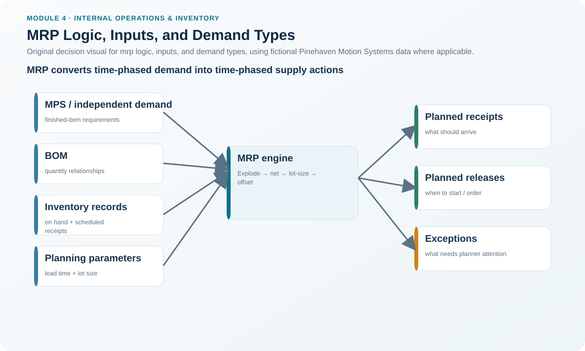
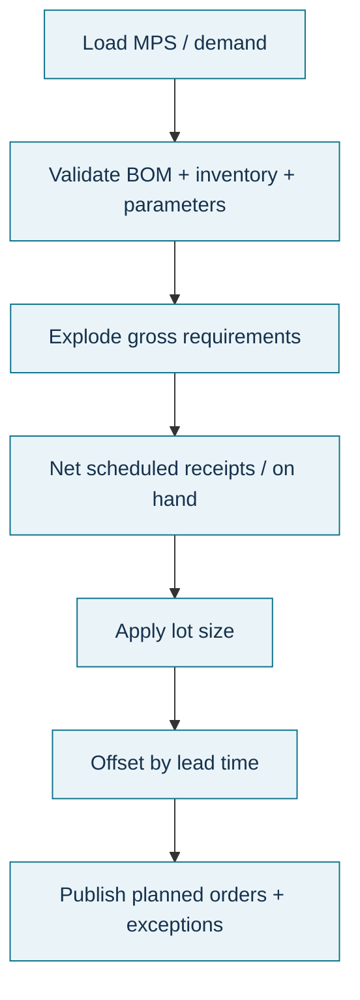

# 7. MRP Logic, Inputs, and Demand Types

## Learning objectives

After this topic, you should be able to:

- distinguish independent demand from dependent demand;
- identify the principal MRP inputs and outputs;
- calculate a simple net requirement; and
- explain the status difference among planned orders, firm planned orders, open orders, and scheduled receipts.

## Concept in plain English

Material requirements planning (MRP) answers a different question from forecasting: **Given what we plan to make, what components and materials are required, in what quantities, and when?**

Finished-product or service demand may need to be forecast. Component demand derived from a parent plan can be calculated from the BOM. That is dependent demand. The same part can have both types of demand—for example, a power module used inside a servo drive may also be sold independently as a spare.

MRP uses four broad input groups: the master production schedule, inventory status, planning factors such as lead time and lot size, and bills of material. It explodes parent requirements, nets available supply, applies lot-sizing rules, offsets by lead time, and produces planned-order recommendations and exceptions.

## Why it matters

Forecasting every component independently would ignore the mathematical relationship between the end-item plan and its components. MRP prevents that by translating a controlled parent plan through product structure and inventory data.

The quality of the result depends on the inputs. A correct algorithm using the wrong BOM quantity, wrong on-hand balance, or wrong lead time still produces a wrong plan—often with impressive precision.

## Decision model and workflow



### Evidence retained through the workflow

Retain the MPS version, BOM revision, inventory snapshot, scheduled receipts, lead times, lot-size parameters, gross requirements, projected on-hand, net requirements, planned receipts/releases, firming actions, and exception messages.

## Practical process flow



## Original visualization

The visual separates the inputs that determine requirement quantity from the controls that determine timing and order status.

## Realistic example — Pinehaven Motion Systems

PH-PWR220 is a purchased power module used in the PH-SD500. In week 5, the gross requirement is 400 units. The prior projected on-hand quantity entering the week is 150 units and there is no scheduled receipt.

```text
Net requirement = Gross requirement − projected on hand − scheduled receipts
                = 400 − 150 − 0
                = 250 units
```

Because PH-PWR220 uses lot-for-lot planning, the planned order receipt is 250 units. Its lead time is two weeks, so the corresponding planned release is in week 3. Those values are contained in [`mrp-planning.csv`](../../assets/data/module-4/mrp-planning.csv).

The same record also illustrates order status. A **planned order** is still a recommendation that can be changed. If a planner freezes its quantity/time, it becomes a **firm planned order**. Once the order is actually released, it becomes an open manufacturing or purchase order; an open order with a due date is a scheduled receipt.

## Applied decision artifact — MRP input-integrity checklist

Before trusting a shortage or expedite message, confirm:

| MRP input | Integrity question |
|---|---|
| MPS | Is the parent schedule current and feasible? |
| BOM | Is the correct revision/effectivity active? |
| Inventory | Is on-hand accurate and truly available? |
| Scheduled receipts | Are open orders current, dated, and realistic? |
| Lead time | Does the parameter reflect the planning assumption? |
| Lot size | Is L4L/FOQ or another rule deliberately assigned? |
| Exception | Can the affected parent requirement be identified? |

## Decision logic

- Forecast independent demand where necessary; calculate dependent demand from the parent relationship.
- Net existing usable inventory and valid scheduled receipts before creating new requirements.
- Floor a negative net requirement at zero; excess availability does not create a negative order.
- Apply lot-size rules only after the net need is known.
- Offset the planned receipt to determine the release timing.
- Review exceptions and firming decisions rather than accepting every proposed reschedule automatically.

## Trade-offs

MRP provides time-phased coordination and rapid replanning, but its output can become unstable when inputs change frequently. Tight parameter governance improves stability but may reduce responsiveness if the business fails to update genuinely changed lead times or product structures.

## Commonly confused with

**Independent demand** is not necessarily “external” and dependent demand is not necessarily “internal.” The distinction is whether the requirement is mathematically derived from another item's plan. A spare part can have independent demand even though the same part also has dependent demand inside production.

## Common mistakes

- Feeding component forecasts directly into MRP when the requirement should be derived from the MPS/BOM.
- Subtracting future planned receipts that are not valid or feasible.
- Treating a planned order as if a supplier has already accepted a purchase order.
- Ignoring an inventory-record error because “MRP will correct it next run.”

## Original knowledge check

**Question.** PH-PWR220 has a gross requirement of 400 units, 150 projected on hand, and no scheduled receipt. What is the net requirement before lot sizing?

A. 150 units

B. 250 units

C. 400 units

D. 550 units

<details>
<summary>Answer and rationale</summary>

### Correct answer

**B. 250 units**

### Why it is correct

The gross requirement is reduced by usable projected on-hand supply: 400 − 150 = 250 units.

### Why the other answers are wrong

- **A.** This is the available inventory, not the shortage.

- **C.** This ignores the 150 units already available.

- **D.** This adds inventory instead of netting it against demand.

</details>

## Practitioner perspective

When an MRP exception looks surprising, trace the logic backward in this order: parent requirement, BOM quantity, inventory/scheduled receipt, lot-size rule, and lead time. That sequence usually finds the true data or planning cause faster than changing the recommendation manually.

## Related concepts

- [Bills of Material and Explosion](./08-bills-of-material-and-explosion.md)
- [Routing and Lot-Sizing for Dependent Demand](./09-routing-and-lot-sizing-for-dependent-demand.md)
- [Lead Time, Offsetting, Planned Receipts, and Releases](./10-lead-time-offsetting-planned-receipts-and-releases.md)

---

[Previous: Disaggregation and Commitment Decision Points](./06-disaggregation-and-commitment-decision-points.md) · [Section overview](./README.md) · [Next: Bills of Material and Explosion](./08-bills-of-material-and-explosion.md)
