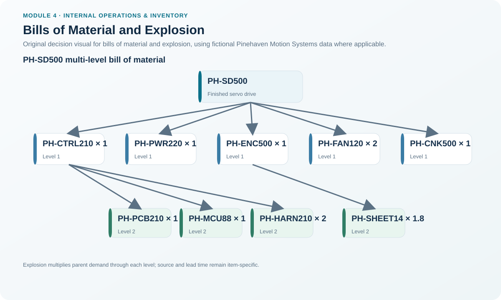
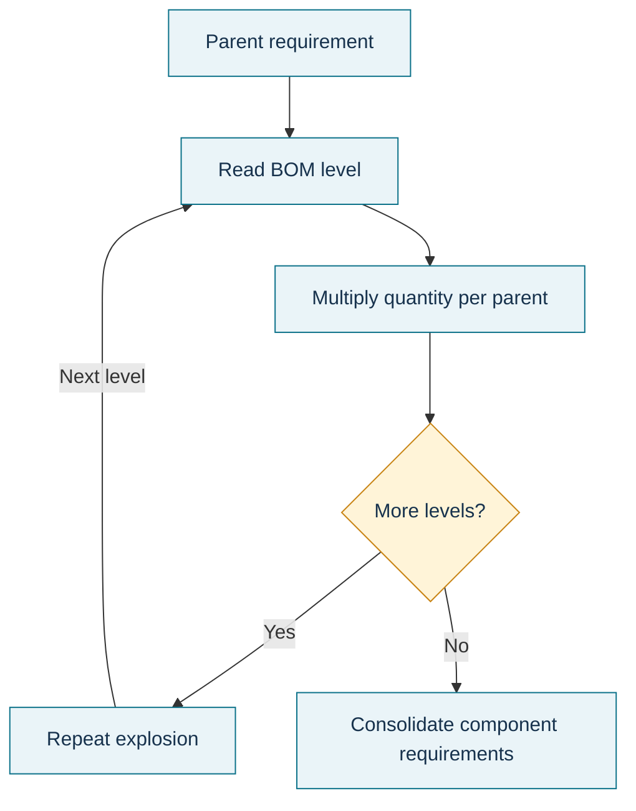

# 8. Bills of Material and Explosion

## Learning objectives

After this topic, you should be able to:

- explain the parent-component structure of a bill of material;
- distinguish a multilevel BOM from a routing;
- explode a parent quantity into lower-level component requirements; and
- explain why BOM accuracy and effectivity are critical to MRP.

## Concept in plain English

A bill of material (BOM) describes **what goes into the product and how much is required**. At the top is a parent item. Below it are components; some components can themselves be parents to lower-level parts or materials. A **multilevel bill of material (BOM)** exposes those relationships down to purchased parts or raw materials.

**Explosion** means starting with a parent requirement and multiplying through each BOM level to calculate the gross component quantities. This is the core relationship that allows MRP to derive dependent demand instead of forecasting every component.

A modular or planning BOM can represent a module used across possible end configurations. That is useful when final product variety is postponed but common modules can be planned earlier.

## Why it matters

A one-unit error in a BOM may seem small until it is multiplied across hundreds or thousands of parent units. An incorrect effectivity date can also cause the planning system to buy the old component after engineering intended a change.

BOM governance therefore links engineering, planning, purchasing, inventory, and quality. MRP cannot distinguish a bad master-data relationship from a real requirement.

## Decision model and workflow



### Evidence retained through the workflow

Retain parent item, BOM revision/effectivity, component item, quantity per parent, level, make/buy indicator, source/work center, scrap/yield assumptions when applicable, and the MPS or planned-order quantity that triggered the explosion.

## Practical process flow



## Original visualization

The visual is based on Pinehaven's fictional PH-SD500 product structure. It shows purchased and made items without reproducing any proprietary product tree.

## Realistic example — Pinehaven Motion Systems

The locked BOM in [`bom-structure.csv`](../../assets/data/module-4/bom-structure.csv) states that one PH-SD500 requires:

- 1 PH-CTRL210 controller assembly;
- 1 PH-PWR220 power module;
- 1 PH-ENC500 enclosure;
- 2 PH-FAN120 cooling fans; and
- 1 PH-CNK500 connector kit.

PH-CTRL210 contains one PCB, one microcontroller, and two PH-HARN210 harnesses. PH-ENC500 uses 1.8 units of sheet material.

If Pinehaven needs 200 PH-SD500 units and there is no offsetting inventory for this simple gross-requirement illustration:

```text
Cooling fans = 200 × 2 = 400 units
Harnesses = 200 × 1 controller × 2 harnesses = 400 units
Sheet material = 200 × 1 enclosure × 1.8 = 360 units
```

Those are gross component relationships. MRP still needs inventory and scheduled receipts before it determines net requirements.

## Applied decision artifact — BOM explosion worksheet

| Parent / path | Qty per parent | Parent requirement | Gross component requirement |
|---|---:|---:|---:|
| PH-SD500 → PH-FAN120 | 2 | 200 | 400 |
| PH-SD500 → PH-CTRL210 → PH-HARN210 | 1 × 2 | 200 | 400 |
| PH-SD500 → PH-ENC500 → PH-SHEET14 | 1 × 1.8 | 200 | 360 |

Add BOM revision and effectivity to every worksheet. A mathematically correct explosion against the wrong revision is still wrong.

## Decision logic

- Start with the controlled parent requirement.
- Read the active BOM revision for the required date.
- Multiply quantity-per-parent at each level.
- Continue until the required lower levels are reached.
- Consolidate the same component if it appears in multiple parent paths.
- Pass gross requirements to MRP for netting and timing.

## Trade-offs

Deep, highly detailed BOMs improve planning traceability but increase master-data maintenance. Modular planning can simplify variety and support postponement, but only if module demand and configuration relationships are governed correctly.

## Commonly confused with

A **BOM tells what and how many**. A **routing tells where, in what sequence, and with what operation time** the item is processed. Both are essential, but they answer different questions.

## Common mistakes

- Treating the BOM as a drawing or document list rather than a quantitative planning structure.
- Ignoring effectivity when an engineering change occurs.
- Exploding net requirements at one level without understanding whether the planning logic uses gross parent requirements and then nets each item separately.
- Forgetting that one component can appear in multiple paths and needs consolidated demand.

## Original knowledge check

**Question.** Pinehaven plans 150 SD-500 units. Each SD-500 needs two cooling fans. Before inventory netting, how many PH-FAN120 units are grossly required?

A. 75

B. 150

C. 300

D. 450

<details>
<summary>Answer and rationale</summary>

### Correct answer

**C. 300**

### Why it is correct

BOM explosion multiplies the parent requirement by quantity per parent: 150 × 2 = 300 fans.

### Why the other answers are wrong

- **A.** This divides instead of multiplying the component usage.

- **B.** This would be correct only if one fan were required per drive.

- **D.** This assumes three fans per parent, which is not the controlled BOM relationship.

</details>

## Practitioner perspective

When planners find unexplained excess or shortages after an engineering change, inspect BOM effectivity before tuning lot sizes or safety stock. Product-structure errors often masquerade as planning-policy problems.

## Related concepts

- [MRP Logic, Inputs, and Demand Types](./07-mrp-logic-inputs-and-demand-types.md)
- [Routing and Lot-Sizing for Dependent Demand](./09-routing-and-lot-sizing-for-dependent-demand.md)
- [Lead Time, Offsetting, Planned Receipts, and Releases](./10-lead-time-offsetting-planned-receipts-and-releases.md)

---

[Previous: MRP Logic, Inputs, and Demand Types](./07-mrp-logic-inputs-and-demand-types.md) · [Section overview](./README.md) · [Next: Routing and Lot-Sizing for Dependent Demand](./09-routing-and-lot-sizing-for-dependent-demand.md)
