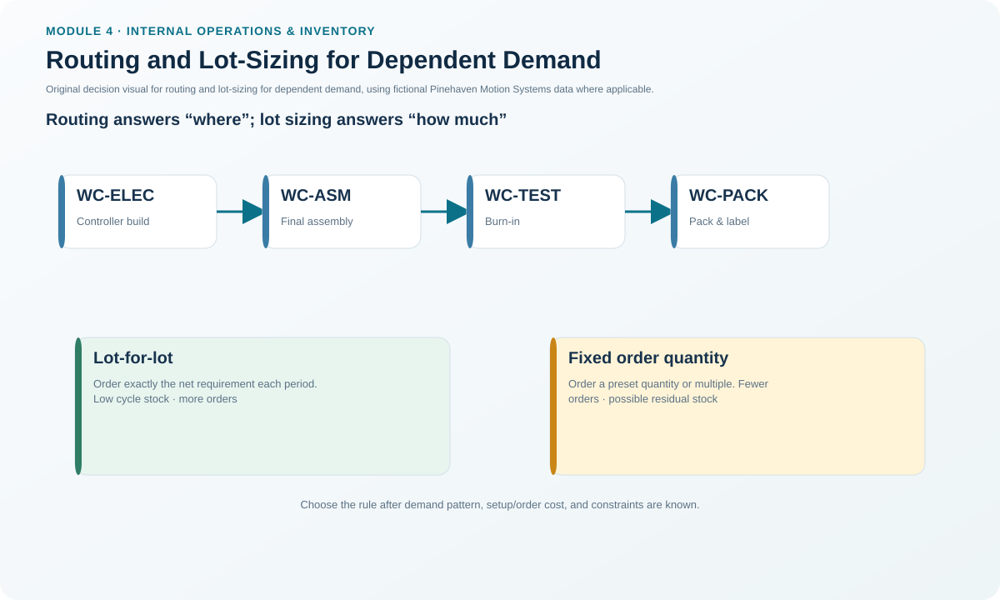
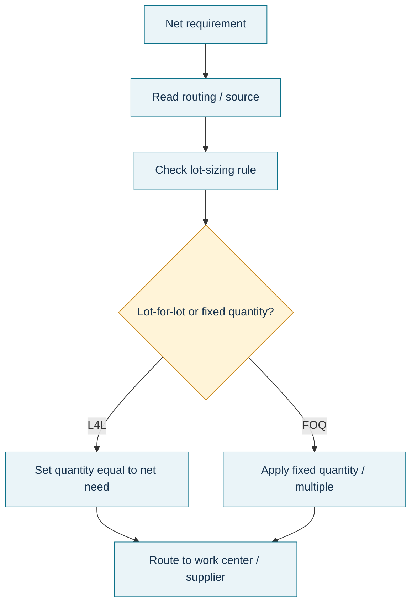

# 9. Routing and Lot-Sizing for Dependent Demand

## Learning objectives

After this topic, you should be able to:

- explain what a routing contributes to production planning;
- distinguish lot-for-lot from fixed order quantity planning;
- select a lot-sizing rule based on the real operating constraint; and
- describe why inappropriate fixed lots can create avoidable dependent-demand inventory.

## Concept in plain English

A routing describes the path and operations an item follows through production. It identifies the work centers or sources involved, the sequence of operations, and the time associated with those operations. Where the BOM answers “what materials?”, the routing answers “what processing path?”

After MRP determines a net material requirement, the planning system also needs a lot-sizing rule. **Lot-for-lot (L4L)** creates a planned quantity equal to the net requirement for that period. **Fixed order quantity (FOQ)** creates a predetermined quantity or multiple when a shortage triggers an order.

L4L often fits dependent demand because the requirement is already derived from a known parent plan and excess components may have no immediate use. FOQ is appropriate when a real batch, package, equipment, or supplier constraint requires a fixed amount. A separate coordination concept is **joint replenishment**, in which related items are deliberately grouped for lot-sizing or release decisions to capture setup, ordering, shipping, or quantity economies; grouping should be intentional rather than an accidental consequence of a fixed lot.

## Why it matters

Lot-size settings quietly shape inventory, capacity, and supplier behavior. A fixed lot copied from historical practice can create excess inventory every time MRP detects a small shortage. An L4L rule used where a furnace, vat, reel, pallet, or supplier minimum requires a fixed batch can create plans that cannot be executed.

Routing accuracy also matters because work-center and lead-time planning depend on the real operation sequence.

## Decision model and workflow

### Evidence retained through the workflow

Retain the active routing/source, operation sequence, net requirement, assigned lot-sizing rule, fixed quantity or multiple if used, physical/commercial constraint supporting the rule, planned quantity, and resulting projected inventory.

## Practical process flow

## Original visualization

The visual contrasts Pinehaven's L4L power-module plan with the fixed-quantity connector-kit plan, linking lot size to its inventory consequence.

## Realistic example — Pinehaven Motion Systems

In [`mrp-planning.csv`](../../assets/data/module-4/mrp-planning.csv), PH-PWR220 uses L4L. In week 5, its net requirement is 250 units, so the planned receipt is exactly 250.

PH-CNK500 uses an FOQ of 500 units. In week 3, the connector kit has a 50-unit net requirement. The fixed-quantity rule creates a 500-unit planned receipt, leaving 450 units projected on hand after the week's 200-unit gross requirement is satisfied.

The excess is not automatically an error. It is the consequence of the selected lot-sizing policy. The planner's job is to confirm that the fixed lot still reflects a real constraint or economic choice rather than an obsolete parameter.

## Applied decision artifact — routing and lot-size selection table

| Question | L4L signal | FOQ signal |
|---|---|---|
| Can batch size vary? | Yes | No / constrained |
| Is demand directly derived and time-phased? | Strong fit | Possible, but excess risk |
| Fixed process or package size? | Weak fit | Strong fit |
| Supplier minimum or transport multiple? | May require override | Stronger fit |
| Excess component exposure | Lower | Potentially higher |

For routing, separately record the work-center sequence and standard timing. Lot sizing decides quantity; routing decides the processing path.

## Decision logic

- Calculate net requirement before applying the lot-size rule.
- Prefer L4L when dependent demand can be supplied in flexible quantities and excess has little value.
- Use FOQ when a documented physical or commercial constraint requires it.
- Quantify the projected excess created by a fixed lot.
- Review routing and lot-size master data after process or supplier changes.

## Trade-offs

L4L reduces planned excess but can increase ordering or setup frequency. FOQ can reduce setup or purchasing frequency and align to fixed batch economics, but it can increase inventory and hide obsolescence risk. The right rule is therefore an operating-policy choice, not a universal formula.

## Commonly confused with

**Routing** is the sequence of work. **Lot sizing** is the quantity rule. **Lead-time offsetting** determines when the resulting planned quantity must be released. These three controls interact but should not be treated as one parameter.

## Common mistakes

- Using FOQ simply because “we have always ordered 500.”
- Applying L4L where the process physically cannot run the proposed small batch.
- Assuming a routing contains component quantities; those belong to the BOM.
- Evaluating lot size only on purchase price and ignoring inventory created by the rule.

## Original knowledge check

**Question.** A connector kit has a 50-unit net requirement, but Pinehaven's controlled fixed order quantity is 500. What planned receipt does the FOQ rule create?

A. 50 units

B. 450 units

C. 500 units

D. 550 units

Answer and rationale

### Correct answer

**C. 500 units**

### Why it is correct

FOQ generates the predetermined order quantity when a net requirement triggers replenishment. The remaining quantity becomes projected inventory after demand is satisfied.

### Why the other answers are wrong

- **A.** That is the L4L quantity, not the fixed-order quantity.

- **B.** 450 is the resulting excess in the Pinehaven example, not the receipt quantity.

- **D.** The fixed quantity is not added to the shortage; it is the planned order amount.

## Practitioner perspective

Lot-size cleanup is often a high-value master-data exercise. A few obsolete fixed quantities can produce recurring excess and misleading MRP messages across many periods.

## Related concepts

- [Bills of Material and Explosion](./08-bills-of-material-and-explosion.md)
- [MRP Logic, Inputs, and Demand Types](./07-mrp-logic-inputs-and-demand-types.md)
- [Lead Time, Offsetting, Planned Receipts, and Releases](./10-lead-time-offsetting-planned-receipts-and-releases.md)

---

[Previous: Bills of Material and Explosion](./08-bills-of-material-and-explosion.md) · [Section overview](./README.md) · [Next: Lead Time, Offsetting, Planned Receipts, and Releases](./10-lead-time-offsetting-planned-receipts-and-releases.md)
