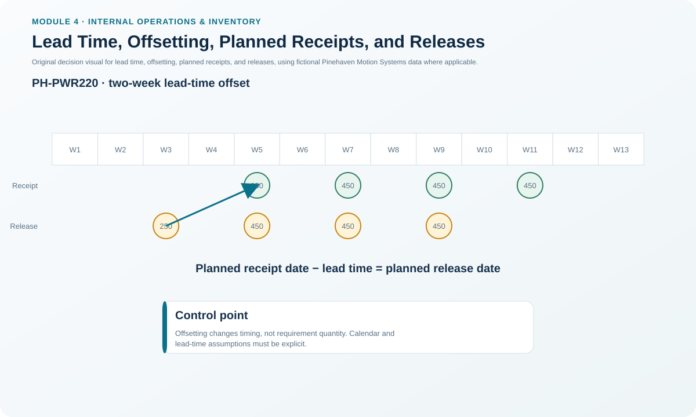
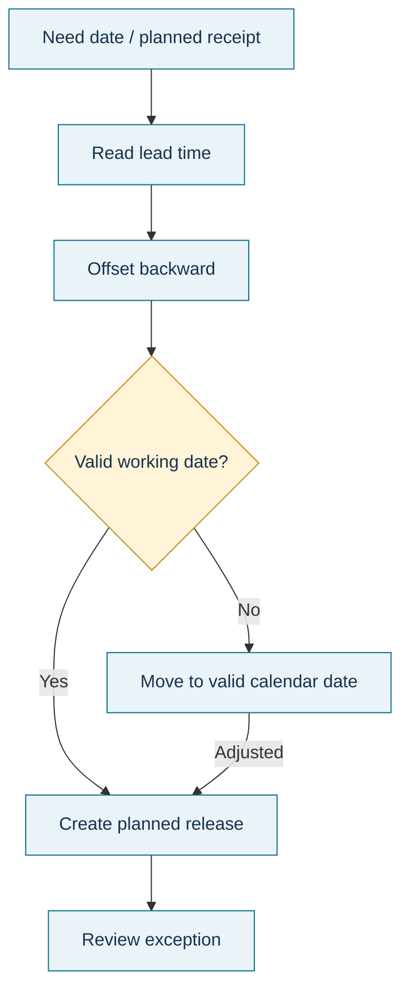

# 10. Lead Time, Offsetting, Planned Receipts, and Releases

## Learning objectives

After this topic, you should be able to:

- distinguish a planned order receipt from a planned order release;
- apply lead-time offsetting to move a requirement backward in time;
- explain why components with different lead times require different release dates; and
- recognize when an offset date requires calendar or feasibility review.

## Concept in plain English

MRP does not only calculate **how much** is needed. It must also calculate **when action must start**. A planned order receipt is the quantity expected to become available in the future. A planned order release is the instruction to start or place that order early enough to meet the receipt date.

**Offsetting** counts backward from the need or receipt date by the item's planning lead time. If a purchased item needs two weeks and is required in week 5, the planned release belongs in week 3. Components used in the same parent can therefore have different release dates even when they all need to arrive for the same assembly date.

## Why it matters

A quantity can be perfectly correct and still arrive too late. Lead-time offsetting turns material quantity into an executable timing decision.

It also exposes cumulative lead-time risk. A late lower-level release can move the critical path for the parent item, particularly when multiple BOM levels each contain their own purchasing or manufacturing lead time.

## Decision model and workflow



### Evidence retained through the workflow

Retain need date, planned receipt date, lead-time parameter, working calendar used, calculated release date, source/work center, quantity, and any exception caused by a release falling before the planning horizon or into a protected time zone.

## Practical process flow



## Original visualization

The timeline uses Pinehaven's locked component parameters to show two different lead-time offsets against future requirements.

## Realistic example — Pinehaven Motion Systems

PH-PWR220 has a two-week planning lead time. Its week-5 net requirement is 250 units, and L4L creates a 250-unit planned receipt in week 5.

```text
Planned receipt: week 5
Lead time: 2 weeks
Planned release: week 3
```

PH-CNK500 has a one-week lead time. Its 500-unit planned receipt in week 3 is offset to a release in week 2.

The timing is visible in [`mrp-planning.csv`](../../assets/data/module-4/mrp-planning.csv). The formula sheet records the rule as a time shift rather than pretending that lead-time offsetting is an arithmetic quantity formula.

## Applied decision artifact — lead-time offset schedule

| Item | Receipt week | Lead time | Calculated release week | Control question |
|---|---:|---:|---:|---|
| PH-PWR220 | 5 | 2 weeks | 3 | Does release enter a protected/firming zone? |
| PH-CNK500 | 3 | 1 week | 2 | Is supplier calendar/working date valid? |

For a real calendar, the system may need to move an offset date to a valid working day. The planner should know whether the parameter represents calendar days, workdays, queue-inclusive manufacturing lead time, or another defined convention.

## Decision logic

- Determine the period in which the item must be available.
- Use the controlled lead-time parameter for that item/source.
- Offset backward by the lead time to determine release timing.
- Validate the date against working calendars and the planning horizon.
- Review any release that falls inside a protected fence or before the current date.
- If the lead time is chronically wrong, correct the parameter rather than repeatedly expediting around it.

## Trade-offs

Long planning lead times create earlier releases and more commitment, which can protect service but reduce flexibility and increase inventory exposure. Aggressively short lead-time parameters create later releases and may reduce planned inventory, but only if the supplier or operation can actually perform to that assumption.

## Commonly confused with

A **planned receipt** is the future availability event. A **planned release** is the earlier start/order event. A **scheduled receipt** is different again: it is an already released/open order with a due date.

## Common mistakes

- Releasing in the need week instead of offsetting backward.
- Changing the release date without understanding whether the receipt date must also move.
- Using an aspirational lead time that the supplier or work center has not demonstrated.
- Ignoring lower-level lead times when evaluating the parent item's cumulative lead time.

## Original knowledge check

**Question.** A component is required as a planned receipt in week 9 and has a three-week planning lead time. Ignoring calendar exceptions, when should its planned release occur?

A. Week 6

B. Week 9

C. Week 12

D. Whenever the parent finishes

<details>
<summary>Answer and rationale</summary>

### Correct answer

**A. Week 6**

### Why it is correct

Offsetting moves the planned release earlier than the receipt by the item's lead time: 9 − 3 = week 6.

### Why the other answers are wrong

- **B.** This would start the order when it is already due.

- **C.** This moves the order in the wrong direction.

- **D.** The release must be time-phased from the component need, not left undefined.

</details>

## Practitioner perspective

When planners regularly use manual “expedite days,” compare those overrides with the master lead-time settings. Persistent manual timing is evidence that the planning parameter or process performance deserves review.

## Related concepts

- [Routing and Lot-Sizing for Dependent Demand](./09-routing-and-lot-sizing-for-dependent-demand.md)
- [Planning Horizons, Time Fences, and Change Authority](./03-planning-horizons-time-fences-and-change-authority.md)
- [Managing MRP: Nervousness, Pegging, Firming, and Exceptions](./11-managing-mrp-nervousness-pegging-firming-and-exceptions.md)

---

[Previous: Routing and Lot-Sizing for Dependent Demand](./09-routing-and-lot-sizing-for-dependent-demand.md) · [Section overview](./README.md) · [Next: Managing MRP: Nervousness, Pegging, Firming, and Exceptions](./11-managing-mrp-nervousness-pegging-firming-and-exceptions.md)
