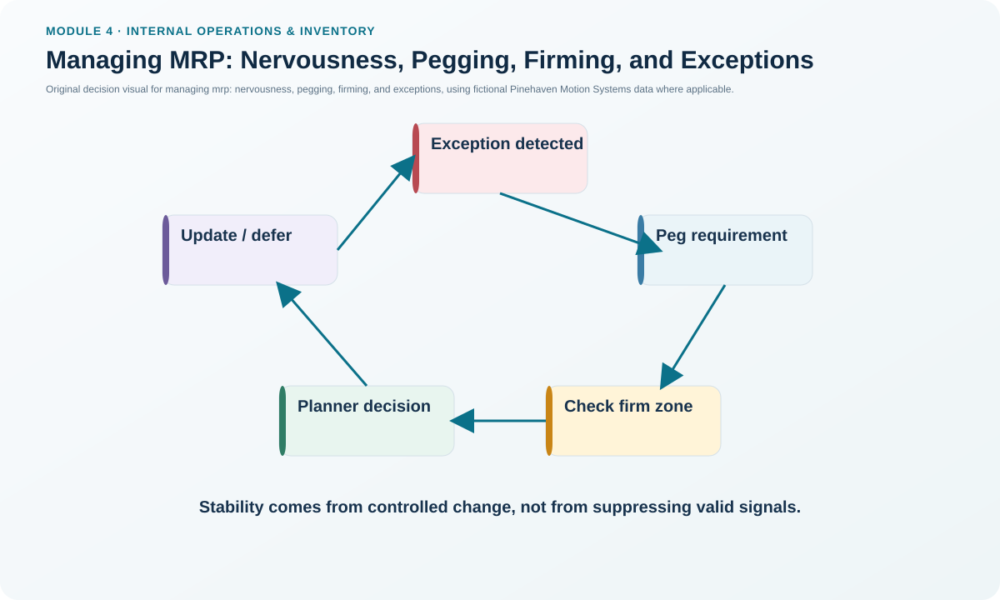
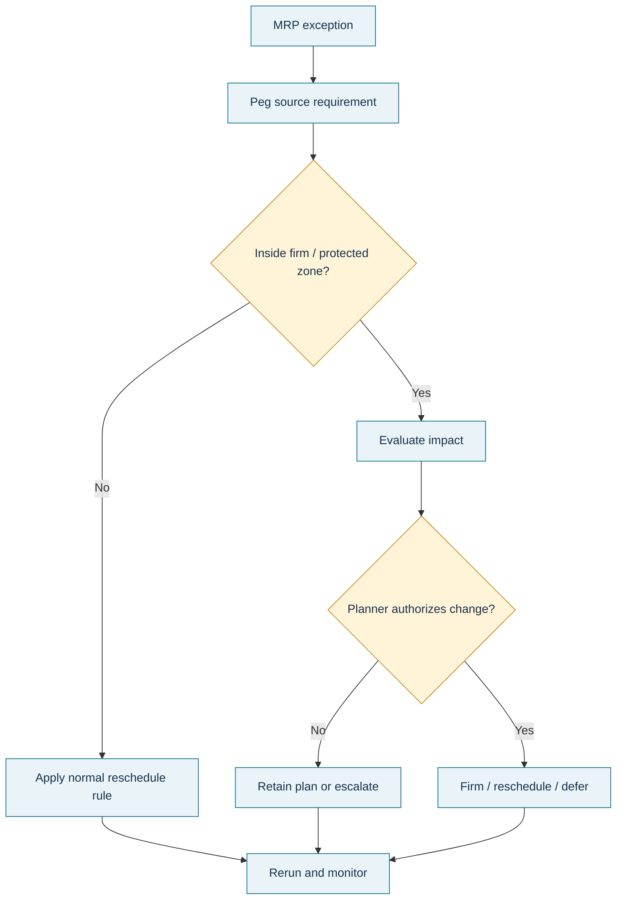

# 11. Managing MRP: Nervousness, Pegging, Firming, and Exceptions

## Learning objectives

After this topic, you should be able to:

- explain system nervousness and why excessive replanning can be costly;
- distinguish net-change replanning from broad regeneration conceptually;
- use pegging, firm planned orders, time fences, and exception reports as planning controls; and
- treat repeated nervousness as a possible symptom of a deeper operating problem.

## Concept in plain English

MRP is powerful because it can recalculate the material consequence of changes. That same strength can become a weakness when every small change causes widespread rescheduling. **System nervousness** is the operational instability created by frequent changes to planned orders, purchase dates, and component priorities.

Several controls help manage it. **Net-change** logic focuses recalculation on affected parts instead of rebuilding everything unnecessarily. **Time fences** protect near-term commitments. A **firm planned order** can freeze a selected planned order's quantity and timing until a planner deliberately changes it. **Pegging** traces a component requirement back to the parent demand that created it. **Exception reports** focus attention on deviations that require action rather than every unchanged record.

These controls are not meant to hide real problems. Nervousness can signal unstable priorities, inaccurate master data, quality losses, supplier failures, or excessive shop-floor reprioritization.

## Why it matters

Frequent schedule changes consume planner, buyer, supplier, and production attention. They can create expedites, setup changes, duplicate messages, excess inventory, and reduced trust in the planning system. Once users stop believing the plan, they often create spreadsheets and unofficial buffers, making the problem worse.

Stable planning therefore requires both **protection mechanisms** and **root-cause discipline**.

## Decision model and workflow

### Evidence retained through the workflow

Retain exception type, item, planned order, pegged parent requirement, time-fence/firming status, old and proposed dates/quantities, planner decision, approval if required, root-cause category, and whether the exception recurs.

## Practical process flow

## Original visualization

The control-loop visual distinguishes a useful exception signal from uncontrolled schedule churn and shows the roles of pegging and firming in the decision.

## Realistic example — Pinehaven Motion Systems

Pinehaven's [`mrp-planning.csv`](../../assets/data/module-4/mrp-planning.csv) flags a 250-unit PH-PWR220 release in week 3 because it supports a week-5 requirement and enters a firming review. The planner should not simply move the release because a new message appears.

First, pegging should identify the parent requirement. Then the planner should check whether the affected order is inside a protected zone, whether the parent demand actually changed, and what consequence a date shift would create. If the exception is real, the planner can firm, reschedule, defer, or escalate according to policy.

MRP can also coexist with lean/JIT execution. Smaller planning buckets or bucketless timing can reduce coarse timing effects, while balanced-flow environments can use MRP for planning and pull signals for local execution. Completion can update inventory through mechanisms such as backflushing where the operating design supports it.

## Applied decision artifact — MRP exception and pegging register

| Field | Example |
|---|---|
| Item | PH-PWR220 |
| Exception | Proposed release / reschedule review |
| Pegged parent | PH-SD500 requirement |
| Protected zone? | Yes / review required |
| Operational impact | Supplier release timing and parent schedule |
| Planner action | Firm, accept, reject, defer, or escalate |
| Root-cause code | Demand, lead time, inventory, quality, supplier, master data |

Trend the root-cause code monthly. A high count of manual changes is an operational KPI, not just planner workload.

## Decision logic

- Start from the exception, then peg back to the parent requirement.
- Check time fences and firming status before rescheduling.
- Separate a changed business requirement from a changed system suggestion.
- Prefer targeted replanning when only a subset of the plan changed.
- Investigate repeated nervousness for root causes rather than suppressing all messages.
- Keep the official plan credible enough that functions do not create shadow schedules.

## Trade-offs

Firming and time fences create stability but can preserve a bad plan if planners refuse legitimate change. Highly responsive replanning improves adaptability but can overwhelm suppliers and execution. The control system must protect commitments while still allowing evidence-based exceptions.

## Commonly confused with

**Pegging** explains where a requirement came from. It does not itself approve a reschedule. **Firming** protects an order from automatic change. It does not mean the order can never be changed by an authorized planner.

## Common mistakes

- Accepting every reschedule message automatically.
- Firming too many orders so the system cannot respond to valid changes.
- Treating an exception report as a list of mandatory actions instead of items requiring judgment.
- Ignoring recurring nervousness because each individual change appears small.

## Original knowledge check

**Question.** A lower-level component suddenly shows a reschedule message. What should the planner do first to understand the business consequence?

A. Delete the planned order

B. Use pegging to identify the parent requirement and then review the protected-zone impact

C. Increase every component safety stock

D. Regenerate the entire plan without reviewing the cause

Answer and rationale

### Correct answer

**B. Use pegging to identify the parent requirement and then review the protected-zone impact**

### Why it is correct

Pegging connects the component requirement to the demand that created it. That context is needed before the planner decides whether a reschedule is valid and authorized.

### Why the other answers are wrong

- **A.** Deleting the order without understanding the parent may create a shortage.

- **C.** Safety stock does not diagnose the requirement change and may add inventory.

- **D.** Full regeneration can create more change without first establishing whether the underlying requirement is valid.

## Practitioner perspective

The planning team should be able to answer, “What percentage of our MRP changes are caused by demand, master data, supplier performance, inventory accuracy, and internal execution?” If that breakdown is unknown, nervousness is being managed transaction by transaction instead of as a process problem.

## Related concepts

- [Planning Horizons, Time Fences, and Change Authority](./03-planning-horizons-time-fences-and-change-authority.md)
- [Lead Time, Offsetting, Planned Receipts, and Releases](./10-lead-time-offsetting-planned-receipts-and-releases.md)
- [MRP Evolution: Closed-Loop MRP, MRP II, ERP, and DDMRP Context](./12-mrp-evolution-closed-loop-mrp-mrp-ii-erp-and-ddmrp-context.md)

---

[Previous: Lead Time, Offsetting, Planned Receipts, and Releases](./10-lead-time-offsetting-planned-receipts-and-releases.md) · [Section overview](./README.md) · [Next: MRP Evolution: Closed-Loop MRP, MRP II, ERP, and DDMRP Context](./12-mrp-evolution-closed-loop-mrp-mrp-ii-erp-and-ddmrp-context.md)
