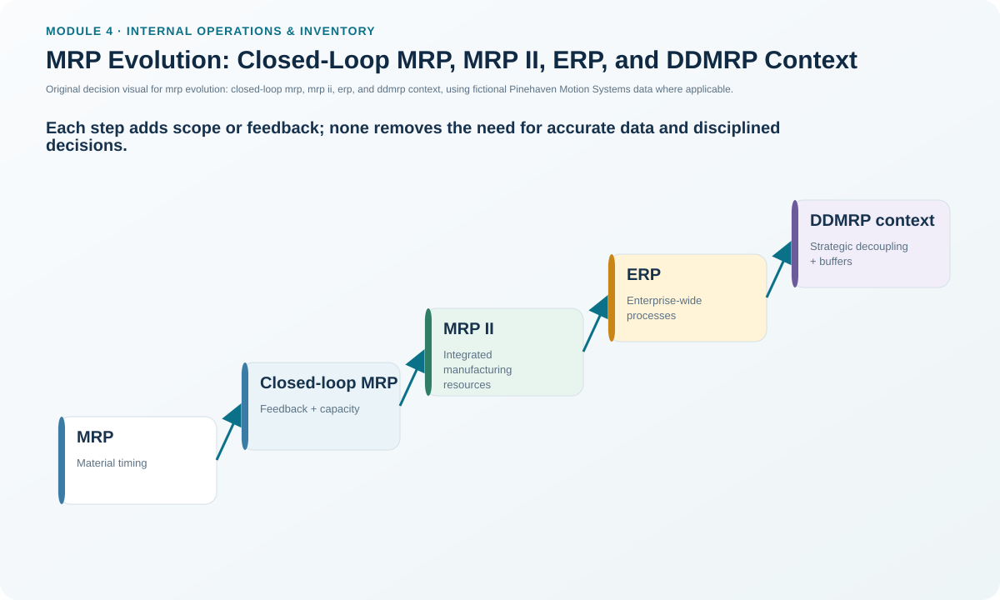

# 12. MRP Evolution: Closed-Loop MRP, MRP II, ERP, and DDMRP Context

## Learning objectives

After this topic, you should be able to:

- describe the planning gap addressed by closed-loop MRP;
- explain how MRP II broadened material planning into manufacturing-resource and financial planning;
- place ERP as a broader enterprise integration layer; and
- recognize the high-level demand-driven planning context introduced for DDMRP without treating it as a substitute for the detailed MRP logic learned earlier.

## Concept in plain English

Planning systems evolved because basic material calculations did not solve every operating problem.

**Basic MRP** automates time-phased material requirements using the MPS, BOM, inventory, lead times, and related planning parameters. A classic weakness of early implementations is that material logic can create a plan that assumes capacity will somehow be available.

**Closed-loop MRP** adds feedback from capacity and execution. If the plan cannot be supported, the planning process receives that information and replans rather than treating the material result as automatically feasible.

**Manufacturing resource planning (MRP II)** expands the scope from materials into the effective planning of manufacturing resources and connects operational plans with financial planning and what-if analysis. **ERP** extends integration more broadly across enterprise functions and, in modern operating models, often supports information exchange across external partners as well.

The module presentation also introduces **DDMRP** at a high level as a later demand-driven context emphasizing what can and will be sold, cumulative lead-time reduction, and strategically positioned/monitored buffers. This lesson keeps that treatment intentionally high level; the detailed mechanics are not established by the Section A source material used here.

## Why it matters

The labels matter less than the capability progression. A company can own an ERP system and still operate with basic-MRP behavior if capacity feedback, financial integration, master data, and exception governance are weak. Conversely, sophisticated software cannot rescue an infeasible or unstable business process by itself.

Understanding the evolution helps a practitioner diagnose which planning capability is missing rather than assuming the answer is always “buy a newer system.”

## Decision model and workflow

### Evidence retained through the workflow

For a planning-capability assessment, retain which inputs/outputs are integrated, how capacity feedback occurs, whether financial consequences are visible, what execution status returns to planning, where cross-functional data are synchronized, and which exceptions still require manual shadow processes.

## Practical process flow

This topic is a **capability comparison**, not an operating transaction. A separate process flow is intentionally not imposed because doing so would suggest a false sequence. Use the original comparison visual and the decision artifact below.

## Original visualization

The evolution ladder shows each capability as adding feedback or scope rather than simply replacing every earlier planning principle.

## Realistic example — Pinehaven Motion Systems

Suppose Pinehaven's material plan says all PH-SD500 components can be available for a large build, but the electrical test cell cannot process the resulting volume. A basic material-only plan may still look complete. A closed-loop design sends the capacity problem back into planning so the schedule can be changed, capacity can be adjusted, or another feasible response can be selected.

If management also needs to understand overtime cost, working-capital impact, and financial consequences of the alternative, the broader MRP II concept becomes relevant. ERP can provide the integrated data environment in which sales orders, materials, production, procurement, finance, and other functions share consistent transactions and master data.

## Applied decision artifact — planning-capability comparison matrix

| Capability | Main planning extension | Key question |
|---|---|---|
| MRP | Time-phased material requirements | What material is needed and when? |
| Closed-loop MRP | Capacity/execution feedback | Is the material plan operationally feasible, and what changed? |
| MRP II | All manufacturing resources + financial integration | What operational and financial plan is feasible? |
| ERP | Broader enterprise integration | Can functions execute against shared transactions and master data? |
| DDMRP context | Demand-driven positioning/buffer emphasis | Where should decoupling/buffers and demand signals shape replenishment? |

Do not use the matrix as a maturity score by itself. The organization must demonstrate the capability in its operating process.

## Decision logic

- Identify the missing business capability before selecting a system label.
- If capacity feedback is missing, fix the planning loop rather than merely increasing material visibility.
- If operations and finance disagree, examine resource/financial integration and common data definitions.
- Treat ERP as an integration platform, not proof that planning governance is mature.
- Keep DDMRP discussion within the supported high-level context unless a separate authoritative source is deliberately added later.

## Trade-offs

Broader integration improves visibility and consistency but increases implementation, governance, data, and training demands. More feedback improves feasibility but can also increase replanning volume if exceptions are not governed. Demand-driven buffers can improve responsiveness in suitable settings but create additional policy and monitoring decisions.

## Commonly confused with

**MRP II** is not “version 2 of the same material calculation.” It broadens the scope to manufacturing resources and financial planning. **ERP** is broader still as an enterprise integration architecture; it does not make every detailed planning decision automatically correct.

## Common mistakes

- Assuming software scope equals process maturity.
- Treating capacity feedback as optional because material availability is green.
- Using financial integration only for after-the-fact reporting instead of planning consequences.
- Presenting a high-level DDMRP mention as if this section had established its full algorithm.

## Original knowledge check

**Question.** What planning weakness does closed-loop MRP most directly address compared with a material-only MRP calculation?

A. It removes the need for a BOM

B. It adds feedback about capacity and execution so infeasible plans can be replanned

C. It eliminates all forecasts

D. It replaces the master schedule with financial statements

Answer and rationale

### Correct answer

**B. It adds feedback about capacity and execution so infeasible plans can be replanned**

### Why it is correct

Closed-loop MRP connects material planning with capacity and execution feedback, helping keep plans valid when operating conditions show that the original plan is not feasible.

### Why the other answers are wrong

- **A.** MRP still depends on product-structure information.

- **C.** Independent-demand planning still exists; forecasts are not eliminated by closed-loop feedback.

- **D.** Financial integration expands later in MRP II; it does not replace the master schedule.

## Practitioner perspective

When evaluating a planning transformation, ask users to show the feedback loop with a real exception. If no one can demonstrate how a capacity miss, late order, or inventory discrepancy changes the official plan, the organization may have integrated software without an integrated planning process.

## Related concepts

- [MRP Logic, Inputs, and Demand Types](./07-mrp-logic-inputs-and-demand-types.md)
- [Managing MRP: Nervousness, Pegging, Firming, and Exceptions](./11-managing-mrp-nervousness-pegging-firming-and-exceptions.md)
- [Push, Pull, and Distribution Requirements Planning](./13-push-pull-and-distribution-requirements-planning.md)

---

[Previous: Managing MRP: Nervousness, Pegging, Firming, and Exceptions](./11-managing-mrp-nervousness-pegging-firming-and-exceptions.md) · [Section overview](./README.md) · [Next: Push, Pull, and Distribution Requirements Planning](./13-push-pull-and-distribution-requirements-planning.md)
