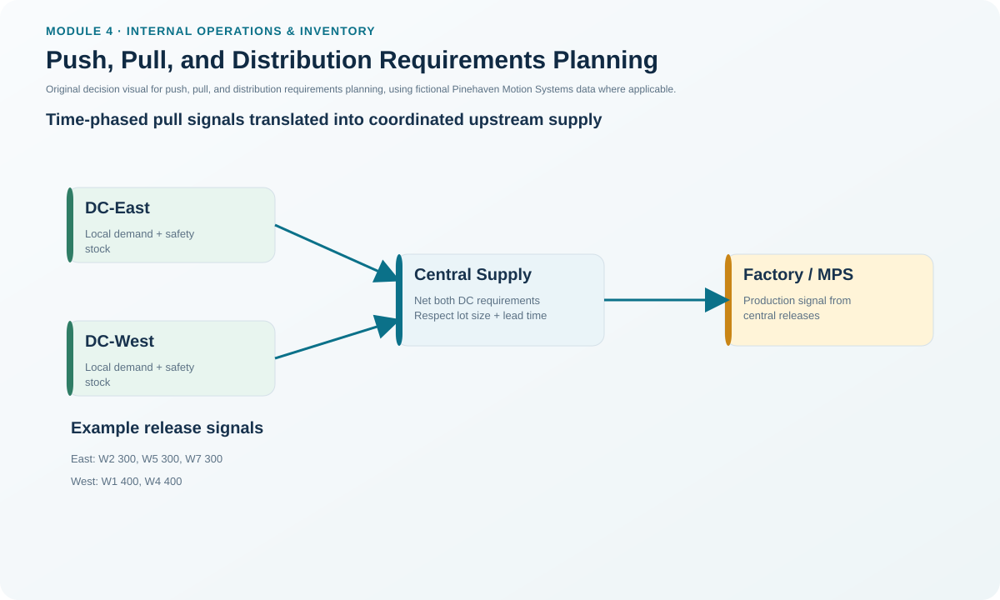
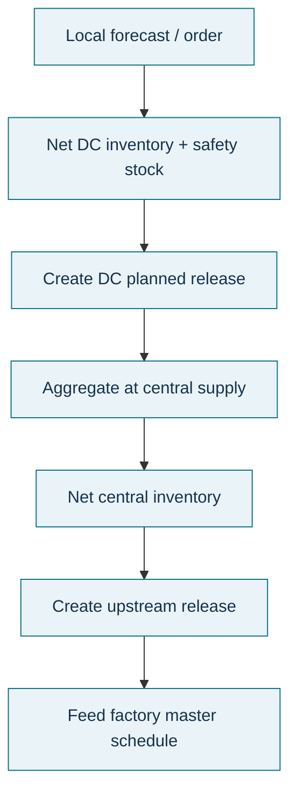

# 13. Push, Pull, and Distribution Requirements Planning

## Learning objectives

After this topic, you should be able to:

- distinguish centralized push distribution from decentralized pull replenishment;
- explain why DRP can combine push coordination with local demand responsiveness;
- identify the major DRP inputs; and
- trace planned distribution releases upstream into central supply and the factory master schedule.

## Concept in plain English

Distribution requirements planning (DRP) time-phases replenishment needs across a distribution network. Its logic is similar to MRP in an important way: a downstream location's planned release becomes an upstream requirement.

A **push system** centralizes distribution-replenishment decisions, often at the plant or central supply location. A **pull system** lets field locations decide when to replenish based on their own needs. Pure pull can respond well to local conditions but may amplify orders, overlook other locations' needs, or ignore the supplier's position. Pure push coordinates the network but can be less sensitive to local market conditions.

DRP is useful as a hybrid because it can collect local demand information, time-phase needs centrally, and coordinate inventory through selected echelons while still allowing local pull behavior where appropriate.

## Why it matters

A distribution network can have enough inventory in total and still fail customers because stock is in the wrong place or replenishment signals arrive too late. DRP connects local requirements, lead times, safety stock, lot sizes, and network structure so that replenishment decisions are synchronized upstream.

The same logic connects distribution with manufacturing: planned releases from central supply can become gross requirements for the factory master schedule.

## Decision model and workflow

### Evidence retained through the workflow

Retain node forecasts/orders, beginning and projected inventory, safety stock, scheduled receipts, lead times, lot sizes, planned receipts/releases, source node, network map, and the requirement passed to the supplying location or plant.

## Practical process flow

## Original visualization

The network visual uses Pinehaven's fictional East and West distribution centers, central supply, and plant to show how time-phased releases move upstream.

## Realistic example — Pinehaven Motion Systems

In [`drp-network.csv`](../../assets/data/module-4/drp-network.csv), DC-East has a one-week lead time and a 300-unit lot size. Its plan creates a 300-unit planned release in week 2 to support the week-3 replenishment need.

DC-West has a two-week lead time and a 400-unit lot size. It releases 400 units in week 1 to support a week-3 planned receipt.

Those downstream releases become demand at Central Supply. Central Supply then nets its own inventory, safety stock, scheduled receipts, lot size, and two-week lead time before creating upstream releases to the Pinehaven plant. The point is not to copy a DC's order directly into plant production; every supplying echelon first evaluates its own net requirement.

## Applied decision artifact — DRP replenishment worksheet

| Node | Key inputs | Planning output | Upstream consequence |
|---|---|---|---|
| DC-East | Local demand, 1-week lead, safety stock, 300 lot | Planned receipts/releases | Release becomes Central Supply demand |
| DC-West | Local demand, 2-week lead, safety stock, 400 lot | Planned receipts/releases | Release becomes Central Supply demand |
| Central Supply | Aggregated downstream releases + own inventory | Central planned release | Becomes plant/master-schedule requirement |

Use a common calendar and item identity across nodes. Otherwise a mathematically sound DRP calculation can still create mismatched timing.

## Decision logic

- Capture local demand and service-stock requirements at each distribution node.
- Net local inventory and scheduled receipts before creating replenishment.
- Apply the node's lead time and lot-size policy.
- Pass the planned release upstream as a requirement to the supplying node.
- Repeat the time-phased logic through the network until the factory master schedule receives the appropriate requirement.
- Decide intentionally where centralized push planning should stop and local pull should begin.

## Trade-offs

Centralized push coordination can protect network priorities and supplier feasibility but may miss local information. Decentralized pull improves local responsiveness but can create bullwhip behavior and competition among nodes. Hybrid DRP seeks the coordination benefits of push while retaining demand visibility from downstream locations.

## Commonly confused with

**MRP** explodes product-structure requirements. **DRP** time-phases replenishment across locations. Both can use netting and offsetting logic, but one follows the BOM structure while the other follows the distribution-network structure.

## Common mistakes

- Treating a DC's desired order as automatically feasible at central supply.
- Ignoring safety stock or lead-time differences by location.
- Using only centralized forecasts without local demand evidence.
- Allowing each location to order independently without understanding the upstream bullwhip and allocation consequences.

## Original knowledge check

**Question.** What is the strongest reason to use DRP as a hybrid rather than relying only on decentralized pull orders?

A. It removes the need for lead times

B. It coordinates replenishment across the network while still using downstream demand information

C. It guarantees zero inventory

D. It makes every warehouse use the same lot size

Answer and rationale

### Correct answer

**B. It coordinates replenishment across the network while still using downstream demand information**

### Why it is correct

DRP combines time-phased network coordination with demand information from downstream locations, allowing supplying nodes to evaluate needs before releasing replenishment upstream.

### Why the other answers are wrong

- **A.** Lead time remains a core DRP input.

- **C.** DRP manages inventory requirements; it does not guarantee zero inventory.

- **D.** Lot-size and safety-stock policies can differ by location.

## Practitioner perspective

When a network says it is “pull,” inspect whether every site is optimizing only its own position. Local autonomy without shared upstream visibility is not the same thing as coordinated demand pull.

## Related concepts

- [Manufacturing Planning and Control Architecture](./01-manufacturing-planning-and-control-architecture.md)
- [MRP Logic, Inputs, and Demand Types](./07-mrp-logic-inputs-and-demand-types.md)
- [Section A Review](./14-section-a-review.md)

---

[Previous: MRP Evolution: Closed-Loop MRP, MRP II, ERP, and DDMRP Context](./12-mrp-evolution-closed-loop-mrp-mrp-ii-erp-and-ddmrp-context.md) · [Section overview](./README.md) · [Next: Section A Review](./14-section-a-review.md)
