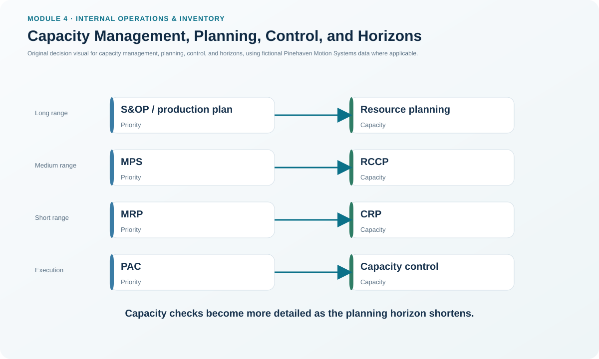
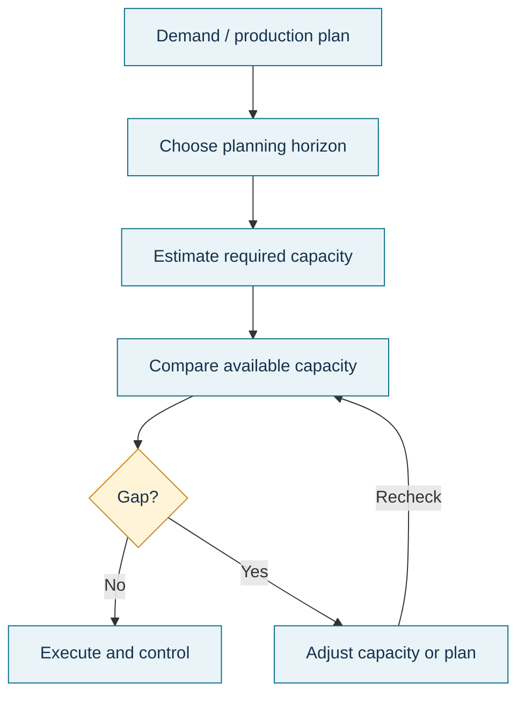

# 1. Capacity Management, Planning, Control, and Horizons

## Learning objectives

After this topic, you should be able to:

- separate capacity planning, capacity management, and capacity control;
- match each capacity check to the planning horizon it supports;
- explain why capacity must be compared with load at several levels; and
- identify when a capacity gap should change the plan rather than be accepted as an execution problem.

## Concept in plain English

Capacity is the amount of useful work a resource system can support over a stated period. The resource can be a plant, line, machine group, workforce, supplier, test cell, warehouse space, or another limiting capability. Capacity only becomes meaningful when it is stated with a unit and horizon, such as standard hours per quarter or machine-hours per week.

Three related activities are easy to mix up:

- **Capacity planning** asks what capability will be required in the future and what resources should be available to meet it.
- **Capacity management** is the broader discipline of setting, measuring, monitoring, and adjusting capacity so planned work can be executed at acceptable service and cost.

**Resource management** coordinates the wider organizational resources needed to make those capacity decisions executable.
- **Capacity control** works closest to execution. It compares actual output and input with the operating plan and triggers corrective action when the deviation is too large.

Capacity is checked repeatedly because the decision becomes more detailed as execution approaches. Long-range resource planning tests the production plan. Medium-range rough-cut capacity planning (RCCP) tests the master production schedule. Short-range capacity requirements planning (CRP) tests detailed MRP-generated work. At execution, production activity control (PAC) uses capacity control to keep daily work aligned with the plan.

## Why it matters

A plan that ignores capacity is only a wish. Too little capacity can produce queues, late orders, backlogs, overtime, and missed customer commitments. Too much capacity can leave expensive people, equipment, buildings, and inventory underused. The goal is not maximum utilization everywhere; it is enough capable capacity, in the right place and time, to support the operating plan economically.

A second reason for multiple horizons is reaction time. A daily supervisor can add a short overtime window, but cannot instantly build a new test laboratory. Strategic capacity decisions must be made early enough for hiring, training, equipment, qualification, and capital projects to finish before the demand arrives.

## Decision model and workflow

### Evidence retained through the workflow

Retain the demand or production plan, capacity unit, time horizon, required load, available or demonstrated capacity, gap, decision owner, approved response, implementation lead time, and next review trigger. A capacity number without its unit and horizon is not decision-ready evidence.

## Practical process flow

## Original visualization

The hierarchy visual places the four capacity checks beside the planning objects they validate. The key teaching point is that the same question—*can the supply system support the planned work?*—is answered with progressively greater detail as the horizon shortens.

## Realistic example — Pinehaven Motion Systems

Pinehaven's current quarterly Final Assembly capacity is **3,600 standard hours**. The locked capacity plan shows requirements rising from **3,200 hours in Q1** to **3,700 in Q3**, **4,000 in Q4**, and **4,550 in Q6**. Q1 therefore has 400 hours of headroom, while Q3 already shows a 100-hour gap and Q6 a 950-hour gap if nothing changes.

The Burn-in Test area follows a similar pattern: current capacity is 2,100 standard hours per quarter, but required load reaches 2,200 in Q3 and 3,000 in Q6. These are not Week-27 dispatching problems yet. They are advance warnings that the long- and medium-range capacity plans must create an approved path before the demand reaches execution.

The complete fictional data are in [`capacity-plan.csv`](../../assets/data/module-4/capacity-plan.csv).

All company names and values in this example are independently created for learning purposes.

## Applied decision artifact — capacity-horizon responsibility matrix

| Planning object | Capacity check | Typical decision question | Primary owner / forum | Evidence produced |
|---|---|---|---|---|
| Production plan / S&OP | Resource planning | Will major resources support the family-level plan? | Cross-functional / executive planning | Long-range gap and resource action |
| Master production schedule | RCCP | Are critical resources sufficient for the item-level MPS? | Master scheduler / operations | Feasible MPS or required revision |
| Material requirements plan | CRP | Can work centers execute the detailed released and planned load? | Planner / manufacturing | Work-center load and leveling action |
| Daily execution | Capacity control within PAC | Is actual input/output staying within operating limits? | Supervisor / production control | Exception, recovery action, updated priority |

The artifact should always show the handoff: if the gap cannot be solved at the current horizon without unreasonable cost or risk, it escalates to a level where either capacity or the production commitment can legitimately change.

## Decision logic

- Define the capacity unit and period before comparing anything.
- Match the capacity check to the planning level; do not use daily control to hide a structural long-range shortage.
- Compare required load with realistic available or demonstrated capability.
- If the gap is temporary, evaluate reversible responses first; if structural, evaluate resource investment or plan changes.
- Recheck the affected demand or production commitment after the capacity decision.

## Trade-offs

| Choice tension | Decision implication |
|---|---|
| Extra capacity improves responsiveness | It also carries fixed cost and may remain idle if demand does not materialize. |
| Tight capacity improves asset use | It leaves less room for variability, maintenance, learning, and disruption recovery. |
| Local optimization can raise utilization | It can increase WIP if the local resource is not the system constraint. |

## Commonly confused with

**Capacity planning** is not the same as **production scheduling**. Planning determines whether adequate capability can exist over the relevant horizon. Scheduling assigns specific work to specific periods or resources within that capability. Likewise, **capacity control** is not a synonym for all capacity management; it is the near-term feedback-and-correction part of the discipline.

## Common mistakes

- Comparing a quarterly requirement with a weekly capacity number.
- Treating every overloaded resource as a strategic bottleneck without checking the relevant planning horizon.
- Assuming high utilization is automatically good even when queues and service deteriorate.
- Letting repeated overtime become a substitute for a missing long-term resource decision.

## Original knowledge check

**Question.** Pinehaven's S&OP production plan shows that Burn-in Test will exceed current capability several quarters from now. Which capacity activity should first test and address that long-range gap?

A. Daily input-output control

B. Resource planning

C. Shop-floor sequencing

D. Cycle counting

Answer and rationale

### Correct answer

**B. Resource planning**

### Why it is correct

The issue is a long-range, aggregate capacity requirement. Resource planning is the capacity check aligned with the production plan and has enough lead time for capital, workforce, or major resource actions.

### Why the other answers are wrong

- **A.** Input-output control is an execution-level capacity control.
- **C.** Sequencing can change the order of near-term work but cannot create the required strategic capability.
- **D.** Cycle counting is an inventory-accuracy activity, not a capacity-planning response.

## Practitioner perspective

Capacity meetings improve when teams stop saying “we are at 95% capacity” without context. Ask: 95% of what resource, based on which standard, over what time bucket, and against what required load? The answer determines whether the issue belongs in S&OP, the master schedule, MRP/CRP, or daily production control.

## Related concepts

- [Resource Planning and Resource Profiles](./02-resource-planning-and-resource-profiles.md)
- [Rough-Cut Capacity Planning and Bottleneck Validation](./04-rough-cut-capacity-planning-and-bottleneck-validation.md)
- [Production Activity Control and the Execution Loop](./06-production-activity-control-and-the-execution-loop.md)

---

[Section overview](./README.md) · [Next: Resource Planning and Resource Profiles](./02-resource-planning-and-resource-profiles.md)
