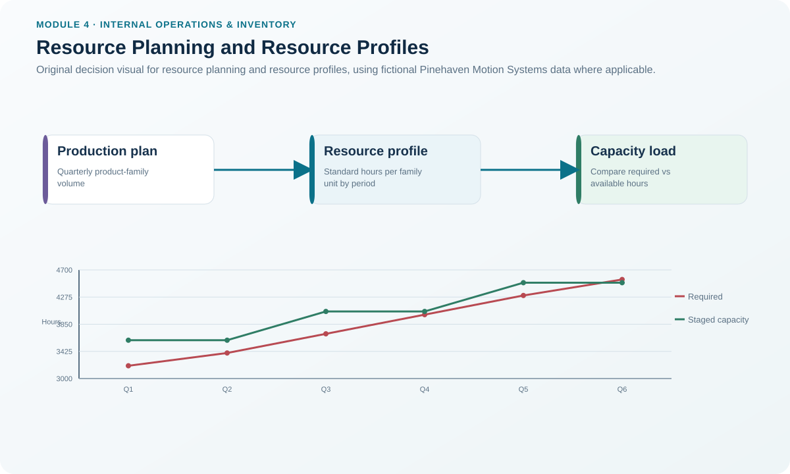
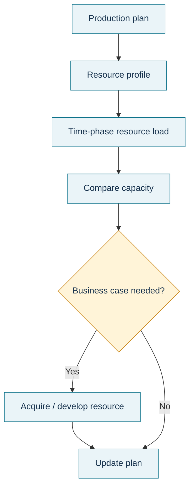

# 2. Resource Planning and Resource Profiles

## Learning objectives

After this topic, you should be able to:

- explain the purpose of long-range resource planning;
- build a simple time-phased resource profile from family-level demand;
- distinguish a resource profile from a bill of resources; and
- identify when a strategic capacity gap requires a business case or a change to the production plan.

## Concept in plain English

Resource planning is the long-range capacity check used to determine whether major resources can support the production priorities created by business planning and S&OP. It works at an aggregate level because decisions such as acquiring equipment, adding a facility, hiring and training a workforce, or qualifying a new external capability take time.

A **resource profile** expresses how much of a resource a product family or planning quantity will consume over time. It converts a volume plan into a capacity view, often using standard hours or another meaningful operational driver. A **bill of resources** lists the key capacity resources needed for one unit of a selected item or family. The bill tells the planner *what resources and quantities per unit matter*; the resource profile time-phases the resulting load so it can be compared with capacity by period.

Resource planning is intentionally broader than machine-hour arithmetic. Plant space, specialized labor, tooling, supplier capability, testing infrastructure, information, knowledge, and capital can all be strategic resources when they determine whether the plan is executable.

## Why it matters

Long-range capacity problems are often cheap to recognize and expensive to ignore. A six-month hiring and qualification requirement cannot be solved by asking for overtime in the week the shortage appears. Resource planning gives management enough time to evaluate whether to add capability, alter the production plan, shift demand, redesign the process, or use an external resource.

The output is therefore not merely a chart. It is a resource decision with ownership, lead time, economics, and an implementation path.

## Decision model and workflow

### Evidence retained through the workflow

Retain the production-family volumes, standard resource factors, time-phased required load, current and committed future capacity, resource acquisition lead time, critical-resource designation, assumptions, approved response, and date when the decision must be initiated.

## Practical process flow

## Original visualization

The visual bridges family-level production demand to time-phased resource load and then to a strategic capacity decision. It reinforces that a capacity gap must be identified early enough to act on the resource lead time.

## Realistic example — Pinehaven Motion Systems

Pinehaven's long-range plan identifies Final Assembly and Burn-in Test as critical resources. For Final Assembly, required load rises from **3,200 standard hours in Q1** to **4,300 in Q5**, while current capacity remains **3,600**. That creates a **700-hour Q5 shortfall** if no action is taken.

Burn-in Test is more sensitive because its current quarterly capability is **2,100 standard hours**, its Q5 requirement is **2,750**, and the locked planning data assign a **three-quarter investment lead time**. A Q5 need with a three-period implementation lead means the decision cannot wait until Q4. Pinehaven needs an approved resource action far enough in advance for equipment, qualification, staffing, or an alternative source to be ready.

This is the value of time phasing. “We need 650 more hours” is incomplete. “We need 650 more Burn-in Test standard hours in Q5, and the capacity action requires three quarters to implement” is decision-ready.

The working data are in [`capacity-plan.csv`](../../assets/data/module-4/capacity-plan.csv).

## Applied decision artifact — resource profile worksheet

| Resource | Period | Required load | Current capacity | Gap | Lead time | Decision trigger |
|---|---:|---:|---:|---:|---:|---|
| Final Assembly | Q3 | 3,700 | 3,600 | -100 | 2 quarters | Confirm temporary bridge and approved expansion path |
| Final Assembly | Q5 | 4,300 | 3,600 | -700 | 2 quarters | Permanent/staged capacity must already be underway |
| Burn-in Test | Q3 | 2,200 | 2,100 | -100 | 3 quarters | Protect near-term plan while long-range action develops |
| Burn-in Test | Q5 | 2,750 | 2,100 | -650 | 3 quarters | Strategic resource action required before the gap arrives |

A negative gap in the table means required load exceeds current capacity. The worksheet should also record the source of each standard and the confidence range around the demand plan.

## Decision logic

- Start with the production plan or strategic demand scenario, not with a favored equipment purchase.
- Convert family-level volume into a consistent resource measure.
- Time-phase the load so the date of the gap is visible.
- Compare the gap date with the resource acquisition or development lead time.
- If the resource cannot be ready in time, change the demand/production plan or build a temporary bridge rather than assuming the gap will solve itself.
- Revisit the profile as demand, productivity, or resource assumptions change.

## Trade-offs

Buying capacity early improves readiness but increases idle-capacity and forecast-risk exposure. Waiting for stronger demand confirmation protects cash but can create a service failure if the resource has a long acquisition or qualification lead time. Resource planning makes that timing trade-off explicit.

## Commonly confused with

A **resource profile** is a time-phased view of resource load. A **bill of resources** is the per-unit or per-family capacity requirement used to help calculate that load. RCCP can use similar resource information, but it operates at the master-schedule level and focuses on critical resources for specific scheduled items rather than the aggregate family-level horizon.

## Common mistakes

- Using unit volume without translating it into resource consumption.
- Ignoring the lead time needed to acquire or qualify capacity.
- Treating average annual capacity as sufficient when a quarterly or seasonal peak creates the real shortage.
- Building a capital case without testing whether the production plan itself should change.

## Original knowledge check

**Question.** Pinehaven expects Burn-in Test to require 2,750 standard hours in Q5 versus 2,100 currently available. The resource action needs three quarters to implement. What is the strongest planning response?

A. Wait until Q5 and use daily sequencing

B. Initiate the approved resource action early enough to be ready for Q5, while monitoring the demand assumption

C. Ignore the gap because annual capacity may still average out

D. Move the issue directly to cycle counting

Answer and rationale

### Correct answer

**B. Initiate the approved resource action early enough to be ready for Q5, while monitoring the demand assumption**

### Why it is correct

Resource planning exists to identify long-lead capability needs before they become execution failures. The decision should be tied to the time-phased gap and the three-quarter implementation lead.

### Why the other answers are wrong

- **A.** Daily sequencing is too late and cannot create strategic capacity.
- **C.** An annual average can hide a period-specific shortage.
- **D.** Cycle counting addresses inventory records, not long-range resource availability.

## Practitioner perspective

A useful resource profile has fewer “perfect” assumptions and more explicit ownership. Record who owns the volume forecast, who owns the resource standard, what change would invalidate the plan, and the last date when action can start without jeopardizing the required capacity date.

## Related concepts

- [Capacity Management, Planning, Control, and Horizons](./01-capacity-management-planning-control-and-horizons.md)
- [Capacity Growth Staging Strategies](./03-capacity-growth-staging-strategies.md)
- [Rough-Cut Capacity Planning and Bottleneck Validation](./04-rough-cut-capacity-planning-and-bottleneck-validation.md)

---

[Previous: Capacity Management, Planning, Control, and Horizons](./01-capacity-management-planning-control-and-horizons.md) · [Section overview](./README.md) · [Next: Capacity Growth Staging Strategies](./03-capacity-growth-staging-strategies.md)
