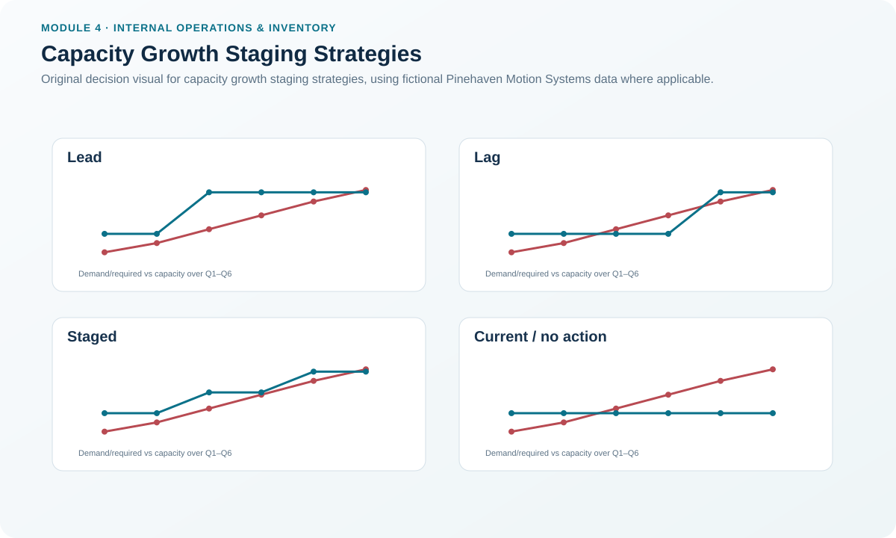
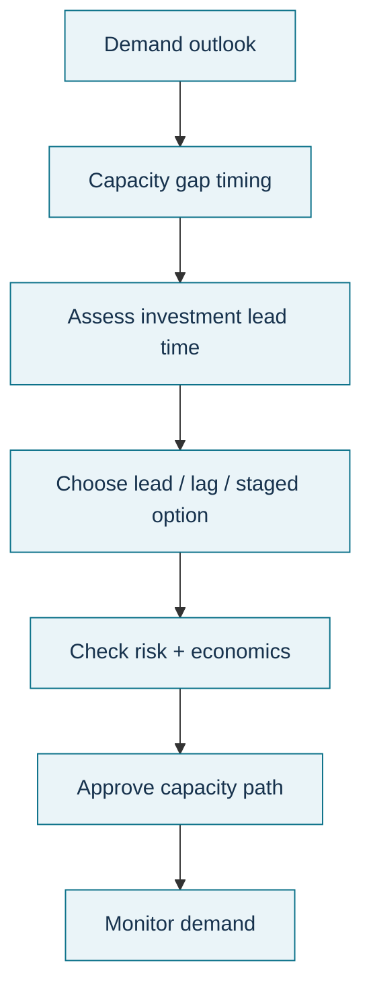

# 3. Capacity Growth Staging Strategies

## Learning objectives

After this topic, you should be able to:

- distinguish lead, lag, staged, and overlapping capacity-growth approaches;
- relate investment timing to demand uncertainty and service risk;
- explain why capacity strategy is an economic and risk decision, not only an engineering decision; and
- use a simple decision matrix to select a defensible staging approach.

## Concept in plain English

When demand is expected to grow, management must decide **when** capacity should be added, not only **how much** should eventually exist. Four useful patterns are:

- **One-step lead:** add the future capacity in one large move before demand reaches it.
- **Stepwise lead:** add smaller increments while staying ahead of forecast demand.
- **Stepwise lag:** add increments after demand has caught up with or exceeded current capability.
- **Overlapping / mixed staging:** alternate between periods of spare capacity and periods of tight capacity as investments are phased.

A lead approach protects service and creates room for upside demand, but carries more unused-capacity risk. A lag approach reduces early capital exposure, but makes backlogs, lost sales, overtime, and customer-service failures more likely if demand arrives as expected or faster. A staged approach can reduce the size of each bet, although it may create repeated implementation work and still requires enough lead time for every increment.

## Why it matters

Capacity additions are often lumpy and difficult to reverse. A new line, cleanroom, test chamber, building expansion, or specialized workforce may remain in place for years. Capacity strategy therefore links demand uncertainty, service requirements, cash, implementation lead time, flexibility, and the cost of being wrong.

The decision is strongest when the team evaluates both errors: **adding too early** and **adding too late**.

## Decision model and workflow

### Evidence retained through the workflow

Retain the demand range, current capacity, required capacity by period, investment increment, implementation lead time, fixed and variable economics, service consequence of shortage, redeployment or exit options, approved strategy, and review triggers.

## Practical process flow

## Original visualization

The visual compares lead, lag, and staged capacity paths against Pinehaven's rising resource requirement. It is intended to show timing risk rather than to imply that one strategy is universally superior.

## Realistic example — Pinehaven Motion Systems

For Final Assembly, current capacity is **3,600 standard hours per quarter**. Required load reaches **3,700 in Q3**, **4,000 in Q4**, **4,300 in Q5**, and **4,550 in Q6**.

The locked scenario contains three possible capacity paths:

| Period | Required | Lead path | Lag path | Staged path |
|---|---:|---:|---:|---:|
| Q3 | 3,700 | 4,500 | 3,600 | 4,050 |
| Q4 | 4,000 | 4,500 | 3,600 | 4,050 |
| Q5 | 4,300 | 4,500 | 4,500 | 4,500 |
| Q6 | 4,550 | 4,500 | 4,500 | 4,500 |

The **lead** option provides a substantial early cushion but exposes Pinehaven to idle capacity if demand underperforms. The **lag** option leaves Q3 and Q4 under-capacity before the larger addition arrives. The **staged** option narrows the Q3-Q4 gap while avoiding the full early 4,500-hour commitment.

Notice that none of the three paths fully covers Q6's 4,550-hour requirement. The correct conclusion is not “the strategy failed”; it is that the next decision point must be defined. Capacity strategy is a rolling plan, not a one-time chart.

The scenario is in [`capacity-plan.csv`](../../assets/data/module-4/capacity-plan.csv).

## Applied decision artifact — capacity-growth decision matrix

| Decision factor | Lead strategy tends to fit when... | Lag strategy tends to fit when... | Staged / overlapping tends to fit when... |
|---|---|---|---|
| Lost-service consequence | Very high | Low or tolerable | Moderate to high |
| Demand confidence | Strong | Weak / uncertain | Moderate or scenario-based |
| Investment reversibility | Capacity can be redeployed | Asset is highly irreversible | Modular increments are feasible |
| Resource lead time | Long | Short | Increments can be timed reliably |
| Cash constraint | Less restrictive | Highly restrictive | Capital can be sequenced |
| Need for upside headroom | High | Low | Moderate |

The matrix is a discussion aid, not a formula. The final decision still needs a financial case and risk ownership.

## Decision logic

- Plot required and current capacity by period.
- Define the latest date each capacity increment can start and still be ready.
- Quantify the service and cost consequences of being short.
- Quantify the cash and idle-capacity exposure of being early.
- Prefer staged options when increments are feasible and demand uncertainty is material.
- Define a trigger for the next increment rather than assuming the demand forecast will remain unchanged.

## Trade-offs

Lead capacity buys responsiveness with earlier cash and idle-resource exposure. Lag capacity protects capital but shifts risk into backlog, expediting, overtime, and customer loss. Staging reduces the size of each commitment but adds project-management complexity and can be ineffective if the physical resource only comes in one large increment.

## Commonly confused with

A **lead capacity strategy** is not the same as **lead time**. Strategy describes when capacity is added relative to demand. Lead time is the elapsed time needed to acquire, build, hire, qualify, or otherwise make the capacity usable.

## Common mistakes

- Choosing “lead” automatically because service is important without checking the cost of idle capacity.
- Choosing “lag” solely to protect capital while ignoring the cost of missed demand.
- Assuming staged investment is possible when the equipment or facility is indivisible.
- Failing to define the demand or utilization trigger for the next increment.

## Original knowledge check

**Question.** Pinehaven faces costly missed shipments, expects demand growth with reasonable confidence, and can add capacity in modular increments. Which approach best balances service protection with avoiding one large early investment?

A. Stepwise lead

B. Stepwise lag only

C. No capacity planning until a backlog appears

D. Run every work center at 100% utilization immediately

Answer and rationale

### Correct answer

**A. Stepwise lead**

### Why it is correct

Small increments can be added before the shortage materializes, preserving service while reducing the exposure of one large advance investment.

### Why the other answers are wrong

- **B.** A lag-only policy accepts more shortage risk before each increment arrives.
- **C.** Waiting for backlog ignores implementation lead time.
- **D.** Local utilization is not a substitute for a strategic capacity path.

## Practitioner perspective

Use scenarios rather than a single demand line. A capacity strategy should still be defensible under a downside case, an expected case, and a plausible upside case. If one forecast point is the only way the investment works, the decision is fragile.

## Related concepts

- [Resource Planning and Resource Profiles](./02-resource-planning-and-resource-profiles.md)
- [Rough-Cut Capacity Planning and Bottleneck Validation](./04-rough-cut-capacity-planning-and-bottleneck-validation.md)
- [Balancing Load and Capacity](./08-balancing-load-and-capacity.md)

---

[Previous: Resource Planning and Resource Profiles](./02-resource-planning-and-resource-profiles.md) · [Section overview](./README.md) · [Next: Rough-Cut Capacity Planning and Bottleneck Validation](./04-rough-cut-capacity-planning-and-bottleneck-validation.md)
