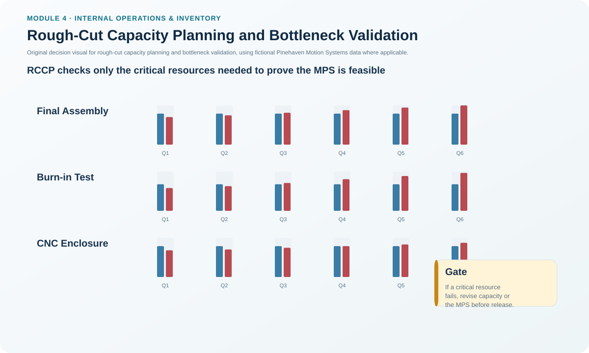
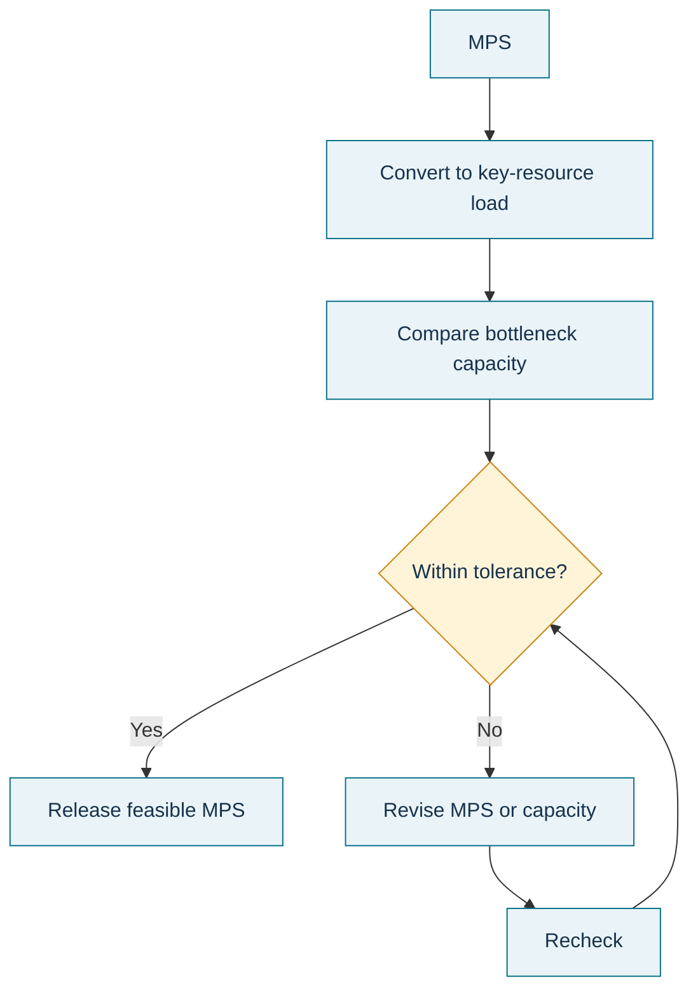

# 4. Rough-Cut Capacity Planning and Bottleneck Validation

## Learning objectives

After this topic, you should be able to:

- explain how RCCP converts the master production schedule into key-resource requirements;
- identify why bottlenecks, gateway work centers, and critical suppliers receive special attention;
- compare MPS load with available or demonstrated capacity; and
- decide when the MPS or capacity assumption must be revised before release.

## Concept in plain English

Rough-cut capacity planning (RCCP) is the medium-range feasibility check for the master production schedule. The MPS says what specific items are expected to be produced and when. RCCP asks whether the **critical resources** required by that schedule can actually support it.

The check is “rough-cut” because it does not model every operation in the factory. Instead, it concentrates on resources whose failure would make the schedule infeasible: bottleneck machines, gateway operations, specialized labor, constrained storage or test resources, and critical suppliers. Resource requirements can be estimated using a bill of resources, overall factors, or a resource profile.

A **bottleneck** is a resource whose capacity is below the load placed on it. Adding speed to non-bottleneck operations does not automatically increase system throughput; it can simply build more work in process in front of the constraint.

## Why it matters

An MPS can balance demand and inventory numerically and still be impossible to execute. RCCP prevents a schedule from becoming an organizational promise before critical capacity has been tested.

A workable MPS should have sufficient bottleneck capacity by period, use resources sensibly, support customer commitments, and remain economically reasonable after any extraordinary capacity measures such as overtime are included.

## Decision model and workflow

### Evidence retained through the workflow

Retain the MPS version, key resources selected for RCCP, resource factors, required load by period, available and demonstrated capacity, tolerance or policy limit, identified bottlenecks, adjustment selected, incremental cost, and the version of the MPS approved after recheck.

## Practical process flow

## Original visualization

The visual compares scheduled load against Pinehaven's critical-resource capacity profile. The point is not to prove that every resource is feasible; it is to test the resources most capable of invalidating the master schedule before detailed CRP begins.

## Realistic example — Pinehaven Motion Systems

Pinehaven's Q4 capacity plan requires **4,000 standard hours** at Final Assembly and **2,500 standard hours** at Burn-in Test. Current available quarterly capacity is **3,600** and **2,100** respectively. Both resources are marked critical in the locked planning data.

That means the Q4 schedule carries a **400-hour gap at Final Assembly** and a **400-hour gap at Burn-in Test** unless additional capability has been approved. RCCP should not simply stamp the MPS “feasible” because total plant labor appears sufficient. These two critical resources can stop the schedule even if other areas have spare capacity.

The master scheduler has several legitimate responses: change the item timing or mix, approve a short-term capacity bridge, add an available shift if the resource permits it, use a qualified alternate source, or escalate the gap to the S&OP/resource plan if the issue is structural. The schedule is then checked again.

The working scenario is in [`capacity-plan.csv`](../../assets/data/module-4/capacity-plan.csv).

## Applied decision artifact — RCCP bottleneck load table

| Critical resource | Q4 required load | Current capacity | Gap | Initial RCCP disposition |
|---|---:|---:|---:|---|
| Final Assembly | 4,000 | 3,600 | -400 | Revise schedule/capacity before MPS release |
| Burn-in Test | 2,500 | 2,100 | -400 | Revise schedule/capacity before MPS release |
| CNC Enclosure | 1,850 | 1,850 | 0 | At limit; monitor but no numeric gap |

RCCP should also record whether the comparison uses **available** or **demonstrated** capacity. A nominal design capability that the operation has never sustained may be too optimistic for schedule approval.

## Decision logic

- Start from the approved MPS, not from annual production volume.
- Select the resources whose capacity can invalidate the schedule.
- Convert MPS quantities into required capacity by period.
- Compare the load with an explicitly defined capacity basis.
- If the gap exceeds policy tolerance, revise capacity or the MPS and recheck.
- Do not move to detailed material and work-center planning as though the MPS were feasible when a critical gap remains unresolved.

## Trade-offs

Checking only critical resources keeps RCCP fast enough to support master scheduling, but it can miss noncritical resources that become constrained under an unusual mix. Checking every work center would add detail but turns RCCP into something closer to CRP. The right level of detail depends on which resources can realistically make the MPS infeasible.

## Commonly confused with

**RCCP** operates at the MPS level and focuses on key resources. **CRP** operates at the MRP/detail level and loads specific work centers using open orders, planned releases, routings, and work-center data. Resource planning is longer range and more aggregate than both.

## Common mistakes

- Declaring an MPS feasible based on total labor hours while a specialized test resource is overloaded.
- Treating every work center as an RCCP resource and losing the speed of a rough-cut check.
- Comparing item-level MPS load with an unrelated annual capacity figure.
- Accepting overtime or subcontracting without adding its cost to the feasibility decision.

## Original knowledge check

**Question.** Pinehaven's MPS creates a 400-standard-hour Q4 overload at a critical Burn-in Test resource. What should RCCP do first?

A. Release the MPS unchanged because detailed CRP will eventually find the problem

B. Revise the schedule or capacity assumption and recheck the critical resource

C. Ignore the gap if another noncritical department has spare hours

D. Increase finished-goods inventory without changing the schedule

Answer and rationale

### Correct answer

**B. Revise the schedule or capacity assumption and recheck the critical resource**

### Why it is correct

RCCP exists to validate critical-resource feasibility before the MPS becomes the basis for detailed downstream planning.

### Why the other answers are wrong

- **A.** Deferring a known bottleneck defeats the purpose of RCCP.
- **C.** Capacity at an unrelated resource does not automatically substitute for a specialized bottleneck.
- **D.** Inventory cannot fix a future schedule that remains physically infeasible unless the schedule is intentionally moved earlier and capacity is available then.

## Practitioner perspective

RCCP works best when the list of critical resources is actively maintained. A gateway work center that was unconstrained last year can become critical after a mix change, new product launch, quality issue, or supplier disruption. Review the critical-resource list rather than treating it as permanent master data.

## Related concepts

- [Resource Planning and Resource Profiles](./02-resource-planning-and-resource-profiles.md)
- [Capacity Requirements Planning, Load, and Manufacturing Lead Time](./05-capacity-requirements-planning-load-and-manufacturing-lead-time.md)
- [Balancing Load and Capacity](./08-balancing-load-and-capacity.md)

---

[Previous: Capacity Growth Staging Strategies](./03-capacity-growth-staging-strategies.md) · [Section overview](./README.md) · [Next: Capacity Requirements Planning, Load, and Manufacturing Lead Time](./05-capacity-requirements-planning-load-and-manufacturing-lead-time.md)
