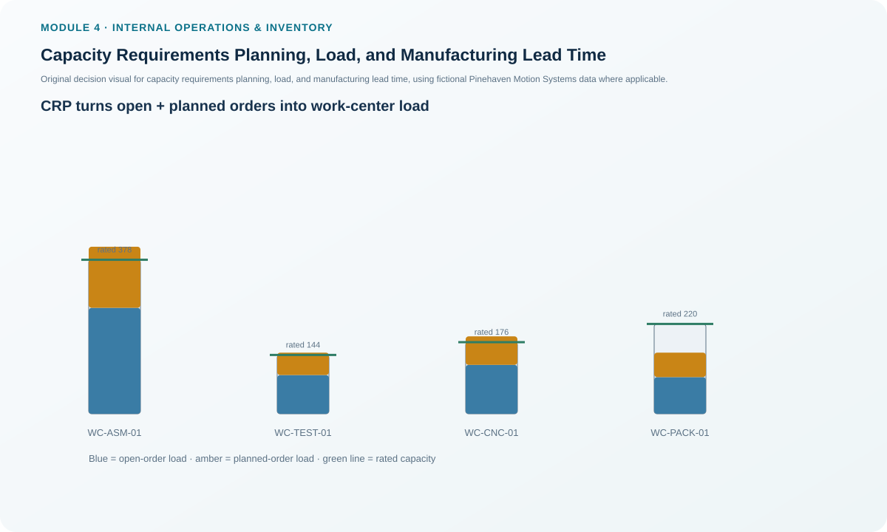
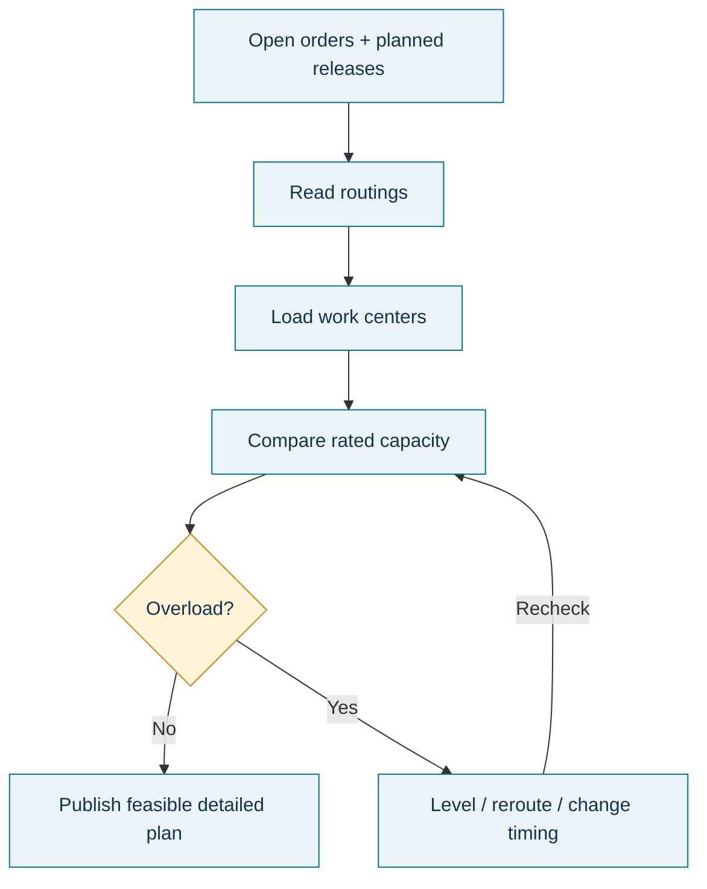

# 5. Capacity Requirements Planning, Load, and Manufacturing Lead Time

## Learning objectives

After this topic, you should be able to:

- explain the scope of capacity requirements planning at the MRP level;
- identify the files and order data needed to calculate detailed work-center load;
- distinguish load from capacity and explain load leveling; and
- describe the time elements that contribute to manufacturing lead time.

## Concept in plain English

Capacity requirements planning (CRP) converts detailed production requirements into work-center load. It works below RCCP. Instead of asking only whether key resources can support the MPS, CRP looks at the detailed workload created by open orders and planned order releases and places that work against the resources identified in routings and work-center data.

Four information sets are especially important:

1. **Open orders** show work already released or committed.
2. **Planned order releases** show additional work expected from the material plan.
3. **Routing data** identify which work centers perform the operations and the setup/run standards.
4. **Work-center data** describe available capability and time elements needed for the operation.

The resulting **load** is the amount of work assigned to a resource for a period. **Load leveling** changes timing or sequencing so that work is distributed more evenly and can actually be completed.

Manufacturing lead time is broader than run time. It can include administrative preparation, queue, setup, run, wait, movement, inspection, and put-away activity. Queue and wait time can dominate the calendar even when the actual machining or assembly operation is short.

## Why it matters

MRP can produce correct material dates and quantities but still fail if the corresponding work centers cannot process the orders. CRP exposes that mismatch before it becomes a shop-floor surprise.

It also shows why “reduce run time” is not always the strongest lead-time improvement. If an order spends far more time waiting than being processed, the queue or release policy may offer the bigger improvement opportunity.

## Decision model and workflow



### Evidence retained through the workflow

Retain open-order load, planned-order load, routing version, setup/run standards, work-center capacity basis, queue assumptions, required load by period, overload amount, leveling or rerouting action, and the revised completion dates if timing changes.

## Practical process flow



## Original visualization

The work-center visual separates open-order and planned-order load and compares the combined requirement with rated capability. It helps show that CRP is not simply “how busy is the machine?” but a structured reconciliation of planned work with detailed capacity.

## Realistic example — Pinehaven Motion Systems

For Week 27, Pinehaven's Final Assembly work center has **260 standard hours of open-order load** and **150 standard hours of planned-order load**:

```text
Required load = 260 + 150 = 410 standard hours
```

Its locked rated capacity is **378 standard hours**, leaving a **32-hour overload**. Burn-in Test carries 95 open-order hours plus 55 planned-order hours, or **150 hours of load**, against **144.4 rated hours**. CNC Enclosure has **190 hours** of load against **175.75 rated hours**.

Pack and Label is different: its listed required load is **200 standard hours** while rated capacity is **220.5**, giving 20.5 hours of headroom. That spare capacity is only useful if the work can legitimately be moved there; unrelated capacity is not interchangeable merely because the units are both “hours.”

The detailed work-center data are in [`capacity-work-centers.csv`](../../assets/data/module-4/capacity-work-centers.csv).

## Applied decision artifact — CRP work-center load table

| Work center | Open-order load | Planned-order load | Total required load | Rated capacity | Gap |
|---|---:|---:|---:|---:|---:|
| Final Assembly | 260 | 150 | 410 | 378.00 | -32.00 |
| Burn-in Test | 95 | 55 | 150 | 144.40 | -5.60 |
| CNC Enclosure | 120 | 70 | 190 | 175.75 | -14.25 |
| Pack and Label | 90 | 60 | 150 listed order load* | 220.50 | +70.50 vs open+planned |

\*The dataset also carries a broader `required_load_standard_hours` field of 200 for Pack and Label. The lesson preserves both fields rather than silently forcing them to match: planners should reconcile whether the extra 50 hours represent another demand category, a manual plan adjustment, or a data-quality issue before publishing the CRP result.

This is an important control principle: when source data disagree, reconcile the definition rather than hiding the difference.

### Manufacturing lead-time lens

For any overloaded or late work center, break elapsed time into the components that actually matter: preparation, queue, setup, run, wait, movement, inspection, and put-away. Reducing a two-hour run by 10% saves 12 minutes; eliminating a six-hour avoidable queue saves far more calendar time.

## Decision logic

- Reconcile open orders and planned releases before calculating load.
- Use the routing to assign the load to the correct work center.
- Use consistent standard-hour definitions across load and capacity.
- Compare total required load with the selected capacity basis.
- If overloaded, test leveling, timing, routing, or capacity action and then re-run CRP.
- Investigate the largest lead-time components rather than assuming run time is the only lever.

## Trade-offs

Leveling can produce a feasible plan but may move an order away from its preferred date. Rerouting can use spare capacity but may add cost, travel, setup, or quality risk. Adding capacity preserves dates but can be expensive. CRP makes the trade-off visible; it does not remove the need for an operating decision.

## Commonly confused with

**Load** is the work assigned or released to a resource. **Capacity** is the resource's ability to perform work. A high load does not mean high capacity, and a high capacity does not mean the resource should be loaded fully. Also, **lot size** affects how much is released in one order, while manufacturing lead time concerns how long the work takes to move through the production process.

## Common mistakes

- Loading a work center from planned releases while forgetting already-open orders.
- Using routing times from an obsolete process revision.
- Treating all standard hours as transferable across work centers.
- Focusing on run time while queue and waiting dominate elapsed lead time.
- Publishing a CRP result when its input fields do not reconcile.

## Original knowledge check

**Question.** Pinehaven Final Assembly has 260 standard hours of open orders and 150 standard hours of planned releases for the week. Rated capacity is 378 standard hours. What should CRP show?

A. 32 hours of overload

B. 118 hours of spare capacity

C. 378 hours of load because capacity determines the requirement

D. No issue because open orders are excluded from CRP

<details>
<summary>Answer and rationale</summary>

### Correct answer

**A. 32 hours of overload**

### Why it is correct

The detailed load is 260 + 150 = 410 standard hours. Compared with 378 rated hours, the resource is short by 32 hours.

### Why the other answers are wrong

- **B.** It reverses the relationship between load and capacity.
- **C.** Capacity does not redefine the work requirement.
- **D.** Open orders are part of the detailed load that CRP must consider.

</details>

## Practitioner perspective

CRP is where master-data quality becomes operational. A wrong routing, stale setup time, unrealistic efficiency assumption, or unclosed order can create an apparent capacity crisis that is actually a data problem. Treat input reconciliation as part of capacity planning, not clerical cleanup after the fact.

## Related concepts

- [Rough-Cut Capacity Planning and Bottleneck Validation](./04-rough-cut-capacity-planning-and-bottleneck-validation.md)
- [Production Activity Control and the Execution Loop](./06-production-activity-control-and-the-execution-loop.md)
- [Measuring Capacity](./07-measuring-capacity-utilization-efficiency-rated-and-demonstrated-capacity.md)

---

[Previous: Rough-Cut Capacity Planning and Bottleneck Validation](./04-rough-cut-capacity-planning-and-bottleneck-validation.md) · [Section overview](./README.md) · [Next: Production Activity Control and the Execution Loop](./06-production-activity-control-and-the-execution-loop.md)
