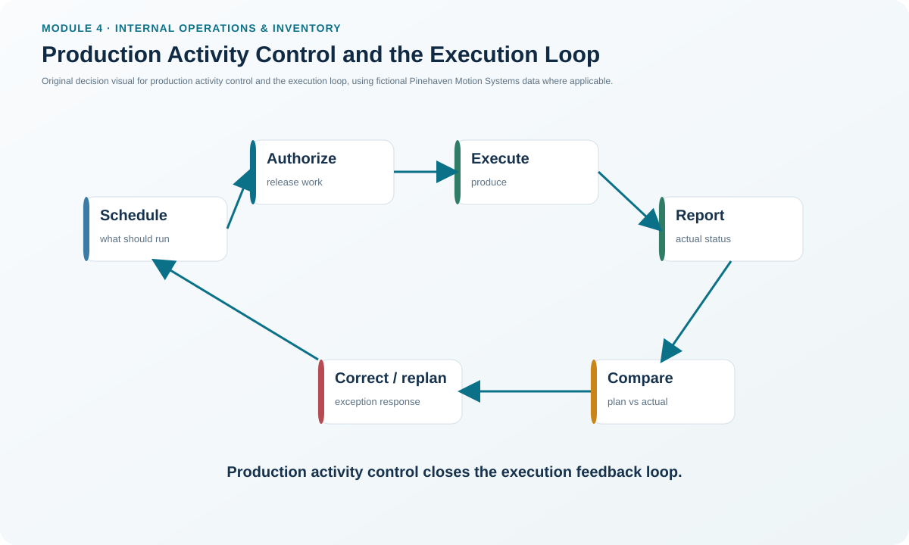
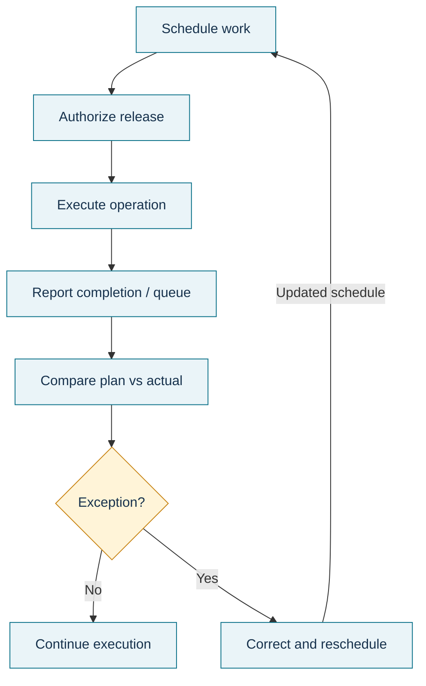

# 6. Production Activity Control and the Execution Loop

## Learning objectives

After this topic, you should be able to:

- explain the role of production activity control (PAC) in executing the plan;
- describe the plan-execute-control feedback loop;
- identify the main objectives of PAC and the role of capacity control; and
- build a simple daily control board that converts exceptions into owned actions.

## Concept in plain English

Production activity control is where the production plan meets actual execution. PAC coordinates the near-term activities needed to make released work happen as intended and feeds operating results back into the next planning decision.

A useful way to view PAC is as a repeating loop:

1. **Plan** the near-term work: confirm resources, priorities, and start/finish timing.
2. **Execute** by authorizing and releasing the work with the information needed to perform it.
3. **Control** by tracking actual progress, queues, WIP, priorities, lead times, and work-center performance.
4. Feed exceptions and learning back into the next plan.

Capacity control sits inside this operating loop. At this horizon, managers are not deciding whether to build a plant next year. They are deciding how to keep today's and this week's work within operating limits using sequencing, input-output control, authorized recovery actions, and escalation when the plan cannot be recovered locally.

## Why it matters

The best MPS and MRP provide no customer value if execution loses priority, WIP accumulates, constraints starve, or completed work is not reported. PAC protects the connection between plan and reality.

Its operating objectives are broader than “keep every machine busy.” Good PAC executes the production and material plans, uses resources sensibly, limits unnecessary WIP, and protects customer service.

## Decision model and workflow

### Evidence retained through the workflow

Retain dispatch priorities, work authorization, planned and actual start/finish, WIP and queue status, input/output by work center, exception reason, recovery action, action owner, revised completion commitment, and the feedback sent to planning/master data if the exception is systemic.

## Practical process flow

## Original visualization

The PAC visual is a control loop rather than a one-way process because execution data should change the next planning action. If an exception is corrected but the cause never returns to planning, the same disruption is likely to recur.

## Realistic example — Pinehaven Motion Systems

Pinehaven's Week-27 control board shows Final Assembly with **410 standard hours required** versus **378 rated capacity** and a queue of **72 units**. Burn-in Test has **150 hours required** versus **144.4 rated capacity** and a queue of **120 units**. Both carry a red operating signal in the fictional dataset. CNC Enclosure is amber, while Pack and Label is green.

PAC should not respond by releasing even more work into red queues. The supervisor first confirms priority, work already authorized, material readiness, and the constraint. If the overload can be recovered with an approved short-term action, the board records that response. If not, the issue escalates so the schedule or promise can be changed before a miss becomes unavoidable.

The Week-27 working data are in [`capacity-work-centers.csv`](../../assets/data/module-4/capacity-work-centers.csv).

## Applied decision artifact — PAC daily control board

| Work center | Required load | Rated capacity | Queue | Signal | Control question |
|---|---:|---:|---:|---|---|
| Final Assembly | 410 | 378.00 | 72 | Red | Which orders must be protected, and what approved recovery is feasible? |
| Burn-in Test | 150 | 144.40 | 120 | Red | Is the constraint continuously supplied without overfeeding the queue? |
| CNC Enclosure | 190 | 175.75 | 48 | Amber | Can timing or routing prevent the overload from worsening? |
| Pack and Label | 200 | 220.50 | 36 | Green | Maintain flow; do not pull work forward without a valid need. |

A good board is action-oriented. A red status without owner, decision, and timing is only decoration.

## Decision logic

- Confirm that released work matches current priority and material readiness.
- Compare input, output, queue, and completion status with the short-term plan.
- Protect customer-critical and constraint-sensitive work first.
- Correct locally only within approved authority; otherwise escalate schedule/capacity decisions.
- Close the loop by updating order status and feeding recurring causes back to planning or process improvement.

## Trade-offs

Expediting one order can protect a customer but disrupt the sequence for several others. Releasing extra work can make people appear busy while increasing WIP and cycle time. Holding work upstream can protect the constraint but may reduce local utilization. PAC therefore optimizes flow and commitments, not isolated activity measures.

## Commonly confused with

**PAC** is broader than **capacity control**. PAC includes planning, release, priority, execution tracking, WIP control, and feedback. Capacity control is one part of PAC focused on whether actual resource input/output remains consistent with the capacity plan.

## Common mistakes

- Treating dispatch lists as fixed when a genuine exception requires controlled reprioritization.
- Releasing work simply to keep upstream resources busy.
- Measuring only output while ignoring queue and WIP growth.
- Solving the same exception every day without feeding the root cause back to planning or improvement teams.

## Original knowledge check

**Question.** A daily work center is falling behind and the supervisor must decide which released orders to run next while monitoring WIP and actual output. Which planning/control layer owns that immediate activity?

A. Resource planning

B. RCCP

C. Production activity control

D. Long-range network design

Answer and rationale

### Correct answer

**C. Production activity control**

### Why it is correct

PAC operates closest to execution and manages near-term release, sequencing, WIP, performance, and capacity-control feedback.

### Why the other answers are wrong

- **A.** Resource planning addresses long-range aggregate capability.
- **B.** RCCP validates the master schedule at key resources before detailed execution.
- **D.** Network design is a structural strategic decision, not a daily work-center control activity.

## Practitioner perspective

Digital production systems can provide real-time status, but visibility is not control by itself. Define thresholds, authority, and standard responses so an exception event produces a decision rather than another dashboard notification.

## Related concepts

- [Capacity Requirements Planning, Load, and Manufacturing Lead Time](./05-capacity-requirements-planning-load-and-manufacturing-lead-time.md)
- [Measuring Capacity](./07-measuring-capacity-utilization-efficiency-rated-and-demonstrated-capacity.md)
- [Improving Production Flow](./09-improving-production-flow-constraints-kanban-demand-pull-and-lean-partnerships.md)

---

[Previous: Capacity Requirements Planning, Load, and Manufacturing Lead Time](./05-capacity-requirements-planning-load-and-manufacturing-lead-time.md) · [Section overview](./README.md) · [Next: Measuring Capacity](./07-measuring-capacity-utilization-efficiency-rated-and-demonstrated-capacity.md)
