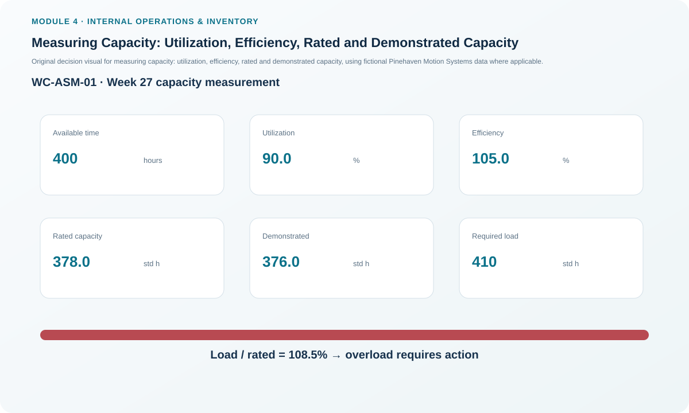
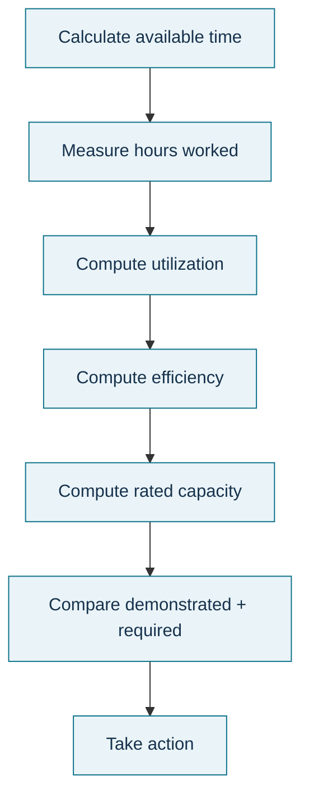

# 7. Measuring Capacity: Utilization, Efficiency, Rated and Demonstrated Capacity

## Learning objectives

After this topic, you should be able to:

- calculate available time, utilization, efficiency, rated capacity, and demonstrated capacity;
- explain why utilization and efficiency measure different things;
- compare rated, demonstrated, and required capacity without mixing units; and
- interpret capacity measures as evidence for action rather than as isolated performance targets.

## Concept in plain English

Capacity calculations begin with a consistent time basis.

```text
Available Time = Hours of Operation × Number of Workers or Machines
Utilization = Hours Actually Worked / Available Hours × 100%
Efficiency = Standard Hours of Output / Hours Actually Worked × 100%
Rated Capacity = Available Time × Utilization × Efficiency

Use the same standard-hour basis when comparing this result.

Demonstrated Capacity = Average Actual Output over the Selected Periods
```

**Utilization** asks how much of available time was actually used. **Efficiency** compares the standard output credited to the work with the hours actually consumed. Efficiency can exceed 100% when the operation produces more standard hours of output than the actual hours worked under the defined standard.

**Rated capacity** uses the planned/observed utilization and efficiency factors to estimate standard-hour capability. **Demonstrated capacity** looks backward at the output the work center has actually sustained over a chosen history. They are different evidence sources, and neither automatically equals the load the work center is required to perform.

## Why it matters

Teams often say a work center is “fully utilized” when they really mean overloaded, efficient, busy, or constrained. Those are not the same condition. Using the right metric prevents a decision from being based on an ambiguous percentage.

Capacity is also a unit problem. Worker-hours, machine-hours, test-chamber hours, beds, storage positions, and standard hours are not interchangeable. The numerator and denominator must describe the same capability.

## Decision model and workflow



### Evidence retained through the workflow

Retain operating hours, resource count, actual hours worked, standard output, utilization definition, efficiency standard/version, rated-capacity calculation, demonstrated-history window, required load, variance, and chosen action.

## Practical process flow



## Original visualization

The dashboard compares the four Pinehaven work centers using one consistent Week-27 dataset. It is designed to show that a capacity decision should look at the chain of inputs rather than treating one percentage as the answer.

## Realistic example — Pinehaven Motion Systems

For Final Assembly:

```text
Available Time = 8 hours/day × 5 days × 10 resources = 400 hours
Utilization = 360 / 400 = 90.0%
Efficiency = 378 / 360 = 105.0%
Rated Capacity = 400 × 0.90 × 1.05 = 378 standard hours
Demonstrated Capacity = (370 + 382 + 376) / 3 = 376 standard hours
```

The required Week-27 load is **410 standard hours**. So even though the work center runs at 105% efficiency against its standard, its rated capacity is still **32 standard hours below** the required load. “Improve efficiency” may be useful, but the current data already show that good efficiency alone does not make the schedule feasible.

For Burn-in Test:

```text
Available Time = 8 × 5 × 4 = 160 hours
Utilization = 152 / 160 = 95.0%
Efficiency = 144.4 / 152 = 95.0%
Rated Capacity = 160 × 0.95 × 0.95 = 144.4 standard hours
```

The full fictional dataset is [`capacity-work-centers.csv`](../../assets/data/module-4/capacity-work-centers.csv), and the formulas are summarized in the [internal operations formula sheet](../../calculations/internal-operations/formula-sheet.md).

## Applied decision artifact — capacity-measurement worksheet

| Work center | Available h | Utilization | Efficiency | Rated capacity | Demonstrated capacity | Required load | Gap vs rated |
|---|---:|---:|---:|---:|---:|---:|---:|
| Final Assembly | 400 | 90.0% | 105.0% | 378.00 | 376.00 | 410 | -32.00 |
| Burn-in Test | 160 | 95.0% | 95.0% | 144.40 | 144.00 | 150 | -5.60 |
| CNC Enclosure | 200 | 92.5% | 95.0% | 175.75 | 176.67 | 190 | -14.25 |
| Pack and Label | 240 | 87.5% | 105.0% | 220.50 | 220.67 | 200 | +20.50 |

The comparison also helps test the reasonableness of standards. If rated capacity is consistently far above or below demonstrated performance, the utilization, efficiency, standard-time, or history assumptions should be reviewed.

## Decision logic

- Define the resource count and operating calendar.
- Calculate available time in a named unit.
- Calculate utilization from actual time used, not from standard output.
- Calculate efficiency from standard output versus actual time.
- Multiply the decimal utilization and efficiency factors by available time for rated capacity.
- Compare rated and demonstrated capacity with the required load, then investigate material differences.

## Trade-offs

Raising utilization can spread fixed cost over more work, but pushing every resource toward maximum utilization can increase queues and lead time. Tight standards can encourage improvement but create misleading “low efficiency” if the method or product mix changed. Demonstrated capacity reflects reality but may institutionalize poor historical performance if it is used without improvement analysis.

## Commonly confused with

**Utilization** measures time used relative to time available. **Efficiency** measures standard output relative to time actually used. **Productivity** is broader and compares useful output with the resources consumed. A resource can be highly utilized and still inefficient, or lightly utilized and highly efficient when it is working.

## Common mistakes

- Using percentages as whole numbers in the rated-capacity multiplication.
- Calling efficiency above 100% impossible without checking the standard definition.
- Comparing worker-hours of capacity with machine-hours of load.
- Treating demonstrated capacity as a guaranteed future maximum.
- Celebrating high utilization while customer queues and WIP are deteriorating.

## Original knowledge check

**Question.** Pack and Label has 240 available hours, 87.5% utilization, and 105% efficiency. What is its rated capacity?

A. 199.50 standard hours

B. 210.00 standard hours

C. 220.50 standard hours

D. 252.00 standard hours

<details>
<summary>Answer and rationale</summary>

### Correct answer

**C. 220.50 standard hours**

### Why it is correct

`240 × 0.875 × 1.05 = 220.50` standard hours.

### Why the other answers are wrong

- **A.** This does not apply both utilization and efficiency correctly.
- **B.** This is only the actual hours worked in the dataset, not rated capacity.
- **D.** This effectively applies efficiency without the utilization reduction.

</details>

## Practitioner perspective

Before putting a capacity KPI on an executive dashboard, publish its formula, time basis, source system, and standard version. Most arguments about “capacity” are actually disagreements about definitions or data lineage.

## Related concepts

- [Capacity Requirements Planning, Load, and Manufacturing Lead Time](./05-capacity-requirements-planning-load-and-manufacturing-lead-time.md)
- [Balancing Load and Capacity](./08-balancing-load-and-capacity.md)
- [Production Activity Control and the Execution Loop](./06-production-activity-control-and-the-execution-loop.md)

---

[Previous: Production Activity Control and the Execution Loop](./06-production-activity-control-and-the-execution-loop.md) · [Section overview](./README.md) · [Next: Balancing Load and Capacity](./08-balancing-load-and-capacity.md)
