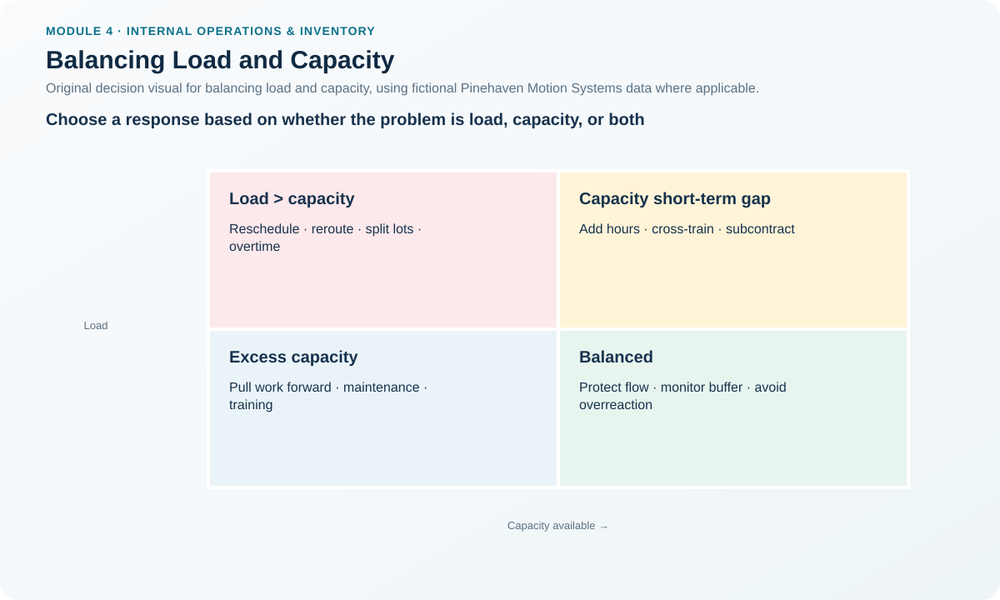
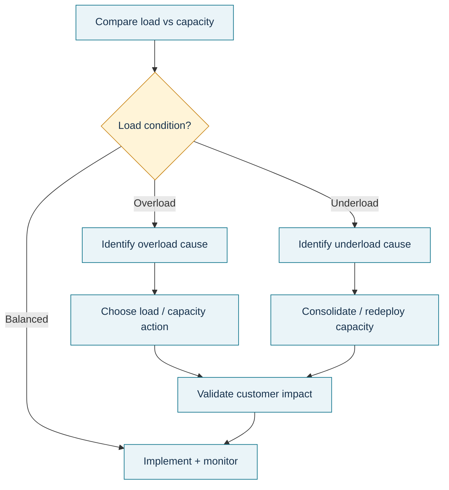

# 8. Balancing Load and Capacity

## Learning objectives

After this topic, you should be able to:

- distinguish actions that change capacity from actions that change load;
- select a short-term response based on the duration and cause of the imbalance;
- explain why subcontracting usually reduces internal load rather than increasing internal capacity; and
- protect customer commitments while avoiding unnecessary permanent capacity changes.

## Concept in plain English

Once required load and capacity are compared, planners have three choices: **change capacity, change load, or change both**.

Capacity-side responses include adding or reducing work hours, changing staffing, moving qualified workers, or changing routings when another capable resource exists. Load-side responses include subcontracting work, changing lot sizes, or rescheduling work to a different period. A short-lived overload should normally be tested against reversible actions before management commits to a permanent resource increase.

The distinction matters. Sending work to a subcontractor does not make an internal machine more capable; it removes some load from that machine. Likewise, moving an order to next week does not increase this week's capacity; it changes when the load occurs.

## Why it matters

Poor load-capacity decisions create two common failures. One is **structural overreaction**: hiring, buying equipment, or adding fixed cost for a temporary spike. The other is **temporary patching of a structural problem**: using overtime every week because management never addresses the underlying capacity shortage.

The response should therefore reflect the expected duration, cause, service impact, skill/resource substitutability, and cost of the gap.

## Decision model and workflow

### Evidence retained through the workflow

Retain load and capacity by period, variance, expected duration, cause, customer orders at risk, candidate actions, qualification constraints, incremental cost, downstream impact, approval authority, selected response, and trigger for escalation to a longer-range plan.

## Practical process flow

## Original visualization

The response matrix separates overload from underload and separates load actions from capacity actions. It prevents teams from calling every response “add capacity” when several options simply move, reduce, or defer work.

## Realistic example — Pinehaven Motion Systems

In Week 27, Pinehaven Final Assembly has **410 standard hours of required load** and **378 rated capacity**, a **32-hour overload**. Burn-in Test is short by 5.6 standard hours, and CNC Enclosure is short by 14.25 hours. Pack and Label has 20.5 standard hours of headroom against its broader 200-hour requirement.

Suppose the Final Assembly overload is a one-week spike caused by a temporary order pull-in and the following weeks return to normal. Permanently hiring another team would be a poor first response. Pinehaven might instead use controlled overtime, reschedule lower-priority work, or use qualified temporary labor if the economics and skills fit.

If the same 32-hour gap appears every week in the rolling plan, the evidence changes. Repeated overtime would be masking a structural problem, and the issue should move back to RCCP/resource planning.

The example uses [`capacity-work-centers.csv`](../../assets/data/module-4/capacity-work-centers.csv).

## Applied decision artifact — load/capacity response matrix

| Condition | Short-duration options | Longer-duration options | Key control |
|---|---|---|---|
| Load temporarily > capacity | Overtime, qualified temporary labor, priority change, short reschedule | — | Confirm service impact and fatigue/quality risk |
| Load persistently > capacity | Temporary bridge while escalating | Add/qualify resources, redesign process, change long-term plan | Do not normalize permanent overtime |
| Capacity > load | Reduce hours, maintenance/training, pull forward justified work | Consolidate/redeploy resources, change staffing or footprint | Avoid producing inventory only to keep resources busy |
| Resource-specific overload | Alternate routing or subcontract if qualified | Capability expansion or product/process redesign | Verify substitution is technically valid |

Subcontracting is shown on the load side: it removes work from the internal constrained resource.

## Decision logic

- Confirm that the load and capacity use the same unit and period.
- Classify the gap as temporary, recurring, or structural.
- Identify which customer commitments and downstream resources would be affected by each response.
- Prefer reversible, controlled measures for short-lived spikes.
- Escalate recurring gaps into the longer-range capacity process.
- Recalculate the affected work centers after shifting load; solving one overload by creating another is not a solution.

## Trade-offs

Overtime preserves internal control but can increase labor cost, fatigue, and quality risk. Temporary labor adds flexibility but may require training. Rerouting can use spare capacity but may change yield or cycle time. Subcontracting protects internal load but introduces supplier cost, lead time, and quality considerations. Rescheduling avoids resource cost but can damage customer service.

## Commonly confused with

**Changing capacity** changes what the internal resource can perform in the period. **Changing load** changes how much work is assigned to that resource or period. Subcontracting, rescheduling, and lot-size changes usually alter internal load; they do not magically raise the physical capacity of the constrained work center.

## Common mistakes

- Hiring permanently for a one-week overload.
- Using overtime continuously and still calling the problem temporary.
- Moving work to a nominally underloaded resource without checking qualification and routing feasibility.
- Producing extra inventory solely to make an underloaded resource look busy.
- Solving a local overload while creating a larger downstream constraint.

## Original knowledge check

**Question.** Pinehaven has a one-week assembly overload caused by a temporary order pull-in. Long-range demand is unchanged. Which response should be tested before a permanent capacity addition?

A. Controlled overtime within approved limits

B. Build a new plant immediately

C. Increase every lot size regardless of demand

D. Release more work into the queue to keep utilization high

Answer and rationale

### Correct answer

**A. Controlled overtime within approved limits**

### Why it is correct

A temporary spike should first be tested against a reversible short-term capacity response if service, fatigue, quality, and cost remain acceptable.

### Why the other answers are wrong

- **B.** A permanent structural investment is disproportionate to a one-week condition.
- **C.** Larger lots can increase WIP and do not address the root timing issue.
- **D.** More released work increases the queue without increasing throughput.

## Practitioner perspective

Tag every recovery action with an expiration condition. “Overtime approved through Friday” is controlled. “Use overtime until things get better” is how a temporary response becomes hidden structural capacity policy.

## Related concepts

- [Measuring Capacity](./07-measuring-capacity-utilization-efficiency-rated-and-demonstrated-capacity.md)
- [Capacity Growth Staging Strategies](./03-capacity-growth-staging-strategies.md)
- [Improving Production Flow](./09-improving-production-flow-constraints-kanban-demand-pull-and-lean-partnerships.md)

---

[Previous: Measuring Capacity](./07-measuring-capacity-utilization-efficiency-rated-and-demonstrated-capacity.md) · [Section overview](./README.md) · [Next: Improving Production Flow](./09-improving-production-flow-constraints-kanban-demand-pull-and-lean-partnerships.md)
