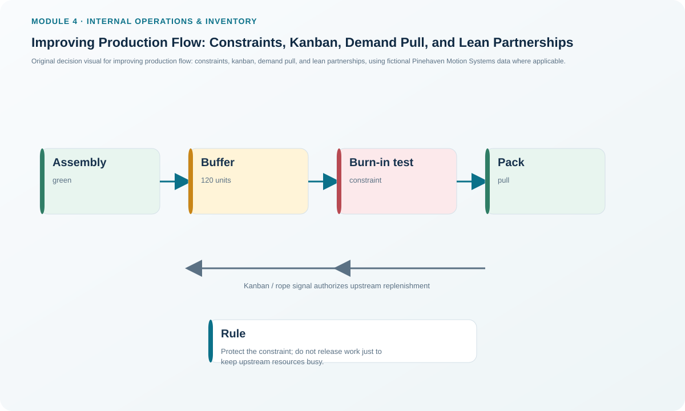
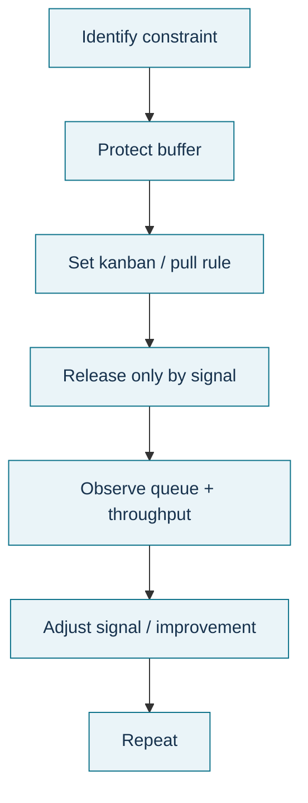

# 9. Improving Production Flow: Constraints, Kanban, Demand Pull, and Lean Partnerships

## Learning objectives

After this topic, you should be able to:

- explain why system throughput is governed by constraints rather than by the fastest local resource;
- use a controlled buffer and release rule to protect a constraint;
- explain kanban and demand-pull logic in plain operational terms; and
- describe why supplier synchronization and lean practices are necessary for sustained pull flow.

## Concept in plain English

Production flow improves when work is released at a rate the system can actually absorb. If one resource is the constraint, producing faster upstream only builds a longer queue in front of it. Constraint-focused control therefore protects the limiting resource, manages the buffer ahead of it, regulates release into the system, and works to improve or elevate the constraint.

A **kanban** is a visual or electronic signal that authorizes replenishment or movement in a pull system. **Demand pull** means material is moved or produced because the consuming operation is ready for it, rather than because an upstream resource wants to stay busy. The signal can be a card, container, empty location, scan, or digital event; the important feature is controlled authorization based on actual consumption/readiness.

**Cycle time** is the elapsed time for material to move through the production facility. Large queues increase cycle time even when individual operations are efficient.

## Why it matters

Local efficiency can harm system flow. If upstream machining produces 200 extra units but Burn-in Test can only process the normal rate, the plant has not increased throughput; it has converted capacity into WIP, floor-space use, handling, and longer response time.

Pull systems reduce unnecessary release, but they depend on stable processes, visible signals, reliable replenishment, small practical lots, and partners capable of responding to the agreed cadence. Pull is a coordination discipline, not simply a card on a container.

## Decision model and workflow

### Evidence retained through the workflow

Retain the identified constraint, required throughput, buffer target and actual buffer, kanban/container quantity, replenishment signal, release frequency, queue length, cycle time, starvation/blockage events, supplier response performance, improvement action, and the trigger indicating the constraint has moved.

## Practical process flow

## Original visualization

The visual joins constraint thinking with a pull signal. The constraint is protected with enough work to avoid starvation, while the release signal prevents upstream resources from flooding the system with unnecessary WIP.

## Realistic example — Pinehaven Motion Systems

Week-27 data show Burn-in Test with **150 standard hours of required load** against **144.4 rated capacity** and a queue of **120 units**, the largest queue in the dataset. The operating signal is red. Final Assembly is also overloaded, but simply accelerating CNC Enclosure or releasing more components would not solve the Burn-in Test shortage.

Pinehaven first confirms whether Burn-in Test is the current flow constraint for the affected product family. If it is, the operating policy should keep enough qualified work ahead of the test process so it never starves, but avoid releasing work so aggressively that the 120-unit queue continues to grow. Setup reduction, downtime reduction, better sequencing, or a qualified alternate test path may improve constraint throughput.

A kanban or equivalent digital signal can then authorize replenishment from upstream based on actual consumption. The signal quantity must be governed; “red” should not mean “produce unlimited work immediately.”

The example uses [`capacity-work-centers.csv`](../../assets/data/module-4/capacity-work-centers.csv).

## Applied decision artifact — constraint and kanban control board

| Work center | Queue / buffer | Signal | Control intent |
|---|---:|---|---|
| Burn-in Test | 120 units | Red | Protect constraint from starvation; stop uncontrolled upstream release |
| Final Assembly | 72 units | Red | Recover overload without adding unnecessary WIP |
| CNC Enclosure | 48 units | Amber | Watch flow and release only to downstream need |
| Pack and Label | 36 units | Green | Maintain cadence; do not overproduce merely because capacity is available |

Add two fields to the board in practice: **buffer target** and **release rule**. A signal without a defined quantity or authorization rule is not a controlled kanban system.

## Decision logic

- Identify the resource that currently limits system throughput for the flow being managed.
- Keep the constraint supplied with enough qualified work to avoid starvation.
- Control upstream release so the buffer is protected without uncontrolled queue growth.
- Improve setup, availability, sequence, quality, or routing at the constraint before optimizing nonconstraints.
- Use kanban or another pull signal to replenish actual consumption.
- Recheck after improvement because the system constraint can move.

## Trade-offs

A larger buffer protects the constraint from starvation but increases WIP and cycle time. A very small buffer lowers inventory but makes the system sensitive to variability. Frequent small replenishments improve flow but demand reliable suppliers, stable quality, disciplined data, and efficient material handling.

## Commonly confused with

A **constraint buffer** is intentionally placed to protect throughput at the limiting resource. It is not the same as uncontrolled WIP. **Demand pull** is triggered by downstream readiness or consumption; it is not simply a forecast-driven schedule with smaller lots. **Kanban** is the authorization mechanism within a pull system, not the entire lean operating philosophy.

## Common mistakes

- Speeding up nonconstraint resources while the constraint remains unchanged.
- Interpreting a red kanban signal as permission for unlimited production.
- Reducing the constraint buffer to zero without understanding variability.
- Installing pull signals while suppliers, quality, or equipment reliability remain too unstable to replenish consistently.
- Assuming the original bottleneck remains the constraint after improvement.

## Original knowledge check

**Question.** Pinehaven's Burn-in Test is the current constraint and its queue keeps growing. Which action is most consistent with constraint and pull logic?

A. Increase upstream release so every resource stays busy

B. Protect Burn-in Test from starvation but regulate upstream release to the needed buffer level

C. Build extra finished goods regardless of demand

D. Measure only utilization and ignore queue length

Answer and rationale

### Correct answer

**B. Protect Burn-in Test from starvation but regulate upstream release to the needed buffer level**

### Why it is correct

The constraint should have enough work to remain productive, but overfeeding it only increases WIP and cycle time without improving system throughput.

### Why the other answers are wrong

- **A.** Keeping nonconstraints busy can make the queue worse.
- **C.** Production without demand increases inventory rather than improving flow.
- **D.** Queue and flow are essential evidence when managing a constraint.

## Practitioner perspective

Modern plants may implement kanban with scanners, e-kanban, MES events, or ERP replenishment signals. The technology can change; the operating rule cannot. Every signal needs a defined trigger, quantity, source, destination, owner, and exception path.

## Related concepts

- [Production Activity Control and the Execution Loop](./06-production-activity-control-and-the-execution-loop.md)
- [Balancing Load and Capacity](./08-balancing-load-and-capacity.md)
- [Capacity Requirements Planning, Load, and Manufacturing Lead Time](./05-capacity-requirements-planning-load-and-manufacturing-lead-time.md)

---

[Previous: Balancing Load and Capacity](./08-balancing-load-and-capacity.md) · [Section overview](./README.md) · [Next: Section B Review](./10-section-b-review.md)
