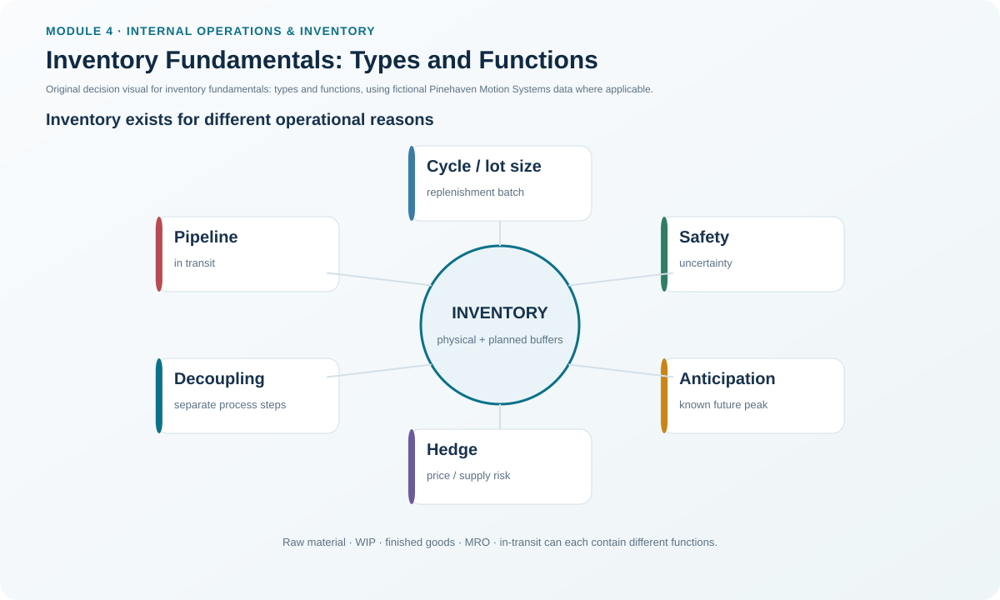

# 1. Inventory Fundamentals: Types and Functions

## Learning objectives

After this topic, you should be able to:

- distinguish inventory by physical stage and by business purpose;
- explain why organizations deliberately hold inventory even though it ties up cash;
- separate raw material, work-in-process, finished-goods, in-transit, and MRO inventory; and
- connect cycle, anticipation, buffer, safety, hedge, and decoupling purposes to operating decisions.

## Concept in plain English

Inventory is material or stock that supports production, supporting activities, or customer service. The important point is that **what an item is** and **why it is being held** are two different questions.

A servo-drive enclosure blank may be raw material when it enters Pinehaven's plant. After machining starts, it becomes work in process. Once the complete drive passes final acceptance, it becomes finished goods. A finished unit on a truck to a regional distribution center is in-transit inventory. Lubricants and replacement tools used to keep the line operating are MRO supplies rather than components of the saleable product.

The same physical stock can also serve different functions. Cycle stock is consumed and replenished through the normal order cycle. Anticipation inventory is positioned for a known future event such as a seasonal peak or planned shutdown. A buffer can protect flow at a constrained operation. Safety stock protects against uncertainty. Hedge inventory is intentionally acquired against a possible future supply or price exposure. Decoupling inventory creates some independence between two operations or supply-chain stages.

## Why it matters

Calling all stock simply “inventory” hides the reason it exists. A reduction program that removes safety stock as though it were ordinary excess can damage customer service. A program that treats slow-moving MRO spares like finished goods can create equipment downtime. Conversely, labeling every extra unit “strategic safety stock” makes overstock impossible to challenge.

The better management question is: **what requirement does this inventory satisfy, what risk does it cover, and is there a lower-cost way to achieve the same result?**

## Decision model and workflow

This visual separates the item's physical position in the flow from the business function that justifies holding it.

### Evidence retained through the workflow

For each material or stock family, retain the item identifier, physical inventory type, inventory function, location/echelon, demand basis, lead time, service consequence, policy owner, and the event that would trigger a policy review.

## Realistic example — Pinehaven Motion Systems

Pinehaven's illustrative item master contains several useful contrasts:

| Item | Physical type | Current function | Why the distinction matters |
|---|---|---|---|
| PH-SD500 | Finished goods | Cycle | Normal regional customer replenishment |
| PH-SHEET14 | Raw material | Cycle | Feeds enclosure production |
| PH-FUSE7 | Purchased component | Safety | Low unit value but high service/continuity importance |
| PH-LUBE02 | MRO | Anticipation | Supports equipment rather than becoming part of the product |

The working data are in [`inventory-item-master.csv`](../../assets/data/module-4/inventory-item-master.csv).

PH-FUSE7 is particularly instructive. Its unit value is only $0.55, but Pinehaven has deliberately assigned it a higher control class because a shortage can stop production or service. The reason for holding it is therefore more important than its purchase value alone.

**Decision insight.** Inventory should be challenged by purpose, not only by quantity. The question is not “Can we reduce stock?” but “Can the underlying uncertainty, lead time, batch constraint, or service requirement be reduced enough to remove stock safely?”

## Applied decision artifact — inventory purpose register

Use a short register for every important inventory family:

| Field | Question |
|---|---|
| Physical type | Raw material, WIP, finished goods, in transit, MRO, or another defined category? |
| Inventory function | Cycle, anticipation, buffer, safety, hedge, decoupling, or another approved purpose? |
| Risk covered | What happens if this stock is unavailable? |
| Alternative | Can variability, lead time, setup, reliability, or information quality be improved instead? |
| Owner | Who approves the policy? |
| Review trigger | What change in demand, lead time, service, or product life cycle requires reassessment? |

This prevents a one-time stocking decision from becoming a permanent assumption.

## Decision logic

- Identify where the item currently sits in the physical flow.
- Identify why the organization is holding it.
- Verify that the purpose is still valid.
- Quantify the operating or service consequence of running short.
- Look for process improvements that can replace part of the inventory with better reliability, speed, or visibility.
- Keep the residual stock only when the economic or service case remains stronger than the alternatives.

## Trade-offs

Inventory improves availability and can decouple processes, but it consumes cash, space, handling effort, and management attention. A buffer can protect a constraint, yet an oversized buffer hides process problems. Anticipation inventory can protect a planned peak, yet a wrong demand assumption creates excess after the event. MRO stock can prevent expensive downtime, yet poorly controlled MRO stores often accumulate duplicates and obsolete spares.

## Commonly confused with

**Inventory type** describes where or what the inventory is: raw material, WIP, finished goods, in transit, or MRO. **Inventory function** describes why it is held: cycle, anticipation, buffer, safety, hedge, or decoupling. An item can have one physical type and a different policy purpose.

## Common mistakes

- Classifying by accounting label only and losing the operational purpose.
- Treating every slow-moving item as unnecessary.
- Ignoring in-transit stock when measuring total supply-chain inventory.
- Calling MRO “free insurance” without controlling duplicates, access, or obsolescence.
- Using safety stock to compensate indefinitely for a supplier or process problem that should be fixed.

## Original knowledge check

**Question.** A completed Pinehaven servo drive has finished assembly but is still waiting for final acceptance testing. Which inventory type best describes it?

A. Raw material

B. Work in process

C. Finished goods

D. MRO inventory

Answer and rationale

### Correct answer

**B. Work in process**

### Why it is correct

The unit has not yet completed the production/acceptance process. It remains in a stage of completion rather than being accepted finished inventory.

### Why the other answers are wrong

- **A** describes material that has not entered production.
- **C** would apply after the unit has completed the defined acceptance process.
- **D** supports operations but is not incorporated into the saleable product.

## Practitioner perspective

In ERP environments, material type, stock status, valuation class, MRP settings, storage location, and business purpose are related but not identical. A good inventory review does not assume one system field tells the whole story. Combine master data with the operating reason for stock.

## Related concepts

- [Inventory Cost Structure](./02-inventory-cost-structure.md)
- [Inventory Management Roles and Policy](./04-inventory-management-roles-and-policy.md)
- [Safety Stock and Safety Lead Time](./11-safety-stock-and-safety-lead-time.md)

---

[Section overview](./README.md) · [Next: Inventory Cost Structure](./02-inventory-cost-structure.md)
