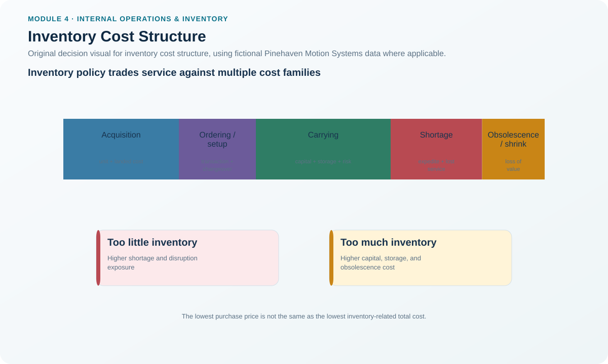

# 2. Inventory Cost Structure

## Learning objectives

After this topic, you should be able to:

- distinguish acquisition, landed, carrying, ordering, and customer-service-related inventory costs;
- explain the storage, capital, and risk components of carrying cost;
- identify why reducing one inventory cost can increase another; and
- define the cost boundary before comparing replenishment or stocking alternatives.

## Concept in plain English

Inventory cost is not just the invoice price of an item. The decision boundary changes depending on the question.

**Acquisition cost** is the cost of obtaining the units themselves. **Landed cost** extends that boundary to logistics-related costs needed to bring the item to the chosen location. **Carrying cost** is the cost of keeping value tied up over time and commonly includes storage, capital, and risk. Finance may use an approved **weighted average cost of capital (WACC)** or another controlled capital-rate basis when estimating the opportunity-cost portion. **Ordering cost** is incurred because an order or production setup occurs; it is driven more by order frequency than by the number of units in a particular order. A stockout can also create backorder, lost-sale, expediting, and even lost-customer consequences. Production decisions can add capacity-variance costs such as overtime or other temporary changes.

No single figure should be called “inventory cost” unless its scope is stated.

## Why it matters

A buyer can reduce unit price by ordering a larger lot while increasing carrying cost and obsolescence exposure. A planner can reduce average inventory by ordering more frequently while increasing ordering and receiving effort. A safety-stock cut can reduce capital tied up but increase expensive expedites or lost sales. Inventory policy is therefore a **total-effect decision**, not a one-column cost-cutting exercise.

## Decision model and workflow



### Evidence retained through the workflow

Retain unit acquisition cost, inbound logistics assumptions, storage basis, capital-cost basis, risk/obsolescence basis, order-event cost, expected shortage consequence, capacity-change costs, horizon, and the decision alternatives being compared.

## Realistic example — Pinehaven Motion Systems

Pinehaven's PH-PWR220 power module has an illustrative unit value of **$168** and annual usage of **18,000 units** in the [`inventory-item-master.csv`](../../assets/data/module-4/inventory-item-master.csv). That annual monetary volume is useful for ABC classification, but it is not the same as the full annual cost of managing the item.

For replenishment modeling, Pinehaven uses an illustrative ordering cost of **$145 per order** and an annual carrying rate of **22%**. At a $168 unit cost, the modeled annual carrying cost per unit is:

```text
$168 × 0.22 = $36.96 per unit per year
```

The assumptions are recorded in [`replenishment-models.csv`](../../assets/data/module-4/replenishment-models.csv).

That number is useful only because its boundary is explicit. It should not be silently treated as the item's freight cost, acquisition cost, or total supply-chain cost.

## Applied decision artifact — inventory cost-boundary sheet

Before comparing policies, complete this table:

| Cost element | Included? | Driver | Evidence owner |
|---|---|---|---|
| Acquisition | Yes/No | Units × unit cost | Procurement/finance |
| Inbound logistics / landed additions | Yes/No | Lane, mode, duty, handling | Logistics |
| Storage | Yes/No | Space, cube, handling | Warehousing |
| Capital | Yes/No | Inventory value × approved capital basis | Finance |
| Risk | Yes/No | Obsolescence, damage, theft, insurance | Finance/operations |
| Ordering/setup | Yes/No | Number of order/setup events | Procurement/operations |
| Stockout/service | Yes/No | Backorders, lost margin, expedite, service penalty | Sales/service |
| Capacity variance | Yes/No | Overtime, extra shifts, temporary changes | Operations |

Do not mix alternatives until they use the same scope and horizon.

## Decision logic

- Define the decision being made: lot size, stocking policy, source, location, or service buffer.
- Identify only the cost elements that materially change across alternatives.
- Keep unit, annual, per-order, and percentage costs in their correct units.
- Evaluate customer-service and risk consequences alongside the modeled hard costs.
- Test whether a “saving” merely moves cost to another function or period.

## Trade-offs

Large orders may reduce order frequency and sometimes acquisition cost, but increase average inventory and risk. Frequent small orders reduce cycle stock but require more transactions and may increase transportation cost. High safety stock improves availability but consumes capital. Low stock can improve cash while raising service risk. The optimal point depends on the operating environment; it is not the minimum of one isolated cost category.

## Commonly confused with

**Acquisition cost** is the value of the units obtained. **Ordering cost** is the cost of creating and processing an order/setup event. **Carrying cost** is incurred because inventory is held over time. **Landed cost** extends acquisition cost through logistics to the selected destination. These scopes overlap in business conversations but should not be blended in a calculation without definition.

## Common mistakes

- Calling purchase price “total inventory cost.”
- Treating an annual carrying-rate percentage as dollars without multiplying it by inventory value.
- Assuming ordering cost increases with units rather than order events.
- Ignoring the opportunity cost of capital tied up in stock.
- Ignoring lost-sale or service consequences because they are difficult to estimate.
- Double-counting freight in both landed cost and a separate transportation line.

## Original knowledge check

**Question.** Pinehaven changes from 12 replenishment orders per year to 24 orders while annual volume stays the same. Which cost category is most directly expected to rise, all else equal?

A. Acquisition cost

B. Ordering cost

C. Unit standard cost

D. Finished-goods selling price

<details>
<summary>Answer and rationale</summary>

### Correct answer

**B. Ordering cost**

### Why it is correct

The organization now performs twice as many ordering/administrative events, so the event-driven ordering cost increases if cost per order is unchanged.

### Why the other answers are wrong

- **A** depends primarily on units and unit price, not simply the number of order events.
- **C** is an accounting/planning standard, not automatically changed by frequency.
- **D** is a commercial price decision and is not mechanically caused by order frequency.

</details>

## Practitioner perspective

When an inventory initiative is presented as “working-capital savings,” ask finance which cash, P&L, balance-sheet, and cost-of-capital effects are actually recognized. The same physical inventory decision can appear differently in operational and financial reporting.

## Related concepts

- [Order Quantities: Lot-for-Lot, FOQ, and EOQ](./08-order-quantities-lot-for-lot-foq-and-eoq.md)
- [Inventory and the Financial Statements](./07-inventory-and-the-financial-statements.md)
- [Safety Stock and Safety Lead Time](./11-safety-stock-and-safety-lead-time.md)

---

[Previous: Inventory Fundamentals](./01-inventory-fundamentals-types-and-functions.md) · [Section overview](./README.md) · [Next: Inventory Planning, Locations, and Echelons](./03-inventory-planning-locations-and-echelons.md)
