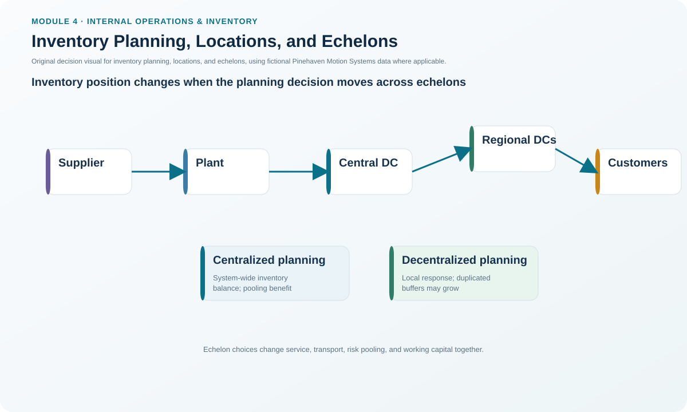
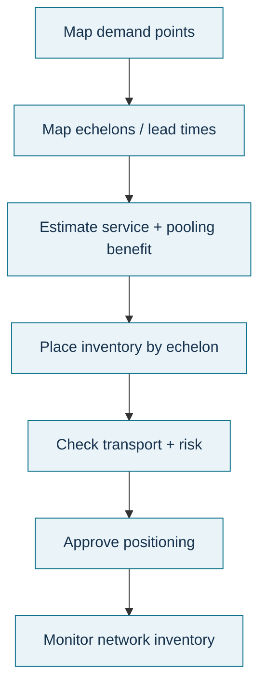

# 3. Inventory Planning, Locations, and Echelons

## Learning objectives

After this topic, you should be able to:

- distinguish centralized, decentralized, and hybrid inventory planning;
- explain why the number of facilities is not the same as the number of echelons;
- evaluate inventory placement using service, pooling, lead time, transportation, and risk; and
- explain how echelon thinking changes the view of inventory at a node.

## Concept in plain English

Inventory planning decides **where stock should be positioned and how much should be held there**. Centralized planning makes replenishment decisions from a common coordinating point. Decentralized planning lets each downstream location decide for itself. Hybrid planning deliberately combines the two.

An **echelon** is a structural level in the network, such as suppliers, manufacturing, distribution centers, and retailers. Ten warehouses at the same structural level can still be one echelon. Each added echelon can improve buffering, consolidation, break-bulk, sorting, seasonal storage, or reverse-logistics capability, but it also adds operating cost, inventory, and time.

Echelon thinking also prevents a local planner from seeing only the stock physically inside one building. An echelon inventory view can include inventory at that point, downstream locations, and relevant in-transit stock, depending on the policy definition.

## Why it matters

A local service problem can tempt every node to add stock independently. That often produces high network inventory without solving the real cause. Centralizing everything can create the opposite problem: efficient global totals but poor response to local demand. Inventory positioning is therefore a network design decision as much as a warehouse decision.

## Decision model and workflow

### Evidence retained through the workflow

Retain demand by market, service target, node/echelon map, lead times, transportation cadence, existing inventory by location, in-transit stock, pooling assumptions, handling/storage cost, local constraints, risk exposure, decision rights, and review triggers.

## Practical process flow

## Realistic example — Pinehaven Motion Systems

Pinehaven currently holds PH-SD500 finished units at regional distribution centers because customer response is important. Long-lead purchased components such as PH-PWR220 and PH-MCU88 are controlled centrally, while the critical low-value PH-FUSE7 is positioned line-side.

That does **not** mean every item needs the same network pattern. Finished-goods stock close to customers can shorten response but duplicates inventory across regions. Central component stock can pool uncertainty but may increase internal replenishment time. Line-side stock helps production continuity but increases the need for accurate transaction control.

The fictional item master is available in [`inventory-item-master.csv`](../../assets/data/module-4/inventory-item-master.csv).

**Decision insight.** The location of inventory should be justified by the service or flow purpose it performs. A location is not automatically valuable merely because stock has historically been kept there.

## Applied decision artifact — inventory-positioning record

For each material family, record:

1. customer or production demand points;
2. network echelons and physical locations;
3. replenishment and transit lead times;
4. service consequence of centralization;
5. pooling benefit of centralization;
6. transportation or consolidation effect;
7. risk or regulatory constraint;
8. recommended stocking echelon and owner.

The approval should state both **where stock is held** and **who is allowed to change the policy**.

## Decision logic

- Map actual demand/consumption points first.
- Separate physical sites from structural echelons.
- Compare local responsiveness with network pooling.
- Include in-transit inventory rather than measuring only warehouse balances.
- Test whether consolidation, break-bulk, cross-docking, or postponement can achieve service with less stock.
- Choose centralized, decentralized, or hybrid decision rights deliberately.
- Reassess when demand geography, lead time, service requirements, or transportation economics change.

## Trade-offs

Centralized planning can lower total inventory and improve network coordination, but can react slowly to local conditions. Decentralized planning uses local knowledge and autonomy but can amplify demand signals and duplicate buffers. Extra echelons can improve service or transportation efficiency, but each adds cost and cycle time. Fewer echelons simplify the network but may lengthen final response.

## Commonly confused with

An **echelon** is a level of nodes, not an individual facility. Seven suppliers with seven warehouses may still represent one supplier echelon. Inventory **visibility** is also not the same as centralized control; a company may allow local decisions while sharing network-wide inventory information.

## Common mistakes

- Counting facilities instead of levels when describing echelons.
- Optimizing each warehouse independently.
- Excluding in-transit stock from network inventory.
- Centralizing because “less inventory is always better” without testing service impact.
- Decentralizing without common demand visibility, creating bullwhip behavior.

## Original knowledge check

**Question.** A network contains a supplier level, one manufacturing plant, three regional distribution centers, and 18 retail stores. How many echelons are described?

A. 4

B. 22

C. 23

D. 18

Answer and rationale

### Correct answer

**A. 4**

### Why it is correct

The structural levels are supplier, manufacturing, distribution center, and retail. Multiple nodes within a level do not create additional echelons.

### Why the other answers are wrong

B, C, and D count facilities or subsets of facilities rather than structural levels.

## Practitioner perspective

In an ERP/network-planning environment, distinguish a **stocking location** from the **planning level** and from the **ownership of the replenishment decision**. Three different system objects may be involved even when the business casually calls all of them “the warehouse.”

## Related concepts

- [Inventory Management Roles and Policy](./04-inventory-management-roles-and-policy.md)
- [Time-Phased Replenishment and DDMRP](./10-time-phased-replenishment-and-ddmrp.md)
- [Product Traceability, Configuration, and Chain of Custody](./12-product-traceability-configuration-and-chain-of-custody.md)

---

[Previous: Inventory Cost Structure](./02-inventory-cost-structure.md) · [Section overview](./README.md) · [Next: Inventory Management Roles and Policy](./04-inventory-management-roles-and-policy.md)
