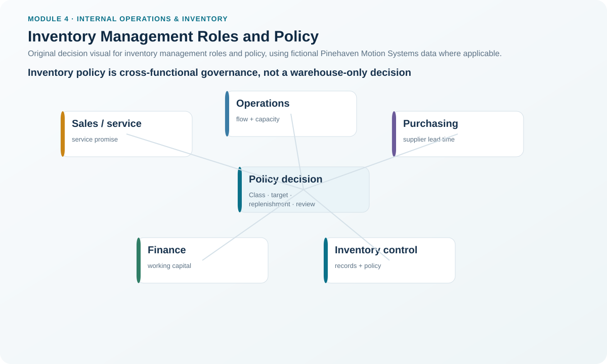
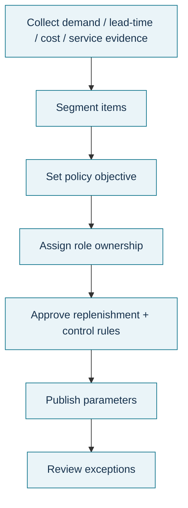

# 4. Inventory Management Roles and Policy

## Learning objectives

After this topic, you should be able to:

- explain why inventory policy requires cross-functional governance;
- identify the major factors that influence stocking rules;
- distinguish inventory planning, management, and control; and
- translate strategic inventory choices into controlled operating rules.

## Concept in plain English

Inventory policy converts management intent into repeatable rules. It can specify who makes replenishment decisions, where inventory is positioned, how much to order, when to order, how exceptions are handled, how service buffers are set, and which items require tighter controls.

Different functions naturally see inventory differently. Purchasing wants reliable material at a favorable total cost. Manufacturing wants stable flow. Finance wants disciplined working capital. Sales wants availability. Logistics wants workable storage and transport. A useful policy does not pretend these interests are identical; it defines how they are balanced.

The key policy inputs in this section are customer demand, planning horizon, replenishment lead time, product variety, inventory costs, and customer-service requirements.

## Why it matters

Without formal policy, stock levels often become the accumulated history of local decisions. A planner increases a buffer after a shortage; nobody removes it later. Sales asks for service stock in every region; finance cuts all C items uniformly; purchasing accepts a large minimum order without revisiting obsolescence. The result may be internally inconsistent even when each individual action looked reasonable.

## Decision model and workflow

### Evidence retained through the workflow

Retain demand/service assumptions, lead-time evidence, product-life-cycle state, cost basis, location/echelon, class/criticality, stocking method, order trigger, exception thresholds, owner, approver, and review date.

## Practical process flow

## Realistic example — Pinehaven Motion Systems

PH-FUSE7 has only **$24,750** of annual monetary volume in the fictional [`inventory-item-master.csv`](../../assets/data/module-4/inventory-item-master.csv). By pure value classification it falls in Class C. Pinehaven nevertheless assigns a **policy class A** because a shortage can stop production and the illustrative lead time is ten weeks.

That is a controlled policy override, not a failure of ABC analysis. ABC value is evidence; it is not the only permitted business criterion. The override should name the criticality reason, approval owner, and review trigger so it cannot become an unexplained permanent exception.

PH-LUBE02 presents the opposite challenge. It is MRO inventory with relatively low annual value. The organization still needs control, but applying the same counting, forecasting, and approval effort used for a critical electronic component could cost more than the risk it manages.

## Applied decision artifact — policy control matrix

| Policy field | Example decision |
|---|---|
| Planning ownership | Central, local, or hybrid |
| Stocking locations | Plant, central warehouse, regional DC, line-side |
| Classification | Value class plus approved criticality override |
| Order quantity rule | L4L, FOQ, EOQ, target level, or other |
| Order timing rule | Order point, periodic review, min-max, TPOP, other |
| Service buffer | Safety stock, safety lead time, or explicit alternative |
| Exception threshold | Conditions requiring planner/manager review |
| Review trigger | Lead-time shift, service miss, demand change, life-cycle event |

The completed policy should make the normal action and the exception action equally clear.

## Decision logic

- Start with the customer or production service requirement.
- Determine the planning horizon and replenishment constraints.
- Consider product variety and life-cycle exposure.
- quantify the relevant inventory and service costs.
- Select a stocking and replenishment rule.
- Define who can override it and on what evidence.
- Review performance against the policy rather than changing settings after every isolated event.

## Trade-offs

Tight controls reduce risk but consume administrative effort. High service targets can require more inventory or faster/expensive response. Standard policy improves consistency but may not fit critical or unusual items. Frequent local overrides increase responsiveness but can destroy network discipline. A good policy therefore combines standard rules with explicit exception governance.

## Commonly confused with

**Inventory planning** determines desired inventory levels and related quantities/buffers. **Inventory management** is the broader management of planning and controlling inventory. **Inventory control** focuses on maintaining desired levels and conditions through operating controls and accurate records. In practice the responsibilities overlap, but the decision purpose should remain clear.

## Common mistakes

- Treating policy as a one-time parameter-setting project.
- Giving every item the same service target.
- Applying ABC value classes without criticality review.
- Creating exceptions without expiry/review dates.
- Letting local workarounds become hidden policy.
- Changing replenishment settings after one unusual demand event.

## Original knowledge check

**Question.** A low-value fuse can stop shipment of a high-value finished drive if it is unavailable. What is the strongest policy response?

A. Keep it Class C in every control because its annual dollar usage is low.

B. Delete it from ABC analysis.

C. Retain the value classification but document a tighter policy control based on criticality.

D. Set the highest possible safety stock with no review.

Answer and rationale

### Correct answer

**C. Retain the value classification but document a tighter policy control based on criticality.**

### Why it is correct

The value calculation remains useful evidence, while the policy explicitly captures the operational consequence that value alone misses.

### Why the other answers are wrong

- **A** ignores criticality.
- **B** removes useful classification evidence.
- **D** replaces one uncontrolled rule with another and ignores cost/review.

## Practitioner perspective

In SAP or another ERP, inventory policy may be distributed across MRP type, lot-size procedure, safety stock, safety time, reorder point, service level, planning calendar, source, storage location, and custom controls. Governance therefore needs a business policy register above the system fields so the reason for each parameter is preserved.

## Related concepts

- [ABC Classification and Pareto-Based Control](./06-abc-classification-and-pareto-based-control.md)
- [Ordering Systems](./09-ordering-systems-order-point-periodic-review-and-min-max.md)
- [Safety Stock and Safety Lead Time](./11-safety-stock-and-safety-lead-time.md)

---

[Previous: Inventory Planning, Locations, and Echelons](./03-inventory-planning-locations-and-echelons.md) · [Section overview](./README.md) · [Next: Aggregate and Item Inventory Management](./05-aggregate-and-item-inventory-management.md)
