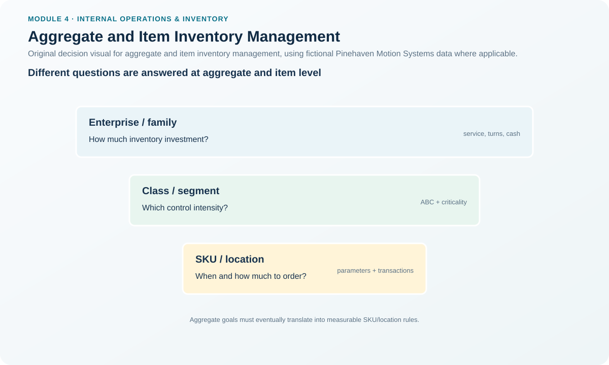
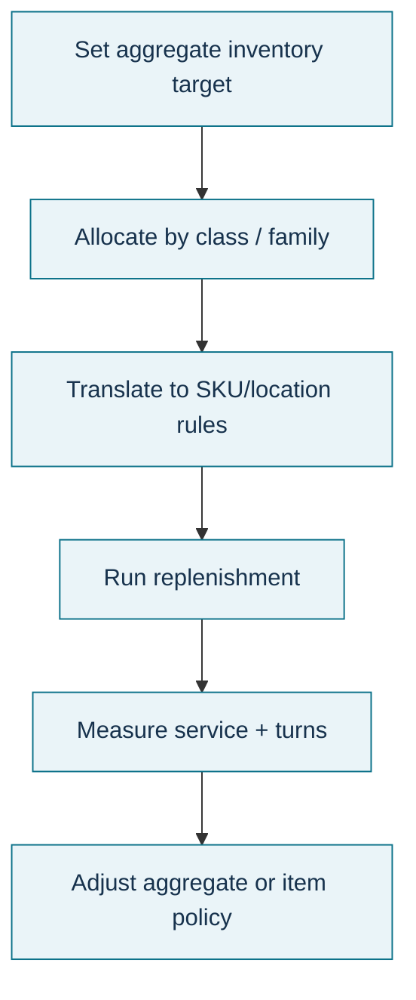

# 5. Aggregate and Item Inventory Management

## Learning objectives

After this topic, you should be able to:

- explain why inventory must be managed at both aggregate and item levels;
- identify useful ways to aggregate inventory for planning;
- connect aggregate objectives with SKU-level replenishment rules; and
- recognize the danger of optimizing one SKU or function while worsening total performance.

## Concept in plain English

Inventory has two management views that must work together.

**Aggregate inventory management** asks strategic and financial questions about groups of inventory: How much total investment is appropriate? Which types or families should be held? Are service, operating efficiency, and inventory-investment objectives in balance? How is inventory flowing through the network?

**Item inventory management** converts that direction into SKU-level operating rules: when to order, how much to order, how tightly to control an item, and which replenishment logic to apply.

Inventory can be aggregated by demand pattern, production process, stage of production, product/SKU family, distribution pattern, or relative value. Aggregation reduces detail and often smooths variability, making it useful for S&OP and financial planning. Item-level control restores the detail needed to actually run the operation.

## Why it matters

A company can hit an aggregate inventory target while being badly imbalanced underneath it: too much of slow-moving items and too little of critical items. The reverse can also happen. Individual planners can optimize their own SKUs so aggressively that the enterprise misses working-capital or warehouse-capacity objectives.

Good inventory management therefore uses a **closed loop**: aggregate goals guide item policies, and item-level performance feeds back to the aggregate view.

## Decision model and workflow

### Evidence retained through the workflow

Retain the aggregation basis, aggregate inventory target, service target, cost/working-capital objective, item classification, SKU-level replenishment rules, exception list, variance from aggregate target, and corrective action.

## Practical process flow

## Realistic example — Pinehaven Motion Systems

Pinehaven can look at its inventory by production stage using the fictional [`inventory-item-master.csv`](../../assets/data/module-4/inventory-item-master.csv):

- raw material such as PH-SHEET14;
- manufactured and purchased components such as PH-ENC500 and PH-PWR220;
- finished goods such as PH-SD500;
- MRO such as PH-LUBE02.

That aggregate view helps management discuss working capital, space, and broad service exposure. It does not tell the planner whether PH-PWR220 should be replenished using EOQ, whether PH-FUSE7 needs a criticality override, or whether PH-CNK500 should use periodic review.

At item level, those rules differ because annual usage, value, lead time, and service consequence differ.

**Decision insight.** The aggregate target is a boundary condition, not an order proposal. Item rules implement the strategy, while aggregate performance tests whether those rules collectively deliver the desired result.

## Applied decision artifact — aggregate-to-item bridge

| Layer | Decision question | Example output |
|---|---|---|
| Enterprise / supply chain | How much inventory investment supports strategy and service? | Working-capital and service target |
| Family / stage / network | Where is inventory concentrated and why? | Component, FG, MRO, regional inventory plan |
| Class | Which items deserve tighter control? | ABC + criticality policy |
| Item | When/how much should be replenished? | Order point, EOQ, periodic review, min-max |
| Exception | What is not behaving as policy expects? | Stockout, excess, count error, lead-time shift |

Use the bridge in both directions: strategy down to execution and performance back up to strategy.

## Decision logic

- Choose an aggregation basis that supports a decision rather than merely creating a report.
- Set aggregate objectives for service, operating efficiency, and inventory investment.
- Translate those objectives into class/item policies.
- Track item-level exceptions and their aggregate financial/service effect.
- Rebalance rules when the item population no longer supports the aggregate target.

## Trade-offs

Aggregation improves clarity and reduces noise, but can conceal individual shortages or obsolete stock. Item-level optimization improves operational precision but can overwhelm management with detail and encourage local optimization. The right balance depends on decision horizon and audience.

## Commonly confused with

**Aggregate inventory management** is not simply “total inventory value.” It can group inventory by demand pattern, production process, flow stage, family, distribution pattern, or relative value. **Item inventory management** is not merely cycle counting; it includes replenishment and control rules for specific SKUs.

## Common mistakes

- Setting a company-wide inventory reduction percentage and applying it uniformly to every SKU.
- Using aggregate service performance to assume every critical item is healthy.
- Managing each item independently without checking the total working-capital result.
- Aggregating so broadly that different demand patterns and service requirements disappear.
- Treating one inventory target as permanent despite product-mix changes.

## Original knowledge check

**Question.** Pinehaven meets its total inventory-dollar target, but critical component shortages repeatedly stop final assembly. What does this indicate?

A. Aggregate inventory management is sufficient because the financial target was met.

B. Item-level rules and exceptions need review even though the aggregate target is met.

C. The company should stop using aggregate measures.

D. Every item should receive the same safety stock.

Answer and rationale

### Correct answer

**B. Item-level rules and exceptions need review even though the aggregate target is met.**

### Why it is correct

The aggregate result can hide the wrong inventory mix. Item-level availability and replenishment controls still have to support operations.

### Why the other answers are wrong

- **A** ignores the operating failure.
- **C** discards a useful strategic view rather than connecting the two levels.
- **D** ignores different usage, lead time, value, and criticality.

## Practitioner perspective

Executives often ask for one inventory number while planners work with thousands of materials. Build reporting that lets management drill from the aggregate target into the small number of item-level drivers causing the variance. That is more useful than a broad reduction mandate.

## Related concepts

- [ABC Classification and Pareto-Based Control](./06-abc-classification-and-pareto-based-control.md)
- [Inventory and the Financial Statements](./07-inventory-and-the-financial-statements.md)
- [Inventory Management Roles and Policy](./04-inventory-management-roles-and-policy.md)

---

[Previous: Inventory Management Roles and Policy](./04-inventory-management-roles-and-policy.md) · [Section overview](./README.md) · [Next: ABC Classification and Pareto-Based Control](./06-abc-classification-and-pareto-based-control.md)
