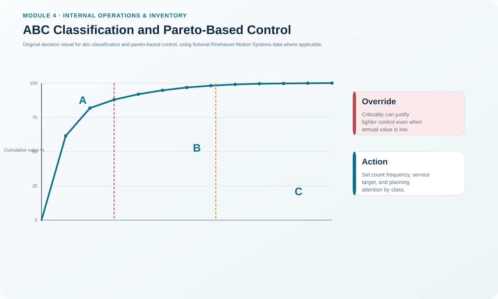
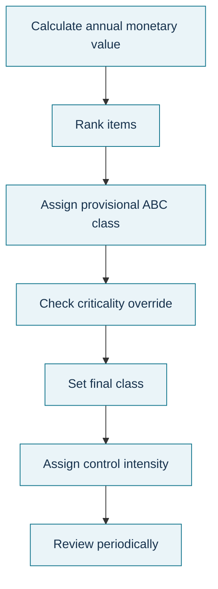

# 6. ABC Classification and Pareto-Based Control

## Learning objectives

After this topic, you should be able to:

- calculate annual monetary volume for an item;
- sort items into a Pareto-style value view before assigning controls;
- explain why ABC percentages are guidelines rather than fixed laws; and
- apply criticality or other business criteria without destroying the underlying value analysis.

## Concept in plain English

ABC classification directs management effort toward the relatively small number of items that account for a large share of inventory value or another chosen criterion.

A common value basis is:

```text
Annual Monetary Volume = Annual Usage × Unit Value
```

Items are sorted from highest to lowest annual monetary volume. The cumulative share is then reviewed and categories are assigned. Class A normally receives the tightest attention, B moderate attention, and C simpler controls.

The important point is **sort first, classify second**. ABC is a prioritization tool, not a requirement that exactly 20% of part numbers must always contain exactly 80% of value. Other criteria such as margin, turnover, quality risk, regulatory exposure, or operational criticality can modify policy.

## Why it matters

Applying the same forecasting, counting, security, supplier-management, and replenishment effort to every SKU wastes resources. But pure dollar value can also mislead: a 55-cent fuse can stop a multimillion-dollar production line. The best use of ABC is to make control intensity visible while allowing documented exceptions.

## Decision model and workflow



### Evidence retained through the workflow

Retain annual usage, unit value, annual monetary volume, descending sort order, cumulative percentage, value class, any policy override, override reason, approver, and review date.

## Practical process flow



## Realistic example — Pinehaven Motion Systems

The fictional [`inventory-item-master.csv`](../../assets/data/module-4/inventory-item-master.csv) contains twelve items.

For PH-SD500:

```text
Annual monetary volume
= 18,000 units × $510/unit
= $9,180,000
```

For PH-PWR220:

```text
18,000 × $168 = $3,024,000
```

The total annual monetary volume across the illustrative set is **$14,935,710**. PH-SD500 alone represents about **61.46%** of that total, and PH-SD500 plus PH-PWR220 represent about **81.71%**.

The analytical sequence must be sorted by annual monetary volume. The CSV is a working item-master extract, not a guaranteed display sort. For example, PH-PKG500 has $28,800 annual monetary volume and therefore belongs ahead of PH-FUSE7 at $24,750 when constructing the Pareto sequence.

PH-FUSE7 demonstrates a policy override: its value class is C, but Pinehaven assigns policy class A because the item is operationally critical.

## Applied decision artifact — ABC control-policy table

| Class / override | Typical control intent | Example |
|---|---|---|
| A | Tight review, strong accuracy, close supplier attention | PH-SD500, PH-PWR220 |
| B | Moderate review and control | PH-MCU88, PH-PCB210 |
| C | Simpler controls where risk allows | PH-CNK500, PH-PKG500 |
| Criticality override | Control intensity raised despite value class | PH-FUSE7 |

The table should describe control consequences, not merely labels.

## Decision logic

- Select the classification criterion and period.
- Compute the criterion consistently for every item.
- Sort descending.
- Calculate cumulative share.
- Assign provisional classes based on the organization's policy.
- Review operational, regulatory, quality, or service criticality.
- Document any override without rewriting the original value evidence.
- Link each final policy class to concrete controls.

## Trade-offs

Tighter control improves accuracy and service protection but costs planner, counting, security, and supplier-management effort. Looser controls reduce administration but may be inappropriate for critical items. Too many overrides make the ABC scheme meaningless; too few can make the scheme operationally dangerous.

## Commonly confused with

**ABC value class** is the result of the selected classification criterion. **Policy class** is the control decision after approved business overrides. They may be identical for most items, but keeping both fields preserves analytical transparency.

## Common mistakes

- Assigning A/B/C before sorting the population.
- Treating 80/15/5 as mandatory exact thresholds.
- Using unit price instead of annual monetary volume.
- Ignoring a low-value item that can stop operations.
- Changing the value class to hide a criticality override rather than documenting the override separately.
- Applying expensive A-item controls to the entire inventory population.

## Original knowledge check

**Question.** A $1 component has low annual monetary volume but is the only approved component for a safety-critical assembly. What is the best use of ABC?

A. Force it to remain under the loosest C controls.

B. Exclude it from the item master.

C. Keep its value evidence and document a tighter control override for criticality.

D. Change its unit price so the ABC result becomes A.

<details>
<summary>Answer and rationale</summary>

### Correct answer

**C. Keep its value evidence and document a tighter control override for criticality.**

### Why it is correct

ABC prioritizes by the selected criterion, while policy can account for an additional material business consequence.

### Why the other answers are wrong

A ignores criticality, B removes needed control, and D corrupts the economic data instead of governing the exception.

</details>

## Practitioner perspective

Do not let the ERP ABC field become a mysterious inherited code. Store the classification basis and date. If an override drives counting or safety policy, keep the override reason in governance documentation or a controlled master-data attribute.

## Related concepts

- [Inventory Management Roles and Policy](./04-inventory-management-roles-and-policy.md)
- [Inventory Accuracy, Physical Inventory, and Cycle Counting](./13-inventory-accuracy-physical-inventory-and-cycle-counting.md)
- [Aggregate and Item Inventory Management](./05-aggregate-and-item-inventory-management.md)

---

[Previous: Aggregate and Item Inventory Management](./05-aggregate-and-item-inventory-management.md) · [Section overview](./README.md) · [Next: Inventory and the Financial Statements](./07-inventory-and-the-financial-statements.md)
