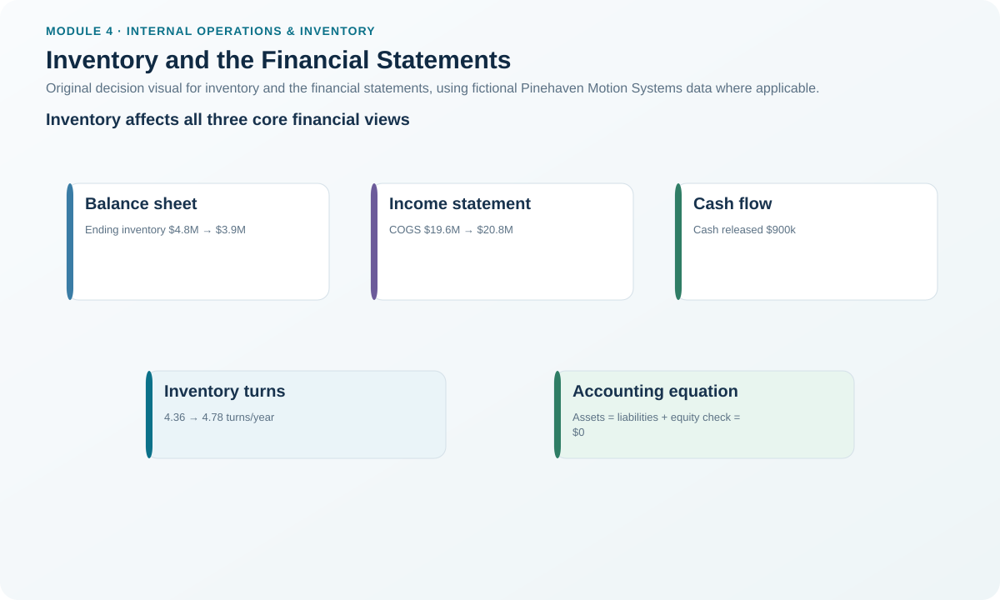
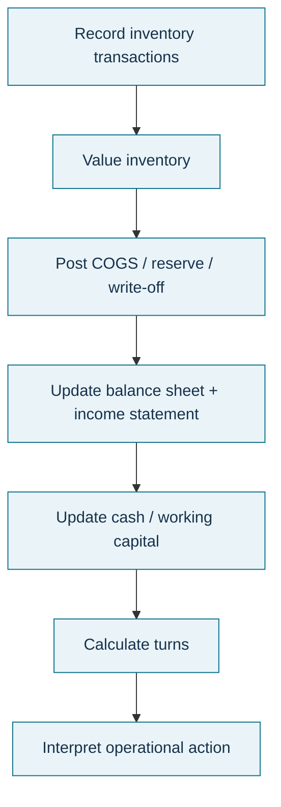

# 7. Inventory and the Financial Statements

## Learning objectives

After this topic, you should be able to:

- connect operational inventory decisions to the balance sheet, income statement, and cash flow;
- calculate simple average inventory and inventory turnover;
- explain the accounting equation and why inventory reduction can require finance coordination; and
- distinguish physical inventory reduction from accounting valuation choices.

## Concept in plain English

Inventory is physical material, but it is also financial value tied up in the operating system.

Raw materials, work in process, and finished goods are generally carried as inventory assets until the related goods are sold or otherwise adjusted. In the Module 4 framing, MRO is treated as a period expense rather than saleable inventory on the balance sheet. When saleable inventory is sold, the relevant product costs flow through cost of goods sold. Unsaleable inventory may require a reserve, write-down, or write-off under the organization's accounting rules.

A balance sheet must satisfy:

```text
Assets = Liabilities + Owners' Equity
```

A simple average-inventory estimate is:

```text
Average Inventory = (Beginning Inventory + Ending Inventory) / 2
```

One common inventory-turnover measure is:

```text
Inventory Turns = Annual COGS / Average Inventory
```

Always document the cost basis and period used.

## Why it matters

An operations team can propose a sensible physical inventory reduction that still creates a timing, covenant, write-off, or cash-planning issue for finance. Conversely, finance can see inventory only as tied-up cash and miss the service or continuity purpose it performs. Inventory decisions need a shared operating-financial view.

## Decision model and workflow



### Evidence retained through the workflow

Retain beginning/ending inventory value, valuation basis, reserves, write-offs, COGS basis, average-inventory method, turns calculation, cash effect, asset/liability/equity effects, covenant constraints, finance approval, and timing.

## Practical process flow



## Realistic example — Pinehaven Motion Systems

Pinehaven's fictional financial dataset is [`inventory-financials.csv`](../../assets/data/module-4/inventory-financials.csv).

For FY2027:

```text
Average inventory
= ($4.2m + $4.8m) / 2
= $4.5m

Inventory turns
= $19.6m / $4.5m
= 4.356 turns
```

For the illustrative FY2028 improvement plan:

```text
Average inventory
= ($4.8m + $3.9m) / 2
= $4.35m

Inventory turns
= $20.8m / $4.35m
≈ 4.782 turns
```

The plan also identifies **$900,000 of cash released versus the current state**, while inventory reserve and write-off amounts fall in the scenario. In both rows, total assets equal liabilities plus owners' equity.

The calculations show improvement, but they do not prove the plan is safe. Pinehaven would still need to verify service performance, one-time accounting effects, tax/accounting rules, and any lender or policy constraints.

## Applied decision artifact — financial bridge for an inventory initiative

| Operational proposal | Financial question |
|---|---|
| Reduce slow-moving stock | Is a reserve/write-off required? |
| Lower average inventory | How much cash is released and when? |
| Increase turns | Is COGS/average-inventory basis consistent? |
| Build anticipation stock | How will cash and working capital be funded? |
| Dispose obsolete stock | What recovery, processing cost, and write-off are recorded? |
| Change valuation method | Is this an accounting-policy decision rather than an operating reduction? |

Require finance sign-off before a material inventory action is represented as realized financial value.

## Decision logic

- Separate physical quantity from accounting value.
- Confirm the valuation basis and financial-reporting rules with finance.
- Calculate average inventory on a consistent period basis.
- Use turns as a velocity/control indicator, not as a standalone goal.
- Evaluate cash, service, reserve/write-off, and covenant effects together.
- Phase major reductions when immediate disposal or write-off would create unacceptable financial effects.

## Trade-offs

Higher turns generally mean less inventory relative to flow, but pushing turns too high can create shortages and expediting. Building inventory can protect service but consume cash. Writing obsolete material off cleans the operating picture but can create an immediate accounting impact. A valuation method changes reported cost timing; it does not physically remove one unit from a warehouse.

## Commonly confused with

**Inventory reduction** changes the physical or owned stock position. **Inventory valuation** determines the accounting value assigned under approved rules. FIFO, LIFO, weighted average, specific identification, and standard costing are accounting contexts; this lesson does not treat choosing among them as an operations optimization exercise.

## Common mistakes

- Claiming cash savings from inventory reduction without checking timing and write-offs.
- Calculating turns with revenue in one period and cost-based inventory in another.
- Assuming high turns are always better.
- Ignoring obsolete or damaged stock included in reported balances.
- Treating MRO, finished goods, and WIP as identical accounting categories.
- Changing an accounting assumption to make an operational KPI look better.

## Original knowledge check

**Question.** Beginning inventory is $3.6 million, ending inventory is $4.0 million, and annual COGS is $19.0 million. Using the simple two-point average, what are inventory turns?

A. 4.75

B. 5.00

C. 5.28

D. 9.50

<details>
<summary>Answer and rationale</summary>

### Correct answer

**B. 5.00**

### Why it is correct

Average inventory is `(3.6 + 4.0) / 2 = 3.8 million`; `19.0 / 3.8 = 5.00` turns.

### Why the other answers are wrong

The other choices use the beginning or ending balance alone or an incorrect denominator rather than the stated average-inventory method.

</details>

## Practitioner perspective

A supply-chain business case should show operational units and financial value side by side. Finance should be able to trace how a proposed reduction in pieces changes average inventory, reserves, cash, COGS timing, and any contractual ratio—not simply receive a single “working capital savings” number.

## Related concepts

- [Inventory Cost Structure](./02-inventory-cost-structure.md)
- [Aggregate and Item Inventory Management](./05-aggregate-and-item-inventory-management.md)
- [End-of-Life, Obsolescence, Returns, and Disposition](./14-end-of-life-obsolescence-returns-and-disposition.md)

---

[Previous: ABC Classification and Pareto-Based Control](./06-abc-classification-and-pareto-based-control.md) · [Section overview](./README.md) · [Next: Order Quantities — L4L, FOQ, and EOQ](./08-order-quantities-lot-for-lot-foq-and-eoq.md)
