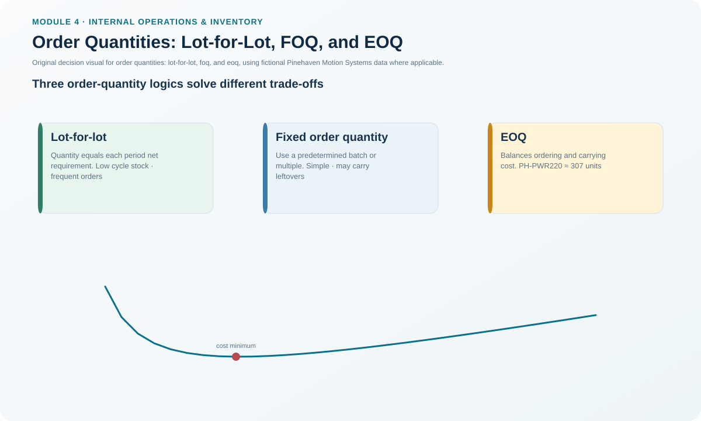
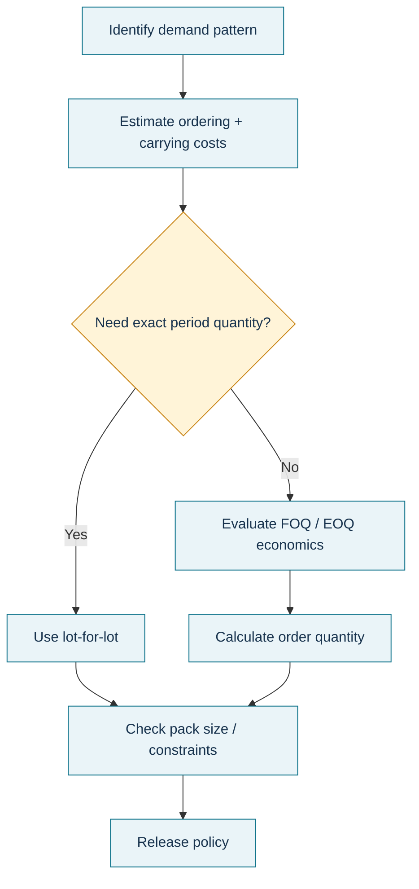

# 8. Order Quantities: Lot-for-Lot, FOQ, and EOQ

## Learning objectives

After this topic, you should be able to:

- distinguish L4L replenishment from fixed-quantity and EOQ-based lot sizing;
- calculate EOQ using the stated assumptions and units;
- explain why EOQ is a model rather than a universal order rule; and
- select a lot-sizing approach that fits the demand and operating constraint.

## Concept in plain English

Order-quantity methods answer **how much to replenish when an order is needed**.

**Lot-for-lot (L4L)** replenishes the net quantity needed for a period. It is especially natural for dependent demand when ordering excess components would merely create unnecessary inventory.

**Fixed order quantity (FOQ)** uses a predetermined quantity or multiples of it. It is useful when packaging, container, process, batch, or economic constraints make variable quantities impractical.

**Economic order quantity (EOQ)** is a refined fixed-quantity model that balances modeled annual ordering cost against modeled annual carrying cost.

Using the notation in this repository:

```text
EOQ = √(2 × A × S / (i × c))
```

where:
- `A` = annual demand/usage in units;
- `S` = ordering or setup cost per order;
- `i` = annual carrying-rate decimal;
- `c` = unit cost.

## Why it matters

Ordering more than needed can lower the number of order events but increase average inventory. Ordering exactly what is needed can reduce stock but create too many setups or shipments. EOQ provides a useful reference point when its simplifying assumptions are reasonably applicable.

## Decision model and workflow



### Evidence retained through the workflow

Retain demand type, annual usage, unit cost, ordering/setup cost, carrying-rate basis, batch/container constraints, supplier MOQ, receipt pattern, demand/lead-time stability, calculated quantity, selected policy quantity, and reason for any override.

## Practical process flow



## Realistic example — Pinehaven Motion Systems

For PH-PWR220, the locked fictional dataset specifies:

- annual demand `A = 12,000 units`;
- ordering cost `S = $145/order`;
- unit cost `c = $168`;
- annual carrying rate `i = 22%`.

The annual carrying cost per unit is:

```text
0.22 × $168 = $36.96
```

Then:

```text
EOQ = √[(2 × 12,000 × 145) / 36.96]
    = √94,155.84...
    ≈ 306.85 units
```

At this quantity, the modeled annual ordering cost and modeled annual cycle-stock carrying cost are both approximately **$5,670.56**, which is the balancing logic behind the basic model.

The source data are in [`replenishment-models.csv`](../../assets/data/module-4/replenishment-models.csv), and the formula is also in the [internal operations formula sheet](../../calculations/internal-operations/formula-sheet.md).

## EOQ assumptions and boundary

Use EOQ carefully. The simple model assumes, among other things, reasonably known/constant demand and lead time, all-at-once replenishment, no quantity discount in the model, ordering and carrying cost as the modeled variable costs, and no stockout if replenishment occurs as planned.

Real operations often violate one or more assumptions. That does not make the model useless; it means the calculated EOQ is evidence to compare with constraints such as MOQ, pallet size, shelf life, variability, capacity, and transportation.

## Applied decision artifact — lot-size selection record

| Question | L4L | FOQ | EOQ |
|---|---|---|---|
| Quantity follows net requirement? | Yes | No | No |
| Fixed batch/container needed? | Poor fit | Strong fit | Possible override |
| Cost-balance reference needed? | Not primary | May be arbitrary | Core purpose |
| Excess-inventory risk | Low | Can be higher | Modeled balance |
| Assumption sensitivity | Demand timing | Fixed-quantity validity | Demand/cost/lead-time model assumptions |

Record the calculated quantity and the **implemented quantity** separately.

## Decision logic

- Determine whether demand is dependent or independent and whether exact-period netting is valuable.
- Check non-negotiable batch, container, MOQ, shelf-life, or process constraints.
- If EOQ is appropriate, use consistent annual units and cost bases.
- Compare the result with operational constraints and service requirements.
- Document any rounding or override rather than presenting the formula result as an automatic order.

## Trade-offs

L4L minimizes intentional excess from lot sizing but can increase order/setup frequency. FOQ is simple and compatible with fixed batches but may create unnecessary stock. EOQ makes the ordering/carrying trade-off explicit but simplifies reality and does not directly solve timing, uncertainty, or service requirements.

## Commonly confused with

EOQ answers **how much** under a particular economic model. An **order point** answers **when** to reorder. A complete replenishment policy may use both an order trigger and an order quantity method.

## Common mistakes

- Using a carrying-rate percentage as though it were dollars per unit.
- Mixing monthly demand with annual carrying cost.
- Assuming EOQ already includes safety stock.
- Ignoring MOQ, container, perishability, or capacity constraints.
- Treating EOQ as exact even when inputs are rough estimates.
- Using FOQ for every dependent-demand component merely for administrative convenience.

## Original knowledge check

**Question.** A dependent-demand component is needed in irregular quantities by period, has no minimum batch constraint, and excess stock has little value. Which lot-sizing logic is the strongest starting point?

A. Lot-for-lot

B. A very large FOQ

C. EOQ regardless of timing

D. Maximum-level replenishment

<details>
<summary>Answer and rationale</summary>

### Correct answer

**A. Lot-for-lot**

### Why it is correct

When the requirement is calculated and batch size can vary, replenishing the net requirement avoids intentionally accumulating unnecessary dependent-demand inventory.

### Why the other answers are wrong

B intentionally creates excess, C may ignore time-phased dependent demand and assumptions, and D is a different target-level concept rather than the best starting lot-sizing logic.

</details>

## Practitioner perspective

ERP systems often offer many lot-sizing procedures. Do not select one because its code is familiar. The business decision should state whether the driver is exact net need, manufacturing batch, supplier MOQ, transport unit, or economic balance. Then map that rule to the system.

## Related concepts

- [Ordering Systems: Order Point, Periodic Review, and Min-Max](./09-ordering-systems-order-point-periodic-review-and-min-max.md)
- [Inventory Cost Structure](./02-inventory-cost-structure.md)
- [Time-Phased Replenishment and DDMRP](./10-time-phased-replenishment-and-ddmrp.md)

---

[Previous: Inventory and the Financial Statements](./07-inventory-and-the-financial-statements.md) · [Section overview](./README.md) · [Next: Ordering Systems](./09-ordering-systems-order-point-periodic-review-and-min-max.md)
