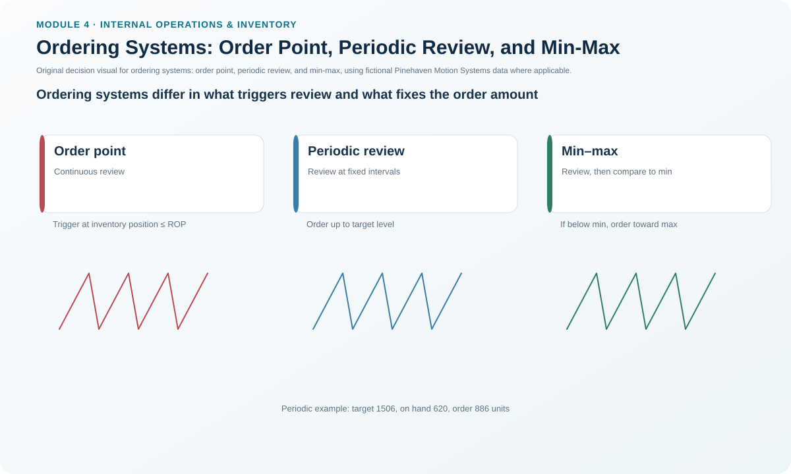
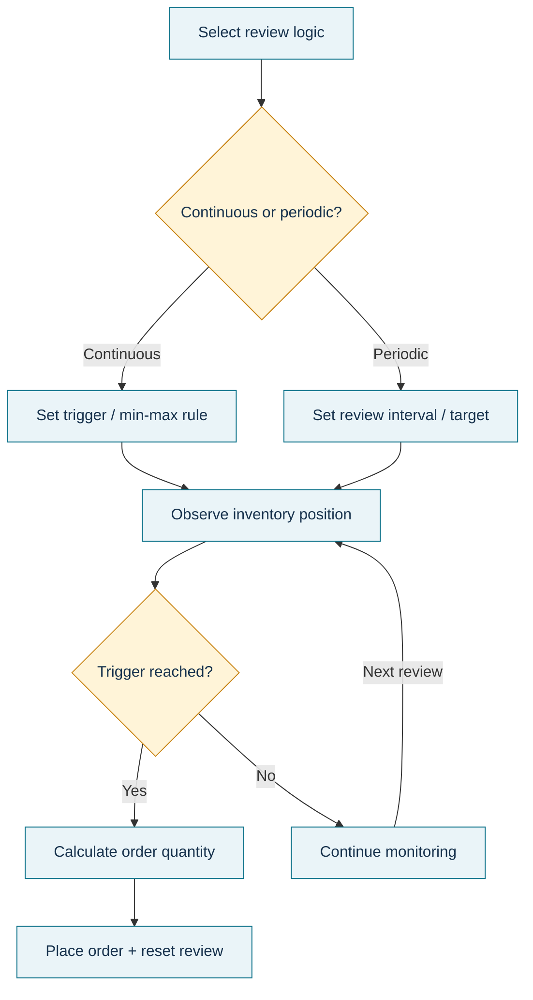

# 9. Ordering Systems: Order Point, Periodic Review, and Min-Max

## Learning objectives

After this topic, you should be able to:

- calculate a basic order point;
- calculate a periodic-review maximum level and order quantity;
- explain how min-max logic differs from order-point and periodic-review logic; and
- select a trigger method that matches monitoring capability, demand behavior, and storage constraints.

## Concept in plain English

Once an organization decides how much to order, it still needs a rule for **when replenishment should be triggered**.

An **order point system** continuously or frequently observes the inventory position and orders when it reaches a predefined trigger:

```text
Order Point = Demand During Lead Time + Safety Stock
```

A **periodic review system** checks the inventory position on a fixed schedule. The order quantity varies so inventory is raised toward a target maximum:

```text
Maximum Level = D × (T + L) + SS
Order Quantity = Maximum Level − Inventory On Hand
```

where `D` is demand per unit of time, `T` is the review interval, `L` is lead time, and `SS` is safety stock.

A **min-max system** uses lower and upper limits. When the observed position falls below the minimum, the system replenishes toward the maximum. Both timing and order amount can therefore vary.

## Why it matters

A good order quantity paired with the wrong trigger can still create shortages or excess. Slow-moving service parts may not behave well under a simple average-demand order point. A retail assortment may be easier to review on a calendar. A material with a hard storage ceiling may need an explicit maximum.

## Decision model and workflow



### Evidence retained through the workflow

Retain demand basis, lead time, safety stock, review interval, inventory-position definition, min/max settings if used, on-hand/on-order/backorder treatment, calculated trigger, calculated order quantity, implemented settings, and exception rules.

## Practical process flow



## Realistic example — Pinehaven Motion Systems

The locked [`replenishment-models.csv`](../../assets/data/module-4/replenishment-models.csv) contains three useful cases.

### PH-PWR220 — order point

```text
Demand per day = 48 units
Lead time = 15 days
Safety stock = 380 units

Order point
= (48 × 15) + 380
= 720 + 380
= 1,100 units
```

If Pinehaven uses this rule, the trigger is **1,100 units of the defined inventory position**. The EOQ calculation from the prior lesson can then be used separately as evidence for how much to order.

### PH-CNK500 — periodic review

```text
Demand per day = 72 units
Review interval = 10 days
Lead time = 8 days
Safety stock = 210 units

Maximum level
= 72 × (10 + 8) + 210
= 1,506 units

On hand at review = 620 units

Order quantity
= 1,506 − 620
= 886 units
```

### PH-FUSE7 — min-max

The selected policy in the dataset has:
- minimum = **700**
- maximum = **2,200**
- on hand = **650**

Since 650 is below the minimum, the selected min-max action is:

```text
2,200 − 650 = 1,550 units
```

The same dataset also contains generic periodic-review comparison fields for the item. Those are **not** the selected min-max order and should not be misreported as such.

## Applied decision artifact — ordering-system selection card

| Environment | Strong candidate | Main control question |
|---|---|---|
| Continuous visibility, stable average lead-time demand | Order point | Is the trigger updated when demand/LT changes? |
| Fixed review cadence, many items reviewed together | Periodic review | Is target level sufficient through review interval + LT? |
| Storage or policy ceiling important | Min-max | Are min/max levels evidence-based and monitored? |
| Lumpy dated demand | Consider TPOP | Is average-demand logic hiding future peaks? |

The next lesson covers TPOP and DDMRP context.

## Decision logic

- Define inventory position precisely.
- Decide whether the system observes continuously or on a fixed review calendar.
- Calculate the trigger/target using consistent time units.
- Include service buffer only once.
- Check storage, MOQ, shelf life, and transport constraints.
- Monitor actual stockouts and excess; revise settings when demand or lead time changes.

## Trade-offs

Order-point systems are responsive but require reliable ongoing inventory visibility. Periodic review reduces monitoring/administrative burden and can coordinate orders, but must cover demand through both the review interval and lead time. Min-max is intuitive and respects an upper target, but poor min/max settings can produce oscillation or hidden excess.

## Commonly confused with

**Order point** is a trigger. **EOQ** is a quantity model. They solve different parts of the replenishment decision. **Periodic review** has fixed review timing and variable quantity. **Min-max** triggers only after the minimum is crossed and replenishes toward a maximum.

## Common mistakes

- Using weekly demand with lead time expressed in days without conversion.
- Subtracting safety stock twice.
- Treating on-hand inventory as identical to inventory position when open supply or backorders matter.
- Calling the periodic-review comparison quantity a min-max order.
- Leaving order-point settings unchanged after demand or lead time shifts.
- Setting a maximum greater than physical or financial constraints allow.

## Original knowledge check

**Question.** Pinehaven reviews an item every 7 days. Demand is 20 units/day, lead time is 5 days, safety stock is 80 units, and on-hand inventory at review is 140 units. What is the periodic-review order quantity using the formula in this lesson?

A. 100

B. 180

C. 320

D. 460

<details>
<summary>Answer and rationale</summary>

### Correct answer

**B. 180**

### Why it is correct

Maximum level is `20 × (7 + 5) + 80 = 320`. Order quantity is `320 − 140 = 180`.

### Why the other answers are wrong

A, C, and D omit a portion of the protection interval, fail to subtract current stock, or combine the terms incorrectly.

</details>

## Practitioner perspective

When configuring reorder point or min-max logic in an ERP, confirm whether the system uses unrestricted stock, total on hand, inventory position, or another availability definition. The same numeric “reorder point” can behave differently if open receipts, reservations, quality stock, or backorders are treated differently.

## Related concepts

- [Order Quantities: Lot-for-Lot, FOQ, and EOQ](./08-order-quantities-lot-for-lot-foq-and-eoq.md)
- [Time-Phased Replenishment and DDMRP](./10-time-phased-replenishment-and-ddmrp.md)
- [Safety Stock and Safety Lead Time](./11-safety-stock-and-safety-lead-time.md)

---

[Previous: Order Quantities — L4L, FOQ, and EOQ](./08-order-quantities-lot-for-lot-foq-and-eoq.md) · [Section overview](./README.md) · [Next: Time-Phased Replenishment and DDMRP](./10-time-phased-replenishment-and-ddmrp.md)
