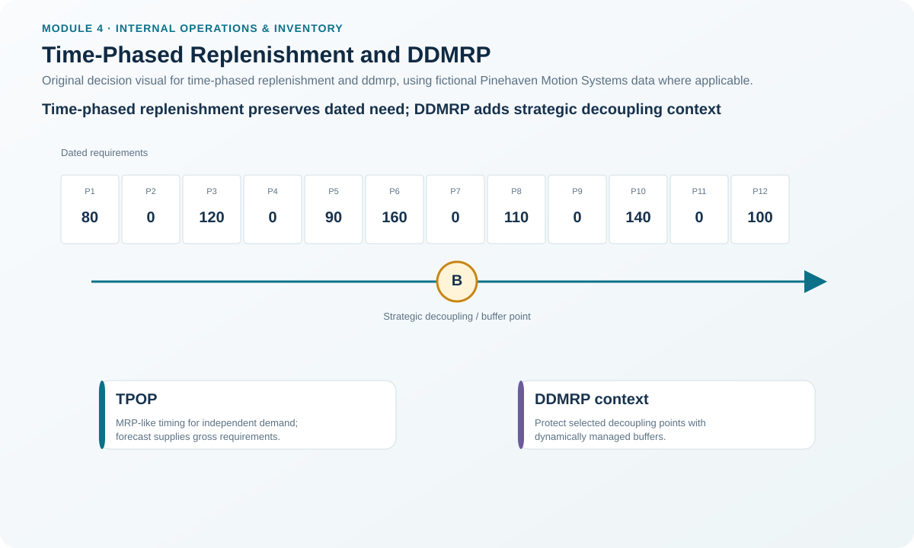
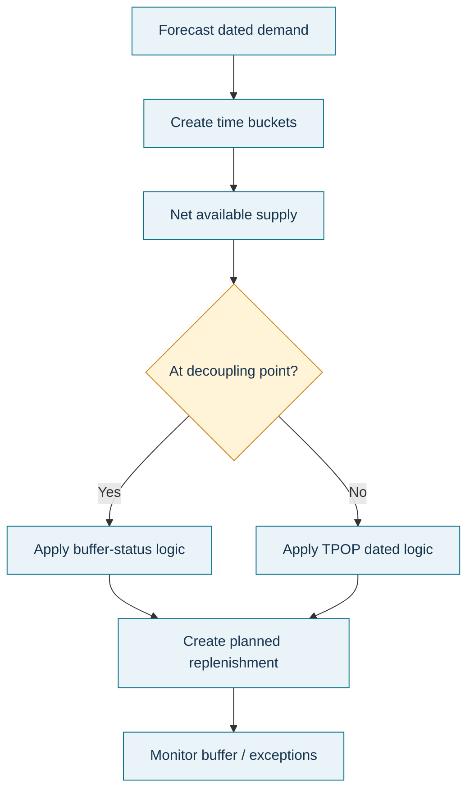

# 10. Time-Phased Replenishment and DDMRP

## Learning objectives

After this topic, you should be able to:

- explain why time-phased order point logic can outperform average-demand triggers for lumpy independent demand;
- describe how TPOP resembles MRP while sourcing gross requirements differently;
- explain the high-level role of strategic decoupling buffers in demand-driven MRP; and
- avoid inventing detailed DDMRP buffer calculations that are not provided in the Module 4 source.

## Concept in plain English

A simple order point summarizes future demand into an average lead-time requirement. That can work well for stable demand. It can be weak when withdrawals are **lumpy, dated, seasonal, promotion-driven, or service-event driven**.

A **time-phased order point (TPOP)** system looks forward through time buckets. It applies MRP-like time-phased logic to independent-demand items, but its gross requirements come from a forecast or dated independent demand rather than a BOM explosion. TPOP can therefore plan a replenishment before a future peak actually crosses a physical reorder point.

When this time-phased logic is used for distribution-center replenishment, it connects closely with distribution requirements planning.

**Demand-driven MRP (DDMRP)** is presented in this module at a higher level. It strategically positions and dynamically manages buffers at selected decoupling points to compress effective lead time and respond to variability. It considers factors such as customer tolerance, supply and demand variability, long-lead-time items, and constraints.

## Why it matters

Using average-demand logic for a slow-moving service part can trigger too late before a known service campaign and too early afterward. Time-phased methods make the date of demand visible.

DDMRP is equally easy to misuse if it is reduced to “add a buffer everywhere.” Its value proposition depends on **where** decoupling is strategically useful and how the buffer is managed—not simply on adding more stock.

## Decision model and workflow

### Evidence retained through the workflow

Retain item demand type, dated forecast/requirements, on-hand and scheduled supply, lead time, review horizon, selected time-phased logic, decoupling rationale, buffer policy, variability evidence, customer-tolerance assumption, bottleneck/constraint considerations, and review cadence.

## Practical process flow

## Realistic example — Pinehaven Motion Systems

The locked [`replenishment-models.csv`](../../assets/data/module-4/replenishment-models.csv) includes:

- **PH-SRVKIT** as a TPOP context item, with annual demand 4,800 units, 10-day lead time, and a dated-requirements coverage policy.
- **PH-MCU88** as a DDMRP-context item, with a 35-day lead time and an illustrative **950-unit decoupling-buffer policy example**.

For PH-SRVKIT, the lesson is not “use the average order point of 287 units forever.” If demand is tied to dated field-service events, the planner should use the time-phased demand profile so a future lumpy withdrawal is visible before it arrives.

For PH-MCU88, the 950-unit value is a fictional policy example created for learning. It is **not** presented as the output of a universal DDMRP formula.

## Source boundary — what we will and will not calculate

The Module 4 material explains DDMRP conceptually: strategic positioning, dynamic buffer adjustment, lead-time compression, variability, customer tolerance, and constraint considerations.

It does **not** provide a complete universal buffer-zone calculation method in this section. Therefore this repository does not invent one. A practitioner implementing DDMRP should use the organization's approved methodology and full implementation guidance rather than extrapolating a formula from this learning page.

That distinction is intentional and part of the repository's source-grounding standard.

## Applied decision artifact — time-phased replenishment screen

For a candidate TPOP/DDMRP item, document:

| Field | Decision purpose |
|---|---|
| Dated independent requirements | Reveal lumpy future withdrawals |
| On hand / scheduled supply | Establish future available balance |
| Lead time | Determine when action must start |
| Order/review horizon | Define time window |
| Decoupling candidate? | Test whether buffer position shortens effective response |
| Variability | Demand and supply uncertainty |
| Customer tolerance | How long customers can wait |
| Constraint interaction | Whether a buffer protects a system bottleneck |
| Review cadence | When buffer/positioning policy is re-evaluated |

## Decision logic

- Use simple average-demand logic when it is adequate.
- Move to time-phased logic when dates and lumps materially change the decision.
- Use forecasts/demand events as independent-demand gross requirements rather than BOM explosion.
- For DDMRP, choose strategic decoupling positions rather than spreading buffers indiscriminately.
- Keep the buffer calculation method controlled and traceable to approved guidance.
- Reassess when lead time, variability, service tolerance, or network structure changes.

## Trade-offs

Time-phased systems require better future-demand and date data than simple triggers. DDMRP buffers can improve response and decouple volatile portions of the flow but still consume capital and require disciplined daily management. Strategic buffers can reduce total lead-time exposure; poorly positioned buffers simply relocate excess inventory.

## Commonly confused with

**TPOP** uses MRP-like time buckets for independent demand. **Traditional MRP** derives dependent demand through BOM relationships. **DDMRP** is a broader demand-driven ordering approach with strategic decoupling buffers; it should not be treated as another name for TPOP.

## Common mistakes

- Using average demand when a promotion or service campaign is already dated.
- Treating TPOP as BOM explosion.
- Adding DDMRP buffers at every item/location.
- Presenting an illustrative buffer as a certified DDMRP calculation.
- Ignoring customer lead-time tolerance or bottleneck location.
- Using a time-phased model with poor dates and assuming the extra complexity creates accuracy automatically.

## Original knowledge check

**Question.** A service part has low average demand but a known set of large maintenance campaigns scheduled in specific future weeks. Which approach best exposes the timing problem?

A. A fixed average order point only

B. Time-phased order point logic using dated requirements

C. Raising every safety stock in the network

D. Ignoring the campaigns until inventory is physically low

Answer and rationale

### Correct answer

**B. Time-phased order point logic using dated requirements**

### Why it is correct

TPOP can see lumpy independent demand by future period rather than compressing the pattern into one average trigger.

### Why the other answers are wrong

A may hide the future lump, C adds inventory without diagnosing timing, and D reacts after the planning advantage has been lost.

## Practitioner perspective

Modern planning systems may support time-phased, reorder-point, MRP, and demand-driven policies under different product names. Focus on the logic: demand source, time-phasing, decoupling point, buffer rule, and exception management. Do not assume similar software labels mean identical planning behavior.

## Related concepts

- [Ordering Systems](./09-ordering-systems-order-point-periodic-review-and-min-max.md)
- [Inventory Planning, Locations, and Echelons](./03-inventory-planning-locations-and-echelons.md)
- [Safety Stock and Safety Lead Time](./11-safety-stock-and-safety-lead-time.md)

---

[Previous: Ordering Systems](./09-ordering-systems-order-point-periodic-review-and-min-max.md) · [Section overview](./README.md) · [Next: Safety Stock and Safety Lead Time](./11-safety-stock-and-safety-lead-time.md)
