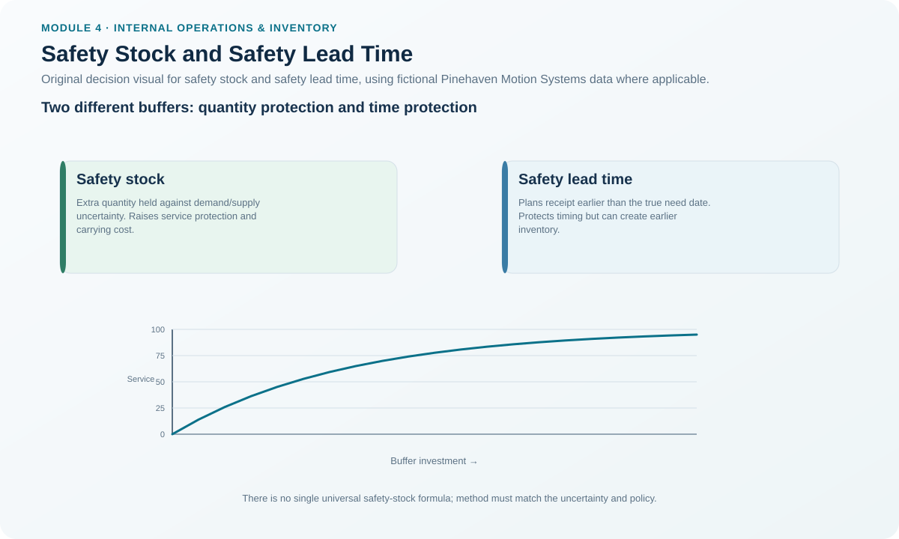
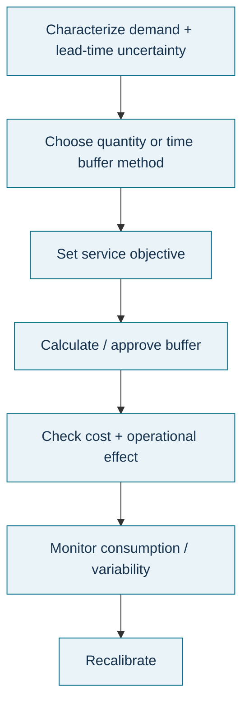

# 11. Safety Stock and Safety Lead Time

## Learning objectives

After this topic, you should be able to:

- explain what safety stock protects and when its repeated use signals a policy problem;
- distinguish fixed, coverage-based, and statistical approaches to setting safety stock;
- explain safety lead time as a time buffer rather than a quantity buffer; and
- balance protection against stockout risk with inventory and bullwhip consequences.

## Concept in plain English

Safety protection exists because actual demand and supply do not always follow the plan.

**Safety stock** is extra quantity held to protect against uncertainty such as demand variation, forecast error, lead-time variation, or supplier shortage.

**Safety lead time** is extra time. The organization plans the replenishment earlier than the nominal need date to protect against lead-time uncertainty.

The source material describes three broad ways to set safety stock:

1. **Fixed amount** — a controlled quantity based on experience or policy.
2. **Coverage** — a number of days/weeks of demand.
3. **Statistical** — a variability/service calculation using an approved statistical model.

There is no single universal safety-stock formula specified for all situations in this Module 4 material. The correct statistical method depends on the organization's approved demand, lead-time, service, and distribution assumptions.

## Why it matters

Safety inventory is meant to be used occasionally. If it is consumed constantly, normal cycle-stock or planning assumptions may be too low. If it is never touched, the buffer may be unnecessarily large. A buffer is therefore both protection and a diagnostic signal.

For slow-moving items, adding safety quantity can create inventory that sits for a very long time. Safety lead time may sometimes be a better tool when the main uncertainty is timing rather than quantity.

## Decision model and workflow

### Evidence retained through the workflow

Retain demand variability, lead-time variability, forecast accuracy, order frequency, service requirement, regulatory minimum, selected method, quantity/time buffer, actual buffer usage, stockout history, carrying cost, and trigger for recalculation.

## Practical process flow

## Realistic example — Pinehaven Motion Systems

The fictional [`replenishment-models.csv`](../../assets/data/module-4/replenishment-models.csv) contains different safety-policy examples:

- PH-PWR220: **380 units** fixed from a service policy.
- PH-CNK500: **210 units** using a coverage-policy example.
- PH-FUSE7: **850 units** as a critical-item fixed buffer.
- PH-SRVKIT: **95 units** tied to dated-requirements coverage.

These values are learning assumptions, not recommendations for real businesses. They demonstrate that safety settings depend on the business reason and data.

PH-FUSE7 has long illustrative lead time and high service importance. Pinehaven may decide the fixed buffer is appropriate, but it should still monitor usage. If the buffer is consumed every cycle, the root issue may be lead time, cycle-stock settings, supplier reliability, or forecast assumptions—not simply “insufficient safety stock.”

## Applied decision artifact — buffer decision record

| Question | Quantity buffer | Time buffer |
|---|---|---|
| Main uncertainty is demand quantity? | Often relevant | Less direct |
| Main uncertainty is replenishment timing? | Possible | Often relevant |
| Item is very slow moving? | Can create dead stock | May be preferable |
| Service/regulatory minimum exists? | May be mandated | May also be needed |
| What should be monitored? | Frequency/depth of safety-stock use | Actual arrival vs protected need date |

The selected approach should include a review rule rather than becoming an untouchable parameter.

## Decision logic

- Identify whether the dominant uncertainty is quantity, timing, or both.
- Evaluate demand variability, lead-time variability, forecast accuracy, order frequency, and service/regulatory needs.
- Select fixed, coverage, or approved statistical quantity logic where safety stock is appropriate.
- Consider safety lead time when timing variability and slow movement make quantity buffers inefficient.
- Monitor actual usage and stockout performance.
- Reduce the buffer when the underlying process becomes more reliable; increase only when evidence supports the change.

## Trade-offs

More safety stock improves availability up to a point but increases capital, space, handling, and obsolescence. Very high service levels often require disproportionately more buffer. Safety lead time can reduce late-arrival exposure but may cause earlier receipts and excess inventory. Ordering earlier throughout a network can also amplify signals and contribute to bullwhip effects.

## Commonly confused with

**Safety stock** is a quantity buffer. **Safety lead time** is a time buffer. **Cycle stock** supports normal expected consumption. **Anticipation inventory** covers a planned known event. These stocks may coexist, but their purposes should not be blended.

## Common mistakes

- Using one safety-stock formula for every demand pattern.
- Increasing safety stock after each shortage without root-cause analysis.
- Keeping a buffer forever after supplier performance improves.
- Applying large quantity buffers to extremely slow movers.
- Forgetting regulatory or critical-service minimums.
- Double-protecting the same risk with both an inflated forecast and excessive safety stock.

## Original knowledge check

**Question.** A very slow-moving spare has reasonably stable quantity demand, but supplier delivery dates vary widely. Which protection deserves specific evaluation before simply adding more units?

A. Safety lead time

B. Larger cycle stock only

C. A higher selling price

D. Removing the item from planning

Answer and rationale

### Correct answer

**A. Safety lead time**

### Why it is correct

The main uncertainty is timing, and a time buffer may protect the need date without accumulating a large slow-moving quantity buffer.

### Why the other answers are wrong

B may create excess without addressing the nature of the risk, C is unrelated to replenishment protection, and D removes planning rather than controlling it.

## Practitioner perspective

Safety stock and safety time are often easy to enter in an ERP and hard to govern. Put every material buffer on a review cadence. Ask what evidence originally justified it, how often it is actually consumed, and what upstream improvement would allow it to shrink.

## Related concepts

- [Inventory Fundamentals](./01-inventory-fundamentals-types-and-functions.md)
- [Ordering Systems](./09-ordering-systems-order-point-periodic-review-and-min-max.md)
- [Time-Phased Replenishment and DDMRP](./10-time-phased-replenishment-and-ddmrp.md)

---

[Previous: Time-Phased Replenishment and DDMRP](./10-time-phased-replenishment-and-ddmrp.md) · [Section overview](./README.md) · [Next: Product Traceability, Configuration, and Chain of Custody](./12-product-traceability-configuration-and-chain-of-custody.md)
