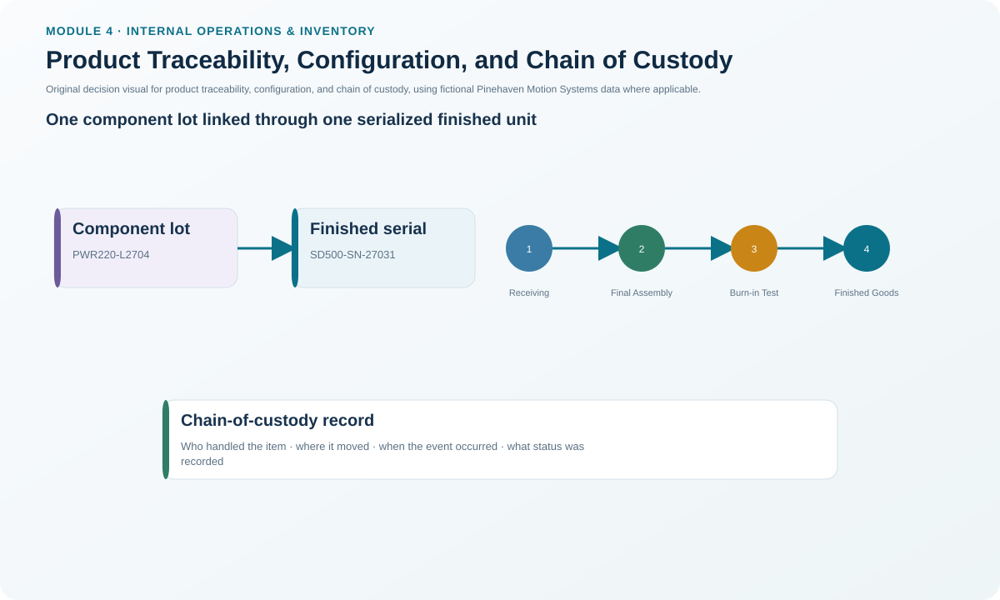
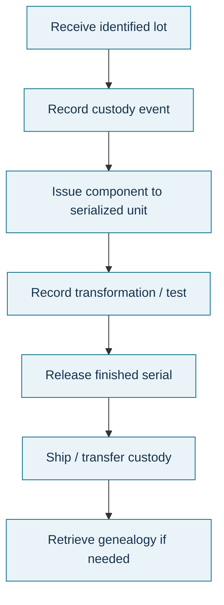

# 12. Product Traceability, Configuration, and Chain of Custody

## Learning objectives

After this topic, you should be able to:

- distinguish traceability, configuration management, and chain of custody;
- explain how genealogy data can narrow recalls and support compliance;
- identify the data events needed to connect component lots to finished-product serials; and
- explain why technology enables traceability but does not guarantee trustworthy records.

## Concept in plain English

**Product traceability** answers questions such as: Where did this material come from? Which finished products contain it? Where did those finished products go?

**Configuration management** controls the approved characteristics, versions, and changes of a product or service across its life cycle.

**Chain of custody** records who or what organization/location had control of an item as it moved through the network.

These capabilities overlap, but they solve different problems. A serial-number genealogy can identify the lot used in a finished unit. Configuration management can prove which design revision was authorized when the unit was built. Custody records can show which parties handled the item in transit or distribution.

## Why it matters

Without reliable genealogy, a suspected component defect may force an organization to recall every unit produced during a broad time window. With good traceability, the organization may isolate only the serial numbers built from the affected lot. That reduces risk, customer disruption, cost, and investigation time.

Traceability also supports origin claims, trade/customs evidence, regulated supply chains, anti-counterfeit controls, cold-chain history, and compliance audits.

## Decision model and workflow

### Evidence retained through the workflow

Retain supplier/material lot, receipt event, inspection/release status, production issue/consumption event, finished serial/batch, configuration revision/effectivity, test/release event, storage/shipment/custody events, timestamps, location, user/system source, and any correction history.

## Practical process flow

## Realistic example — Pinehaven Motion Systems

The fictional [`traceability-cycle-count.csv`](../../assets/data/module-4/traceability-cycle-count.csv) contains a simple genealogy:

| Time | Finished serial | Component lot | Event |
|---|---|---|---|
| 2027-07-08 08:15 | SD500-SN-27031 | PWR220-L2704 | Receipt verified |
| 2027-07-09 10:40 | SD500-SN-27031 | PWR220-L2704 | Component issued to serial |
| 2027-07-10 14:05 | SD500-SN-27031 | PWR220-L2704 | Burn-in test passed |
| 2027-07-11 09:20 | SD500-SN-27031 | PWR220-L2704 | Finished unit released to stock |

If PWR220-L2704 later becomes suspect, Pinehaven has a starting point for identifying affected serials rather than searching every SD500 unit.

The data are intentionally simple. A real regulated genealogy may also include supplier batch, certificate status, quality inspection, configuration/effectivity, rework, split/merge transactions, packaging hierarchy, shipment, customer, and custody changes.

## Applied decision artifact — recall-readiness trace

For one randomly selected finished serial, require the organization to demonstrate:

1. source component/material lots;
2. approved configuration/effectivity;
3. production and quality status;
4. current or shipped location;
5. downstream customer/custody data where required;
6. reverse trace from a suspect component lot to all affected finished units.

Time the exercise. A traceability system that contains the data but cannot answer the query fast enough for a real incident is not fully effective.

## Decision logic

- Define which materials and products require lot/serial genealogy.
- Capture identifiers at controlled physical events.
- Link consumption to the actual finished batch/serial, not merely to a production order when finer trace is required.
- Preserve configuration/version/effectivity evidence.
- Record downstream movement and custody to the required depth.
- Test both backward and forward traceability.
- Audit corrections and master-data changes that could break the chain.

## Trade-offs

More granular traceability reduces recall scope but increases scanning, data volume, integration, and control requirements. Serial-level genealogy is more precise than batch-level tracking but may not be justified for every low-risk item. Blockchain or other immutable-record approaches may strengthen shared records, yet they cannot make incorrect source data correct.

## Commonly confused with

**Traceability** follows product/material genealogy. **Configuration management** controls approved product information and change. **Inventory visibility** shows where stock or status is visible. **Chain of custody** emphasizes possession/control across parties or locations. A strong solution may use all four.

## Common mistakes

- Capturing supplier lot at receiving but losing it during production issue.
- Tracking the production order without linking the actual consumed lot.
- Allowing engineering revision changes without controlled effectivity.
- Assuming barcode/RFID/blockchain automatically guarantees data accuracy.
- Testing only backward trace from finished unit to supplier, not forward trace from suspect lot to customers.
- Keeping trace data in isolated systems that cannot be reconciled during an incident.

## Original knowledge check

**Question.** A supplier reports that component lot X may be defective. Which capability most directly helps Pinehaven identify only the finished serials that consumed lot X?

A. Aggregate inventory turnover

B. Product genealogy / traceability

C. EOQ

D. Periodic review

Answer and rationale

### Correct answer

**B. Product genealogy / traceability**

### Why it is correct

Genealogy links the suspect component lot to the specific finished products that used it.

### Why the other answers are wrong

A measures inventory velocity; C and D are replenishment tools. None identifies component-to-finished-product relationships.

## Practitioner perspective

In SAP environments, batch management, serial numbers, material documents, inspection lots, production confirmations, equipment/configuration records, and delivery history may all contribute to genealogy. Do not assume one transaction provides an end-to-end chain. Define the recall question first, then prove the systems can answer it.

## Related concepts

- [Inventory Accuracy, Physical Inventory, and Cycle Counting](./13-inventory-accuracy-physical-inventory-and-cycle-counting.md)
- [End-of-Life, Obsolescence, Returns, and Disposition](./14-end-of-life-obsolescence-returns-and-disposition.md)
- [Inventory Planning, Locations, and Echelons](./03-inventory-planning-locations-and-echelons.md)

---

[Previous: Safety Stock and Safety Lead Time](./11-safety-stock-and-safety-lead-time.md) · [Section overview](./README.md) · [Next: Inventory Accuracy, Physical Inventory, and Cycle Counting](./13-inventory-accuracy-physical-inventory-and-cycle-counting.md)
