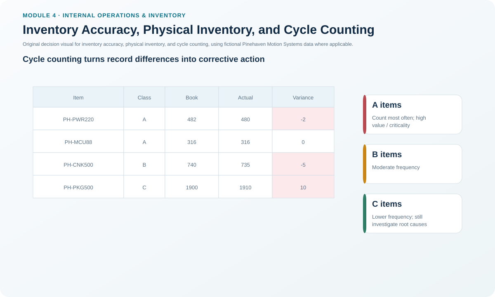
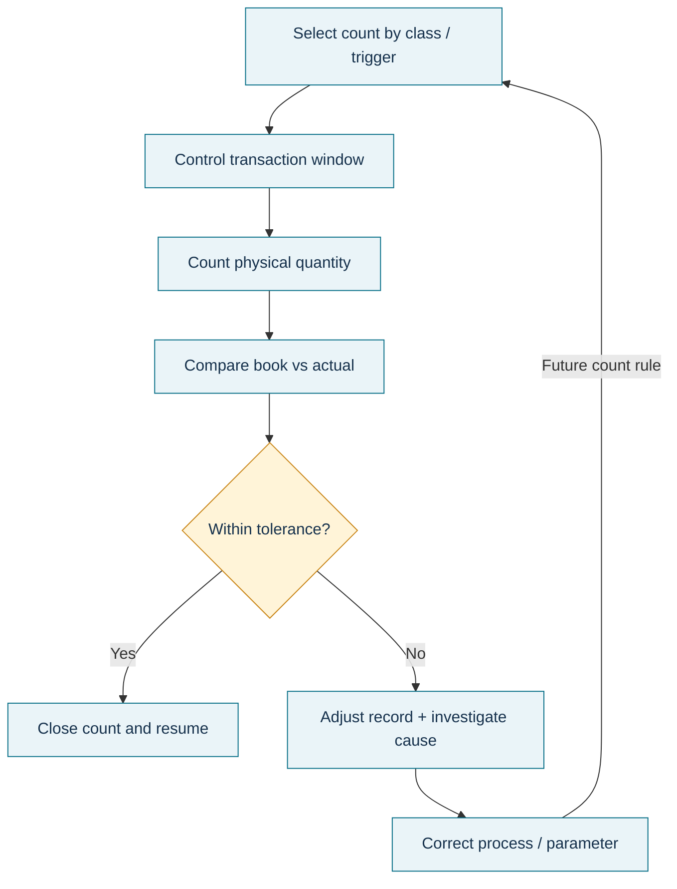

# 13. Inventory Accuracy, Physical Inventory, and Cycle Counting

## Learning objectives

After this topic, you should be able to:

- explain why accurate records are a prerequisite for planning and financial control;
- distinguish periodic physical inventory from cycle counting;
- use ABC/criticality to set count frequency without assuming one universal schedule; and
- treat inventory differences as signals for root-cause correction rather than routine write-offs.

## Concept in plain English

Inventory systems make decisions from records. If the record says 500 units exist but only 420 are physically available, an otherwise perfect MRP, reorder-point, or ATP calculation can still fail.

A **physical inventory** is a determination of actual quantity by count. It can be periodic or annual and may require broad operational interruption.

**Cycle counting** counts selected items on a recurring schedule throughout the year. High-value, fast-moving, critical, or historically inaccurate items are often counted more frequently. Its strongest purpose is not merely correcting the record; it is finding and eliminating the transaction or process causes of error.

An **inventory adjustment** changes the system balance to match verified physical inventory. Adjustment is necessary when the record is wrong, but repeated adjustments without root-cause work are evidence that the control system is failing.

## Why it matters

Inaccurate inventory creates false shortages, false availability, unnecessary purchases, production interruptions, incorrect financial balances, and poor customer promises. Better forecasting cannot compensate for an unreliable on-hand record.

Cycle counting also avoids some of the disruption and delayed learning of a once-a-year count. A discrepancy discovered today can be investigated while the receiving, picking, issue, transfer, quality, or conversion transaction is still recent.

## Decision model and workflow

### Evidence retained through the workflow

Retain count class, book quantity, physical quantity, tolerance policy, recount evidence, adjustment quantity, transaction history, root cause, corrective action, responsible owner, and recurrence check.

## Practical process flow

## Realistic example — Pinehaven Motion Systems

The locked [`traceability-cycle-count.csv`](../../assets/data/module-4/traceability-cycle-count.csv) includes four fictional cycle counts:

| Item | Class | Book | Actual | Difference | Observed reason |
|---|---:|---:|---:|---:|---|
| PH-PWR220 | A | 482 | 480 | -2 | Issue posting lag |
| PH-MCU88 | A | 316 | 316 | 0 | No adjustment |
| PH-CNK500 | B | 740 | 735 | -5 | Unposted quality hold |
| PH-PKG500 | C | 1,900 | 1,910 | +10 | Case-pack conversion error |

The lesson deliberately does **not** impose a universal tolerance. Pinehaven's policy must define when a recount, investigation, and approval are required based on item value, criticality, control environment, and applicable financial/regulatory requirements.

The useful result is not “three adjustments.” It is three different control defects: timing of issue posting, quality-stock transaction discipline, and pack-conversion master/process accuracy.

## Applied decision artifact — count-to-cause record

For every count outside the allowed policy:

| Stage | Required evidence |
|---|---|
| Verify | Independent recount / unit-of-measure check |
| Reconcile | Book, physical, blocked/quality, open transaction status |
| Adjust | Controlled record adjustment with approval |
| Diagnose | Transaction/process root cause |
| Correct | Training, master data, interface, storage, security, or process fix |
| Confirm | Follow-up count or KPI evidence showing recurrence stopped |

This turns cycle counting into process control rather than clerical cleanup.

## Decision logic

- Prioritize items for count using value, movement, criticality, and error history.
- Count under controlled conditions.
- Recount or reconcile when the variance exceeds policy.
- Adjust the record only after the physical fact is established.
- Investigate cause while transaction history and operator memory are current.
- Change the process, system, master data, or physical control.
- Track whether the same error returns.

## Trade-offs

Annual physical inventory can provide a broad point-in-time verification but may require shutdown and temporary labor. Cycle counting spreads effort through the year and speeds root-cause learning but demands discipline and a stable process. Very frequent counts can waste effort when accuracy is already proven; infrequent counts can allow errors to compound.

## Commonly confused with

**Inventory accuracy** is the degree to which physical and recorded inventory agree under the defined tolerance. **Inventory adjustment** is the correction transaction. **Cycle counting** is an audit/control method. A high volume of adjustments does not mean the organization has a good cycle-count program; it may mean the process is repeatedly creating errors.

## Common mistakes

- Adjusting the system immediately without verifying the physical count.
- Counting only high-dollar items and ignoring line-stopping critical items.
- Treating quality-hold or blocked stock as missing stock.
- Failing to control unit-of-measure and case-pack conversions.
- Using cycle counts only to satisfy an audit rather than eliminate causes.
- Allowing unrestricted access to storage locations and then trying to count the problem away.

## Original knowledge check

**Question.** A cycle count finds five fewer units than the book record, and transaction history shows five units physically moved to quality hold but the posting was never completed. What is the strongest response?

A. Adjust the balance and close the issue.

B. Ignore it because the units still exist.

C. Correct the inventory record and fix the quality-hold transaction process that caused the mismatch.

D. Increase safety stock by five units.

Answer and rationale

### Correct answer

**C. Correct the inventory record and fix the quality-hold transaction process that caused the mismatch.**

### Why it is correct

Accuracy requires the record to reflect physical/status reality, and cycle counting should trigger correction of the process cause so the error does not recur.

### Why the other answers are wrong

A fixes only the symptom, B leaves planning data wrong, and D masks a record-control problem with extra inventory.

## Practitioner perspective

Inventory accuracy problems often cross warehouse, production, quality, and integration processes. In an ERP, investigate posting timing, stock type/status, backflush, goods issue/receipt, transfer posting, interface queues, UOM conversion, and physical-access control before blaming the planner.

## Related concepts

- [ABC Classification and Pareto-Based Control](./06-abc-classification-and-pareto-based-control.md)
- [Product Traceability, Configuration, and Chain of Custody](./12-product-traceability-configuration-and-chain-of-custody.md)
- [Inventory Management Roles and Policy](./04-inventory-management-roles-and-policy.md)

---

[Previous: Product Traceability, Configuration, and Chain of Custody](./12-product-traceability-configuration-and-chain-of-custody.md) · [Section overview](./README.md) · [Next: End-of-Life, Obsolescence, Returns, and Disposition](./14-end-of-life-obsolescence-returns-and-disposition.md)
