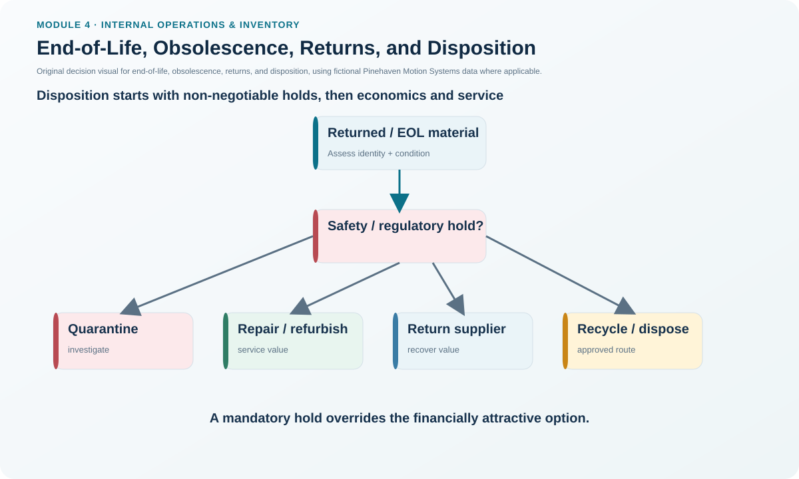
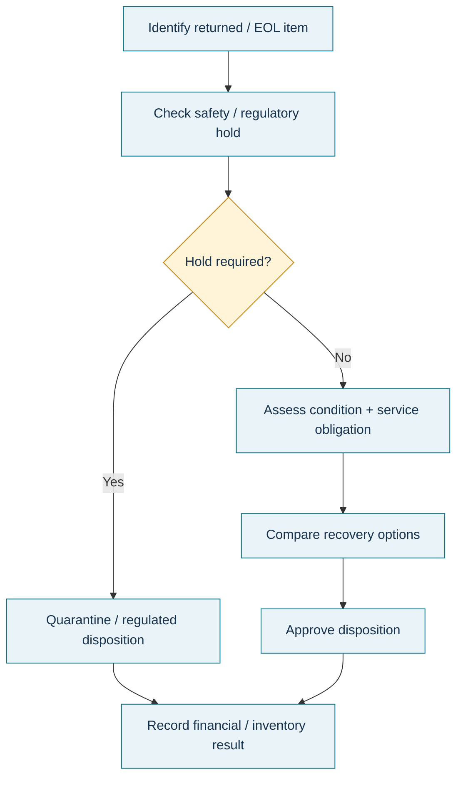

# 14. End-of-Life, Obsolescence, Returns, and Disposition

## Learning objectives

After this topic, you should be able to:

- explain why end-of-sales and end-of-service are separate planning decisions;
- identify supplier MOQ, lifetime sales, service-parts, and product-transition issues in end-of-life planning;
- evaluate return/disposition options using mandatory gates before economics; and
- connect obsolescence planning with inventory, customer communication, sustainability, and risk.

## Concept in plain English

A product does not stop creating supply-chain obligations the day sales end.

**End-of-life product management** coordinates phase-out so the organization avoids premature stockout, uncontrolled excess, service failure, and unnecessary environmental impact. The plan may include end-of-sales timing, end-of-service timing, service-parts support, equipment/space changes, communication, take-back obligations, regulatory requirements, and transition to replacement products.

**Obsolescence** can be planned—such as replacement by a new product—or market-driven when demand collapses unexpectedly.

In this module's forecasting context, **life cycle analysis** can compare historical demand patterns across introduction, growth, maturity, saturation, and decline to help estimate how a similar product may wind down. It is evidence for the phase-out decision, not a guarantee of the exact final demand curve.

For returned, obsolete, damaged, or unsaleable material, **disposition** selects the appropriate outcome. Options can include return to available stock, return to supplier/manufacturer, repair/refurbish, liquidation, donation, recycling, or disposal. Economics matter, but safety, regulatory, contractual, and service gates come first.

## Why it matters

An old product can have declining sales while suppliers raise minimum order quantities to protect their own economics. The manufacturer may then have to buy more components exactly when it wants less stock. Service obligations may continue for years. Stopping production too early can leave the installed base unsupported; stopping too late creates obsolete finished goods and components.

Returns pose a similar decision problem: the highest immediate recovery value may be unacceptable if a safety hold, quality investigation, warranty obligation, or regulatory rule applies.

## Decision model and workflow

### Evidence retained through the workflow

Retain end-of-sales and end-of-service dates, replacement-product readiness, lifetime-sales forecast, lifetime-buy/service-parts requirement, supplier MOQ and exit clauses, inventory by echelon, obsolescence reserve, return condition, recoverable value, processing cost, warranty/service obligation, safety/regulatory hold, approved disposition, and final financial/sustainability result.

## Practical process flow

## Realistic example — Pinehaven Motion Systems

The fictional [`returns-disposition.csv`](../../assets/data/module-4/returns-disposition.csv) demonstrates why disposition is a **gated decision**.

### R-1002 — safety gate overrides economics

The returned PH-SD500 has:
- recoverable value: **$250**
- processing cost: **$180**
- nominal net recovery: **$70**
- regulatory/safety hold: **Yes**

The correct action in the dataset is **quarantine pending failure analysis**. Pinehaven does not select a revenue-maximizing disposition while the failure is under investigation. The hold overrides the economic ranking.

### R-1003 — supplier return

An unused sealed PH-PWR220 lot has $150 recoverable value and $22 processing cost, giving **$128 net recovery** under the illustrative assumptions. With no safety hold or service obligation, return to supplier is the selected path.

### R-1004 — service-pool value

A functional prior revision of PH-CTRL210 has $72 illustrative net recovery and a service-exchange obligation. Refurbishing it for the service pool preserves value that could be missed if the product were treated simply as obsolete.

### R-1005 — controlled recycling

An obsolete PH-MCU88 revision has $6 recoverable value and $9 processing cost, or **-$3 net recovery**. The dataset still selects an approved recycler, showing that responsible disposition may be required even when it is not profitable.

## Applied decision artifact — end-of-life and disposition gate sheet

Use two linked records.

### Product phase-out record
- end-of-sales strategy/date;
- end-of-service/support strategy/date;
- replacement availability;
- lifetime remaining sales;
- service-parts lifetime buy;
- supplier MOQ/contract exits;
- inventory drawdown by echelon;
- equipment/space transition;
- customer/supplier communication;
- reserve/disposition plan.

### Return/disposition record
1. verify identity and condition;
2. apply safety/regulatory/quality hold gates;
3. apply warranty, service, and contractual obligations;
4. determine reusable/recoverable options;
5. calculate recovery less processing cost;
6. choose approved disposition;
7. record inventory and financial impact.

## Decision logic

- Forecast the remaining sales life rather than waiting for demand to reach zero.
- Separate end of sales from end of service.
- Review supplier MOQ and commitments as volume declines.
- Estimate lifetime service-parts demand before discontinuing components.
- Coordinate old-product drawdown with replacement availability.
- For returns, apply mandatory holds before economic ranking.
- Track disposition outcomes and feed recurring causes back into quality/product design.

## Trade-offs

Keeping service inventory protects customers but can create long-tail obsolescence. Buying a lifetime quantity secures availability but commits cash based on uncertain long-term usage. Aggressive sell-off reduces old stock but can damage price positioning or channel relationships. Recycling/disposal may cost money but be required for safety, regulation, or sustainability.

## Commonly confused with

**End of sales** ends new commercial sales. **End of service** ends support obligations and may occur much later. **Lifetime sales quantity** estimates remaining old-product sales; a **lifetime buy quantity** estimates the stock needed now to support future use when replenishment will no longer be possible.

## Common mistakes

- Ending component supply as soon as finished-goods sales stop.
- Ignoring supplier MOQ increases during product decline.
- Announcing a replacement too early and unintentionally freezing sales of old inventory.
- Selecting disposition only by immediate recovery dollars.
- Returning suspect product to available stock before safety/quality release.
- Forgetting inventory already held downstream in the channel.

## Original knowledge check

**Question.** Pinehaven can recover $300 from refurbishing a returned drive, but engineering has placed the serial number on a safety hold pending failure analysis. What should happen first?

A. Refurbish immediately because recovery is positive.

B. Liquidate it to a secondary market.

C. Maintain quarantine until the safety/quality gate is cleared.

D. Return it to available stock.

Answer and rationale

### Correct answer

**C. Maintain quarantine until the safety/quality gate is cleared.**

### Why it is correct

Mandatory safety and quality controls take precedence over economic disposition.

### Why the other answers are wrong

A, B, and D allow economic or inventory pressure to bypass the unresolved safety condition.

## Practitioner perspective

End-of-life planning should be visible in MRP and procurement before the final sales announcement. Review effectivity dates, safety stock, lot sizes, open POs, supplier MOQs, service obligations, and excess/obsolete projections together. For returns, integrate quality status with warehouse disposition so material cannot be financially attractive but operationally unsafe.

## Related concepts

- [Inventory and the Financial Statements](./07-inventory-and-the-financial-statements.md)
- [Product Traceability, Configuration, and Chain of Custody](./12-product-traceability-configuration-and-chain-of-custody.md)
- [Inventory Accuracy, Physical Inventory, and Cycle Counting](./13-inventory-accuracy-physical-inventory-and-cycle-counting.md)

---

[Previous: Inventory Accuracy, Physical Inventory, and Cycle Counting](./13-inventory-accuracy-physical-inventory-and-cycle-counting.md) · [Section overview](./README.md) · [Next: Section C Review](./15-section-c-review.md)
