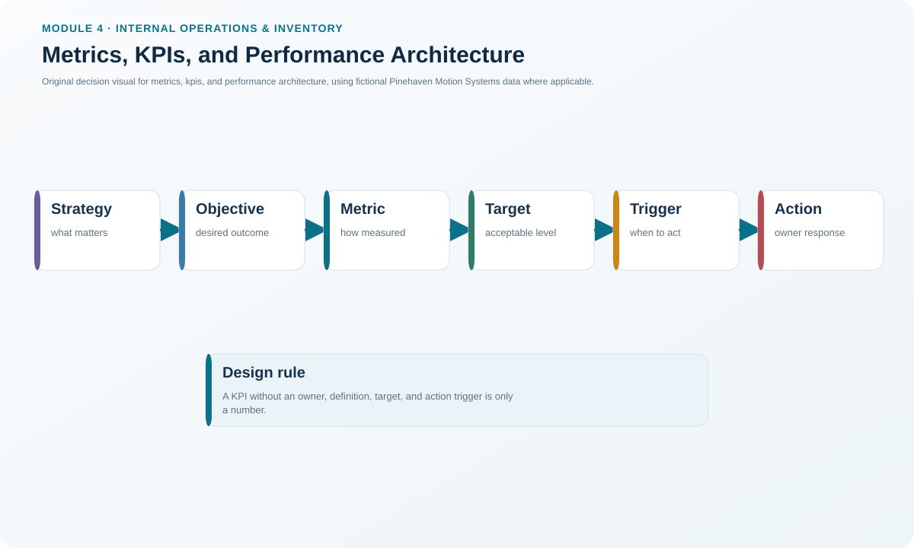
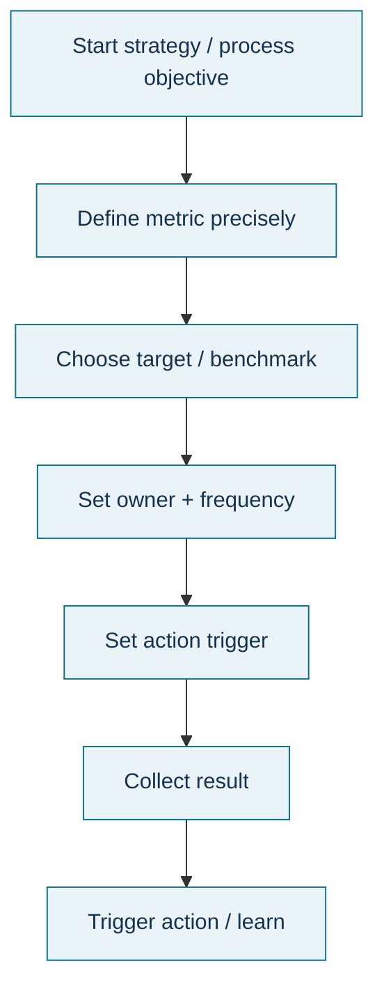

# 1. Metrics, KPIs, and Performance Architecture

## Learning objectives

After this topic, you should be able to:

- distinguish a metric from a key performance indicator (KPI);
- build a measurement chain from objective to target, report, and action;
- explain why supply-chain KPIs must discourage local suboptimization; and
- design a practical KPI charter with ownership, frequency, and trigger rules.

## Concept in plain English

A metric is a defined way to measure an outcome, condition, activity, or process. A **KPI** is a metric selected because it represents progress toward an important strategic objective. The distinction matters: an operation can collect hundreds of measurements while only a small set should guide management attention.

A useful performance architecture begins with the objective, not the available data. The team states what success means, chooses evidence that can show progress, establishes a baseline, sets a challenging but feasible target, assigns an owner, defines how often the metric is refreshed, and specifies what action occurs when the result crosses a trigger. Measurement is therefore a control system, not a reporting decoration.

Supply-chain KPIs also need a cross-node perspective. A plant can improve local efficiency by producing more than customers need, but the extra output may increase WIP, finished-goods inventory, carrying cost, and obsolescence. A warehouse can reduce its own labor cost by shipping less frequently while customer lead time deteriorates. A KPI is stronger when it reflects the end-to-end objective and is paired with balancing measures.

## Why it matters

Good metrics turn strategy into observable behavior. Poor metrics reward the wrong behavior with great precision. A useful set is small enough to be understood, broad enough to balance customer, process, financial, and learning outcomes, and detailed enough to drill down when the headline result deteriorates.

The cost of measurement also matters. A metric that requires expensive manual collection should earn its place by supporting a decision. If a team cannot explain what action a measurement could trigger, it may be information rather than management control.

## Decision model and workflow

### Evidence retained through the workflow

Retain the strategic objective, metric name, operational definition, unit, data source, baseline, target, reporting frequency, owner, cross-node relevance, cost of measurement, action trigger, and the date the definition was approved. This prevents the same KPI name from being interpreted differently by different functions.

## Practical process flow

## Realistic example — Pinehaven Motion Systems

Pinehaven's locked KPI file shows several simultaneous warnings. Schedule attainment is **94.5%** against a **98%** target. Order lead time is **6.4 days** against a **5-day** target. Inventory turns are **4.36** against a **5.0** target. Burn-in queue is **124 units**, beyond its **100-unit action trigger**.

No single one of these numbers should drive an isolated response. Raising local output merely to improve schedule attainment could increase the already-high burn-in queue. Pinehaven therefore uses a small set of linked measures: customer timing, flow, inventory, quality, and cost. The purpose is to improve the system rather than one department's score.

The fictional data are in [`operations-kpis.csv`](../../assets/data/module-4/operations-kpis.csv).

All names and values in this example are fictional and independently selected for learning purposes.

## Applied decision artifact

Create a **KPI charter** with one row per key measure. Include the strategic objective, formula/definition, unit, owner, data source, target, warning/action thresholds, frequency, required drill-down, and balancing metric. Require a named action owner for any KPI that crosses its trigger.

A good review asks three questions in order: **What changed? Why did it change? What decision follows?** If the dashboard stops at the first question, it is reporting rather than performance management.

## Decision logic

- Start with the strategic or operating objective.
- Choose only measures that reveal progress or risk against that objective.
- Define the measure precisely enough that two analysts would calculate the same result.
- Pair local measures with end-to-end or balancing measures where gaming or suboptimization is possible.
- Set target, trigger, owner, and response before the result is reported.
- Retire or redesign metrics that no longer influence decisions.

## Trade-offs

More metrics increase visibility but also create collection cost, conflicting signals, and diluted attention. Fewer metrics improve focus but can hide failure modes. A target that is too easy fails to motivate; a target that is unrealistic encourages gaming. Automation lowers collection effort, but bad definitions become bad data faster.

## Commonly confused with

A **metric** is any defined measure. A **KPI** is a metric elevated because it reflects a critical objective. An operational measure such as machine utilization can be useful without being a KPI. A KPI should also not be confused with a target: the KPI is the measure; the target is the desired level.

## Common mistakes

- Selecting measures because the data are easy to obtain rather than because the decision matters.
- Using a large KPI list that gives every measure equal priority.
- Setting a target without a baseline or without a defined unit and time period.
- Rewarding local efficiency while customer service, inventory, or total cost deteriorate.
- Reporting an exception without a named owner and response trigger.

## Original knowledge check

**Question.** A production manager proposes “units produced per shift” as the only plant KPI. What is the strongest concern?

A. The unit is impossible to calculate.

B. It can reward overproduction even when demand, inventory, or customer service do not improve.

C. KPIs must always be financial.

D. A KPI cannot be measured daily.

Answer and rationale

### Correct answer

**B. It can reward overproduction even when demand, inventory, or customer service do not improve.**

### Why it is correct

Output can be useful, but by itself it can reward local production that creates excess inventory or WIP. A balancing architecture should connect production to demand, flow, customer, quality, and financial outcomes.

### Why the other answers are wrong

- **A.** The unit can be calculated; the weakness is the behavior it may reward.
- **C.** KPIs can be financial or nonfinancial.
- **D.** Frequency depends on the decision horizon; daily measurement is valid when useful.

## Practitioner perspective

In ERP and analytics environments, document the technical data element separately from the business definition. “Schedule attainment” can produce different answers depending on what counts as on time, which orders are in scope, whether partial completion counts, and which timestamp is authoritative. Governance of the definition is as important as the dashboard.

## Related concepts

- [Operations, Inventory, Tracking, and Financial Performance](./02-operations-inventory-tracking-and-financial-performance.md)
- [Internal Operations and Inventory Formula Sheet](../../calculations/internal-operations/formula-sheet.md)

---

[Section overview](./README.md) · [Next](./02-operations-inventory-tracking-and-financial-performance.md)
