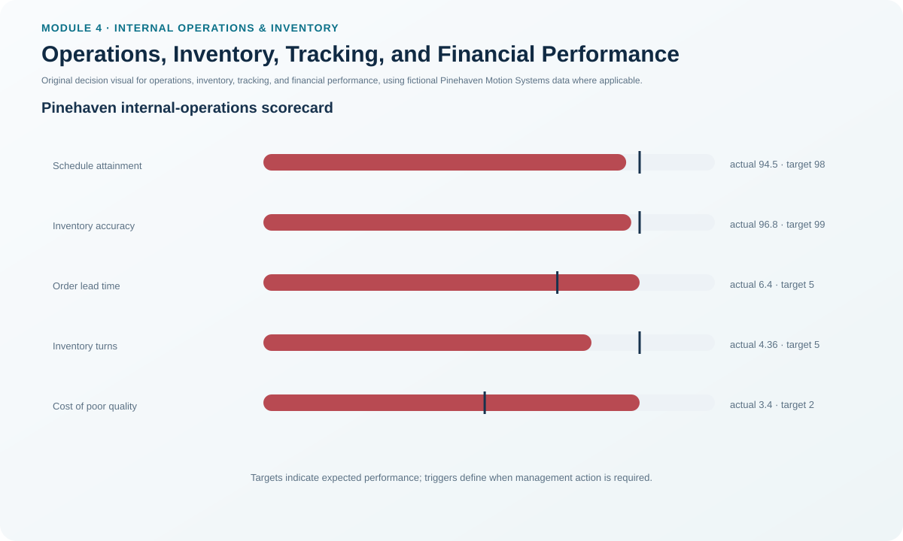
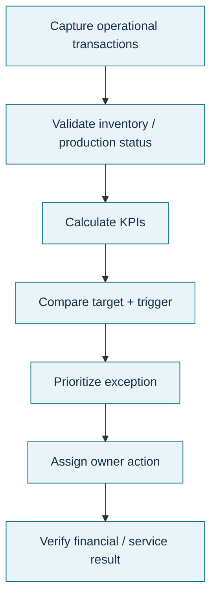

# 2. Operations, Inventory, Tracking, and Financial Performance

## Learning objectives

After this topic, you should be able to:

- interpret operations and inventory performance as a balanced system;
- describe the five-step inventory tracking control sequence;
- connect inventory shrinkage and record accuracy to planning reliability; and
- explain how supply-chain operating processes influence financial results.

## Concept in plain English

Operations performance measures whether execution follows the operating plan without creating avoidable cost, delay, WIP, defects, or inventory. Inventory performance adds the question of whether enough stock is available to support service while capital and risk stay controlled. Financial performance translates those operating choices into assets, liabilities, cash, revenue, expense, and profit.

Inventory tracking is a control process. An item must be identified, quantity verified, movement authorized, movement executed, and the transaction completed in the record. If physical movement and system movement separate, record-on-hand data can diverge from physical-on-hand data. That difference may come from scrap, theft, deterioration, transaction error, or another form of shrinkage. Planning logic that uses a wrong on-hand balance can then promise or replenish stock that does not exist.

Balanced interpretation is critical. High utilization can look favorable while queues, lead time, WIP, or finished-goods inventory rise. Inventory reduction can improve cash but hurt availability if the underlying variability remains. Performance should therefore be read across operations, inventory, customer, and finance rather than in one column.

## Why it matters

Supply-chain operating decisions eventually appear in financial statements and customer outcomes. Better flow can reduce WIP and cash tied up in inventory. Poor quality can create scrap, rework, returns, reserves, and warranty expense. Excess stock raises assets today but can later create write-downs. A scorecard should make these connections visible before local improvements create enterprise damage.

## Decision model and workflow

### Evidence retained through the workflow

Retain KPI definitions and results, record-on-hand versus physical-on-hand reconciliation, inventory adjustments with reason codes, transaction timestamps, responsible location, shrinkage/root-cause findings, financial account linkage, and action ownership. The record should make it possible to trace a performance exception from dashboard to transaction or process evidence.

## Practical process flow

## Realistic example — Pinehaven Motion Systems

Pinehaven's illustrative scorecard shows **97.8% first-pass yield**, **96.8% inventory accuracy**, **4.36 inventory turns**, and **96.2% perfect-order contribution**, all below their targets. Burn-in queue is **124 units** and order lead time is **6.4 days**.

The pattern is more informative than any one number. Lower first-pass yield creates rework and delays. Queue growth lengthens flow. Inaccurate inventory makes replenishment and order promising less reliable. Slower turns tie up more capital. Pinehaven therefore does not launch four unrelated improvement projects; it first tests whether common process causes connect quality, flow, and record accuracy.

Use [`operations-kpis.csv`](../../assets/data/module-4/operations-kpis.csv) for the complete fictional scorecard.

All names and values in this example are fictional and independently selected for learning purposes.

## Applied decision artifact

Build an **operations-and-inventory scorecard** with four columns beyond the raw measure: customer consequence, inventory/cash consequence, likely process driver, and decision owner. For inventory tracking, add a transaction-control checklist: identify item → verify quantity → authorize move → execute move → close the record. Any physical/system mismatch requires a reasoned adjustment and root-cause review rather than a silent balance change.

## Decision logic

- Read operating, inventory, customer, and financial measures together.
- When a record discrepancy appears, protect service first, then correct the record, then find the cause.
- Distinguish the symptom metric from the process driver.
- Do not improve utilization at the expense of WIP, lead time, or demand alignment.
- Translate material improvements into cash, cost, asset, or revenue implications so management can see enterprise value.

## Trade-offs

Tighter inventory control improves reliability but adds transaction discipline and measurement effort. More frequent movement and smaller lots can increase handling transactions even as they lower inventory. Financial reduction targets can create service risk if applied without demand and variability evidence.

## Commonly confused with

**Inventory accuracy** measures agreement between the physical and system record. **Inventory shrinkage** is an actual loss of quantity due to causes such as theft, damage, deterioration, or scrap. A record error can create inaccuracy without physical shrinkage; shrinkage will usually create inaccuracy until the record is adjusted.

## Common mistakes

- Treating utilization as an enterprise success measure by itself.
- Adjusting system inventory without documenting the cause.
- Using different SKU/location definitions across WMS, ERP, and financial reports.
- Measuring inventory cost without a customer-service balancing measure.
- Assuming a financial statement explains the operational cause behind the number.

## Original knowledge check

**Question.** Pinehaven improves machine utilization while its burn-in queue and order lead time both rise. What is the best interpretation?

A. The utilization improvement proves the plant is better.

B. The metrics may be showing local optimization that is increasing WIP and slowing flow.

C. Inventory accuracy must have improved.

D. Higher utilization automatically lowers working capital.

Answer and rationale

### Correct answer

**B. The metrics may be showing local optimization that is increasing WIP and slowing flow.**

### Why it is correct

The combination is a warning that the local utilization measure may be driving more work into a constrained flow without improving system throughput.

### Why the other answers are wrong

- **A.** Local utilization alone does not prove end-to-end improvement.
- **C.** Nothing in the facts establishes inventory accuracy.
- **D.** Higher local utilization can increase WIP and working capital instead of reducing it.

## Practitioner perspective

Link scorecards to drill-down transactions. When a KPI turns red, a planner should be able to move from the aggregate result to the order, material, work center, supplier, location, or transaction that explains it. That is what makes a dashboard operational rather than decorative.

## Related concepts

- [Metrics, KPIs, and Performance Architecture](./01-metrics-kpis-and-performance-architecture.md)
- [TQM and Continuous Improvement Foundations](./03-tqm-and-continuous-improvement-foundations.md)
- [Internal Operations and Inventory Formula Sheet](../../calculations/internal-operations/formula-sheet.md)

---

[Previous](./01-metrics-kpis-and-performance-architecture.md) · [Next](./03-tqm-and-continuous-improvement-foundations.md)
