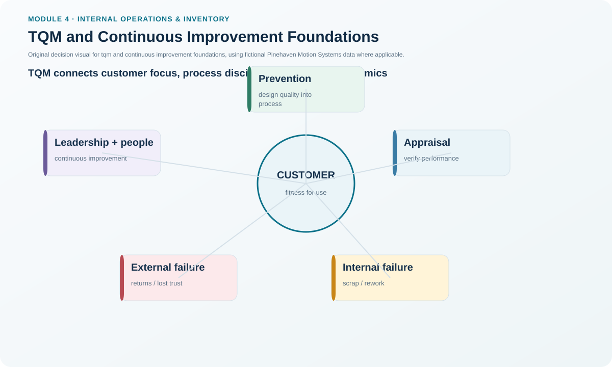
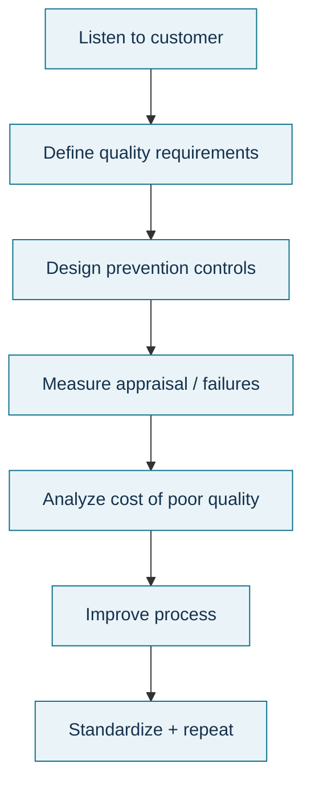

# 3. TQM and Continuous Improvement Foundations

## Learning objectives

After this topic, you should be able to:

- explain continuous improvement and TQM as management systems rather than one-time projects;
- distinguish quality of design from quality of conformance;
- describe leadership, customer, employee, supplier, and measurement responsibilities; and
- separate prevention/appraisal effort from the cost of poor quality.

## Concept in plain English

Continuous improvement means repeatedly improving products, processes, and capabilities instead of waiting for a crisis or periodic audit. When the focus is a process, the same idea becomes continuous process improvement: expose problems, identify root causes, make controlled changes, and keep learning.

Total quality management (TQM) provides a broader management philosophy around that work. Quality is not only absence of defects. It also includes whether the product or service was designed to satisfy customer needs. TQM therefore links **quality of design** with **quality of conformance**. A perfectly manufactured product can still fail if the design does not solve the customer's problem.

The operating culture matters. Management must participate, improvement should repair processes rather than search for blame, the customer belongs at the center of decisions, suppliers should be treated as partners where appropriate, and performance needs consistent measures so improvement can be seen over time. Quality costs also need structure: prevention and appraisal are purposeful control efforts, while internal and external failures represent poor-quality consequences.

## Why it matters

Without a management system, quality becomes the quality department's problem. Defects may be inspected out at the end while upstream design, process, supplier, training, and leadership causes remain untouched. TQM and CI shift attention toward building quality into work and making every function accountable for the customer outcome.

## Decision model and workflow

### Evidence retained through the workflow

Retain customer requirements, defect/failure definitions, quality-of-design and conformance measures, prevention/appraisal activities, internal/external failure costs, supplier-quality evidence, improvement actions, leadership review decisions, and the trend in cost of poor quality.

## Practical process flow

## Realistic example — Pinehaven Motion Systems

Pinehaven's illustrative **cost of poor quality is 3.4% of sales** against a **2.0% target**, and incoming supplier defect rate is **1.1%** against a **0.5% target**. Treating the problem only by adding more final inspection would increase appraisal effort but would not remove the supplier or process causes.

The TQM response is broader: define the customer-critical requirement, examine supplier and internal process causes, strengthen prevention where justified, verify the improved process, and keep a shared performance measure. The objective is not “more inspection”; it is less need for failure handling.

All names and values in this example are fictional and independently selected for learning purposes.

## Applied decision artifact

Use a **cost-of-quality register** with prevention, appraisal, internal failure, and external failure categories. For each major cost, identify the process cause, customer consequence, owner, and prevention opportunity. Pair it with a TQM governance checklist covering leadership participation, customer focus, workforce involvement, supplier partnership, and standard measures.

## Decision logic

- Define quality from the customer and specification perspective.
- Separate design failures from conformance failures.
- Quantify the failure consequences before simply adding inspection.
- Prefer prevention and process correction over repeated sorting/rework.
- Use common measures across functions and suppliers when the process crosses organizational boundaries.
- Keep leadership involved in priorities, resources, and barrier removal.

## Trade-offs

Prevention and appraisal require money and time, but failure costs can be far larger. Excessive inspection can become waste, while too little verification can allow unstable processes to reach customers. Partnership improves joint problem solving, but it still requires clear standards and accountability.

## Commonly confused with

**Quality of design** asks whether the product/service characteristics satisfy the intended customer need. **Quality of conformance** asks whether execution matches the approved design or requirement. TQM covers both; final inspection mainly observes conformance.

## Common mistakes

- Treating TQM as a temporary quality campaign.
- Adding inspection without addressing the process cause.
- Using blame as the main corrective-action method.
- Excluding suppliers from improvement when their process contributes to the outcome.
- Tracking defect counts without the cost and customer consequence.

## Original knowledge check

**Question.** Pinehaven reacts to a rising defect rate by doubling final inspection while leaving the process unchanged. Which TQM principle is most clearly missing?

A. Focus on repairing the process and preventing recurrence.

B. Increase the number of KPIs.

C. Reduce customer involvement.

D. Move all quality responsibility to inspection.

Answer and rationale

### Correct answer

**A. Focus on repairing the process and preventing recurrence.**

### Why it is correct

TQM seeks to improve the process and prevent defects rather than depend on more detection after the defect has already been created.

### Why the other answers are wrong

- **B.** More KPIs do not fix the process.
- **C.** Customer focus should increase, not decrease.
- **D.** TQM distributes quality responsibility rather than isolating it in inspection.

## Practitioner perspective

A useful quality review distinguishes “detection controls” from “cause-removal controls.” Both can be necessary during containment, but a corrective action is not complete when the only permanent change is more inspection.

## Related concepts

- [Operations, Inventory, Tracking, and Financial Performance](./02-operations-inventory-tracking-and-financial-performance.md)
- [Continuous Improvement Model, Initiatives, and People](./04-continuous-improvement-model-initiatives-and-people.md)
- [Internal Operations and Inventory Formula Sheet](../../calculations/internal-operations/formula-sheet.md)

---

[Previous](./02-operations-inventory-tracking-and-financial-performance.md) · [Next](./04-continuous-improvement-model-initiatives-and-people.md)
