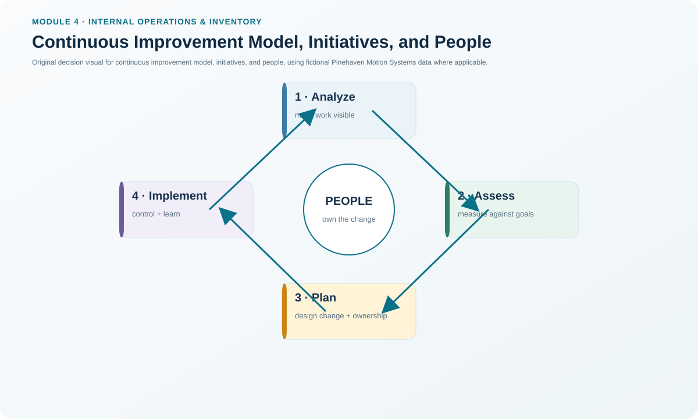
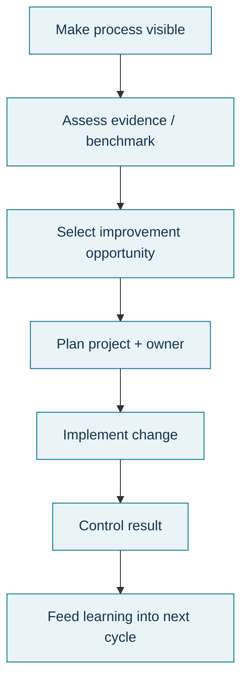

# 4. Continuous Improvement Model, Initiatives, and People

## Learning objectives

After this topic, you should be able to:

- apply the four-stage continuous-improvement model;
- separate process analysis, assessment, project planning, and implementation/change management;
- explain how personnel development supports sustained improvement; and
- design an improvement charter with accountability, training, and adoption controls.

## Concept in plain English

A continuous-improvement initiative should move through a disciplined sequence rather than jump from complaint to solution. A practical four-stage model is: **analyze the current process, assess performance and opportunities, plan the improvement project, and implement/manage the change**.

Analysis establishes the “as-is” process and the evidence behind the problem. Assessment uses KPIs, benchmarks, root-cause evidence, and stakeholder needs to determine what should improve and by how much. Project planning converts the idea into responsibilities, resources, budget, schedule, risks, and commitments. Implementation changes the process and manages adoption, feedback, standardization, and follow-through.

People development is part of the system. Training, on-the-job learning, cross-training, coaching, mentoring, formal courses, online learning, and certification can all be useful depending on the skill and audience. Improvement is directed strategically from the top but usually implemented by the people closest to the process.

## Why it matters

Many improvement projects fail because a team chooses a solution before it understands the process, or it proves a technical solution but does not change behavior and standard work. The stage-gate model makes evidence and ownership visible at each transition. It also protects against “training” being used as a default corrective action when the system itself is the problem.

## Decision model and workflow

### Evidence retained through the workflow

Retain the as-is process map, baseline metrics, root-cause evidence, prioritized opportunity, benchmark/target, project charter, resource and training plan, stakeholder commitments, implementation feedback, updated standard work, adoption evidence, and post-change result.

## Practical process flow

## Realistic example — Pinehaven Motion Systems

Pinehaven's setup-time KPI is **37 minutes** against a **22-minute target**. Jumping straight to “retrain operators” would be premature. The CI model first maps the current changeover and separates tasks that require equipment stoppage from tasks that can occur while the prior run is still active. Assessment then identifies the largest delay sources. Planning assigns engineering and operator owners, defines the trial, and sets the target. Implementation changes the sequence, updates standard work, trains affected people, and verifies that the shorter setup is sustained.

All names and values in this example are fictional and independently selected for learning purposes.

## Applied decision artifact

Create a **continuous-improvement project charter** with four approval gates: (1) current state and evidence accepted, (2) target and root-cause hypothesis accepted, (3) implementation plan/resources approved, and (4) change adopted with control evidence. Add a people-development plan that states the required knowledge/skill, learning method, proof of competence, and owner.

## Decision logic

- Do not approve a solution before the current process and baseline are visible.
- Use assessment to distinguish root cause from symptom and to set a measurable target.
- Plan the change with resources, accountability, stakeholder commitments, and training.
- Pilot or stage implementation where risk is material.
- Update standard work and controls so the process does not revert.
- Evaluate training by job performance, error reduction, retention, or another relevant outcome—not attendance alone.

## Trade-offs

Quick wins can build momentum but may encourage superficial fixes. Larger redesigns can create greater benefit but need more governance and change capacity. Formal certification motivates some roles and proves minimum knowledge, while hands-on coaching may be more effective for task performance.

## Commonly confused with

**Process analysis** describes and investigates the current state. **Process assessment** evaluates performance and priorities against objectives or benchmarks. **Project planning** designs how the change will be delivered. **Change management** ensures the new way is adopted and sustained.

## Common mistakes

- Starting with a favored solution rather than an evidence-based problem statement.
- Calling a project successful at implementation date without verifying sustained performance.
- Using training as the cure for a broken method or system.
- Ignoring the learning style and job context of the people who must adopt the change.
- Running local projects that do not align with strategic priorities.

## Original knowledge check

**Question.** A Pinehaven team has verified the root cause and selected an improvement, but operators do not understand the new standard work. Which stage is incomplete?

A. Process analysis only.

B. Implementation and change management.

C. Benchmark selection only.

D. ABC inventory classification.

Answer and rationale

### Correct answer

**B. Implementation and change management.**

### Why it is correct

Technical design is not enough; implementation must include communication, role clarity, training, adoption, and feedback so the new process becomes normal work.

### Why the other answers are wrong

- **A.** The root cause has already been verified, so analysis is not the main missing element.
- **C.** Benchmarking may inform targets but does not replace adoption.
- **D.** ABC analysis is unrelated to the change-management failure.

## Practitioner perspective

A change record should show both **technical readiness** and **organizational readiness**. In system projects, that can mean configuration/test evidence on one side and role, training, cutover, support, and adoption evidence on the other.

## Related concepts

- [TQM and Continuous Improvement Foundations](./03-tqm-and-continuous-improvement-foundations.md)
- [Benchmarking for Improvement](./05-benchmarking-for-improvement.md)
- [Internal Operations and Inventory Formula Sheet](../../calculations/internal-operations/formula-sheet.md)

---

[Previous](./03-tqm-and-continuous-improvement-foundations.md) · [Next](./05-benchmarking-for-improvement.md)
