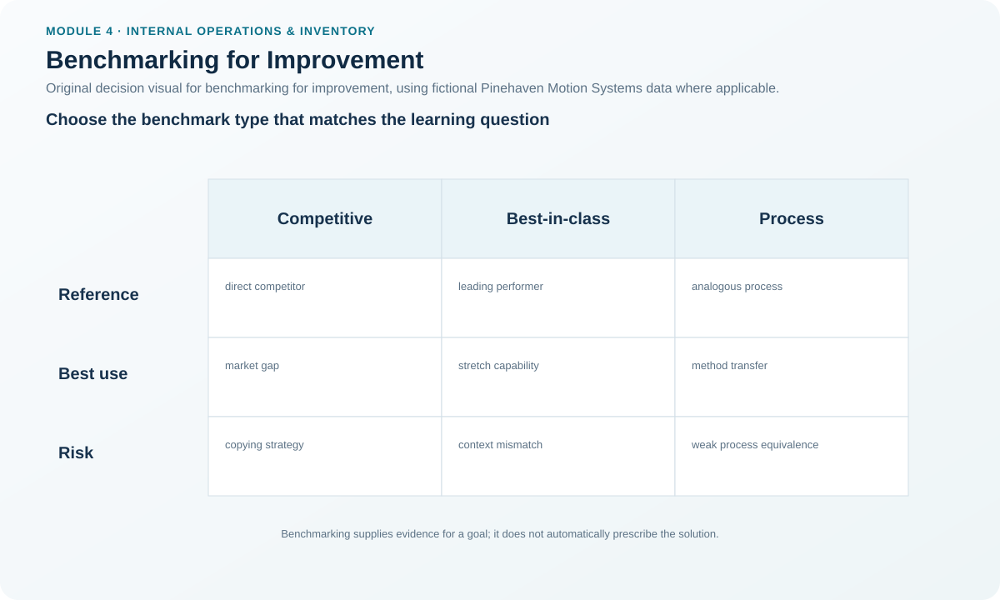
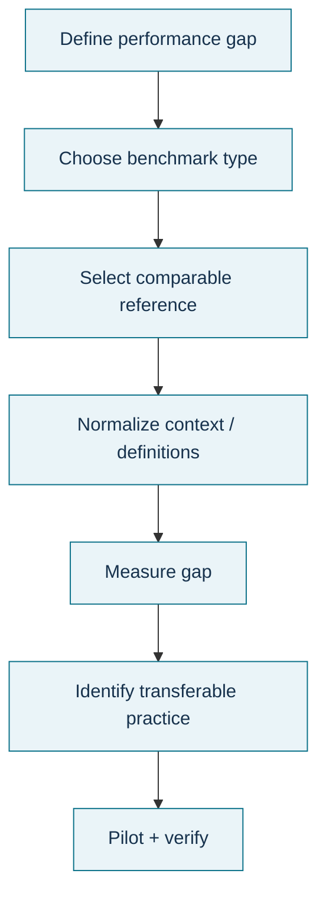

# 5. Benchmarking for Improvement

## Learning objectives

After this topic, you should be able to:

- distinguish competitive, best-in-class, and process benchmarking;
- select comparable benchmark measures and normalize differences;
- use benchmarking to set challenging but credible targets; and
- avoid copying another organization without understanding process context.

## Concept in plain English

Benchmarking sets a performance goal by reference to an external or authoritative standard rather than by internal preference alone. **Competitive benchmarking** compares with a competitor in the same industry. **Best-in-class benchmarking** looks for exceptional performance wherever it exists, even outside the industry. **Process benchmarking** compares the process against a recognized description or model of an excellent process.

The benchmark is a target-setting input, not proof that the same result is achievable in the same way. Differences in product mix, automation, regulation, volume, geography, accounting rules, service promise, and measurement definitions can make a direct numerical comparison misleading. Good benchmarking therefore normalizes the metric and studies the process behind the performance before transferring a practice.

## Why it matters

Internal targets often drift toward what seems comfortable. Benchmarking can reveal that a better result is already possible somewhere else. It can also prevent an organization from declaring success merely because it improved from a weak baseline. But benchmarking is useful only when the comparison is sufficiently fair and when the team learns from the underlying process rather than chasing a number.

## Decision model and workflow

### Evidence retained through the workflow

Retain the benchmark type, comparison organization/process, metric definition, unit, period, volume/product-mix differences, normalization method, data reliability, benchmark value, Pinehaven baseline, gap, transferable practice, constraints, and approved target.

## Practical process flow

## Realistic example — Pinehaven Motion Systems

Pinehaven's first-pass yield is **97.8%** while the illustrative benchmark in the locked KPI file is **99.0%**. Its setup time is **37 minutes** against a **25-minute benchmark**. These gaps are useful signals, but Pinehaven should not copy another plant's target blindly. It first confirms that the product mix, setup definition, and quality boundary are comparable.

For setup time, the transferable question is not “How do we force 25 minutes?” but “What methods enable comparable operations to change over faster, and which of those methods fit our process?”

All names and values in this example are fictional and independently selected for learning purposes.

## Applied decision artifact

Use a **benchmarking comparison worksheet** with: benchmark type, metric definition, source, comparison context, normalization adjustments, current performance, benchmark, gap, process practice observed, transferability assessment, risk/constraint, and target recommendation. A target is approved only after the metric definitions and operating context are reconciled.

## Decision logic

- Choose the benchmark type that fits the learning goal.
- Normalize definitions and context before comparing numbers.
- Study the process that creates the benchmark result.
- Separate transferable practice from context-specific advantage.
- Set a target that is ambitious but feasible for the actual process.
- Revisit the benchmark when technology, customer expectations, or operating context change.

## Trade-offs

Competitive benchmarking offers high relevance but may provide limited access to process details. Best-in-class benchmarking can reveal breakthrough ideas but may require more translation. Process standards are accessible and consistent, yet they may not represent the frontier of performance for a specific industry.

## Commonly confused with

Benchmarking is **not** the same as a target. A benchmark is an external reference point. Management chooses the target after considering the benchmark, the local baseline, feasibility, and strategy. Benchmarking is also not imitation; the goal is learning and target calibration.

## Common mistakes

- Comparing metrics whose definitions are different.
- Assuming the best observed result can be copied without understanding the process.
- Benchmarking only the number and not the method.
- Choosing a weak peer so the organization looks good.
- Ignoring customer or financial trade-offs when pursuing a benchmark.

## Original knowledge check

**Question.** Pinehaven finds a hospital has a much faster document-approval process than its own engineering-change process. Which benchmarking approach is this most likely to represent?

A. Competitive benchmarking only.

B. Best-in-class or cross-industry process learning.

C. Inventory cycle counting.

D. RCCP.

Answer and rationale

### Correct answer

**B. Best-in-class or cross-industry process learning.**

### Why it is correct

The learning source is outside Pinehaven’s industry, so the team is looking for excellent process performance rather than a direct competitor comparison.

### Why the other answers are wrong

- **A.** A hospital is not a direct industrial competitor.
- **C.** Cycle counting is an inventory-control method.
- **D.** RCCP is a capacity-planning method.

## Practitioner perspective

Keep a benchmark-definition appendix. Seemingly simple measures such as lead time often differ in start event, end event, calendar, exclusions, and population. Without reconciliation, a comparison can be numerically precise and operationally wrong.

## Related concepts

- [Continuous Improvement Model, Initiatives, and People](./04-continuous-improvement-model-initiatives-and-people.md)
- [Basic Quality Tools I: Process Maps and Control Charts](./06-basic-quality-tools-i-process-maps-and-control-charts.md)
- [Internal Operations and Inventory Formula Sheet](../../calculations/internal-operations/formula-sheet.md)

---

[Previous](./04-continuous-improvement-model-initiatives-and-people.md) · [Next](./06-basic-quality-tools-i-process-maps-and-control-charts.md)
