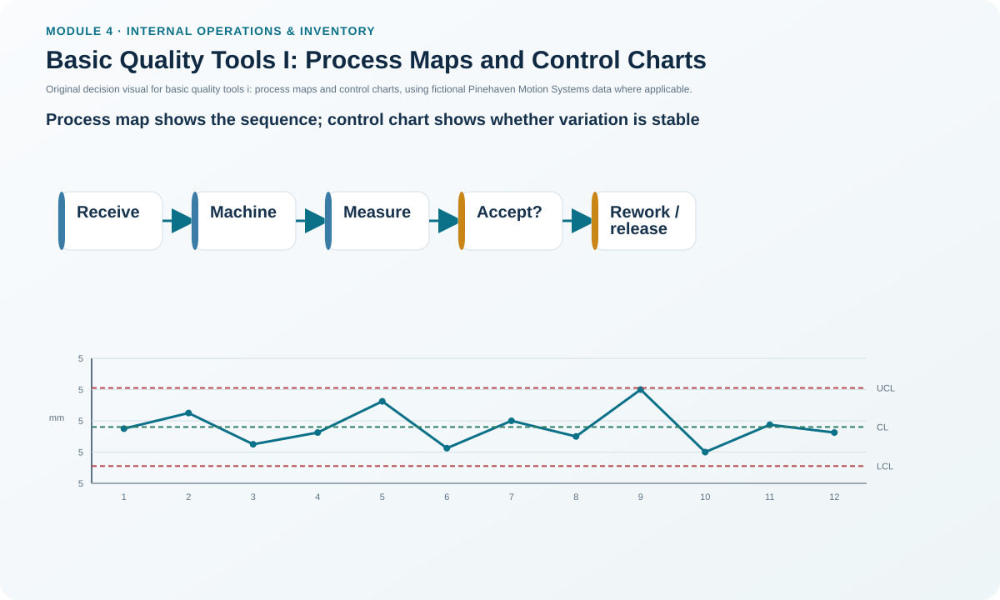
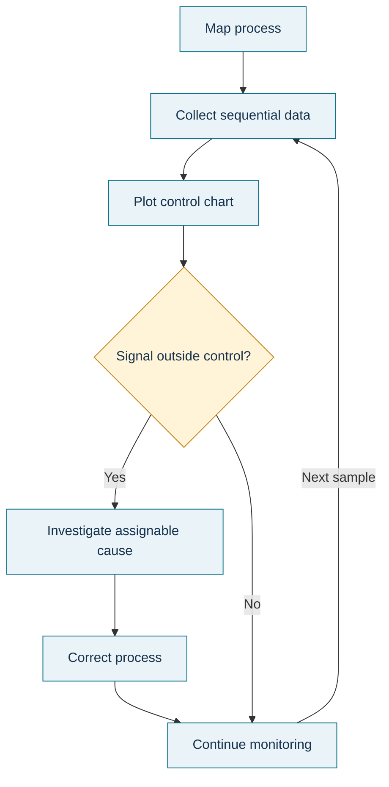

# 6. Basic Quality Tools I: Process Maps and Control Charts

## Learning objectives

After this topic, you should be able to:

- use process maps to expose sequence, handoffs, delay, and decision points;
- interpret control charts as process-stability tools rather than specification charts;
- distinguish common-cause from special-cause variation at a conceptual level; and
- select an appropriate response when a process signal becomes abnormal.

## Concept in plain English

A **process map** makes work visible. It shows the sequence of activities, decision points, handoffs, inputs/outputs, and often time, owner, or resource information. It is useful because many delays and rework loops are invisible in procedure text. Mapping the actual process—not the ideal procedure—gives an improvement team a common picture of what really happens.

A **control chart** shows process measurements over time against a center line and statistically determined control limits. The purpose is to understand process behavior and detect unusual signals. Control limits describe expected process variation based on the process data; **specification limits** describe what the customer or engineering requirement will accept. A process can be statistically stable but still incapable of meeting a tight specification, or it can be capable on average but unstable because special causes are present.

Statistical process control (SPC) uses such evidence to monitor and adjust operations. The manager's job is not to react to every normal wiggle but to investigate signals that indicate the process may have changed.

## Why it matters

Teams often debate symptoms because they lack a shared process picture. Process mapping aligns the discussion. Control charts then add time-based evidence so the team can distinguish ordinary variation from a meaningful shift. Used together, the tools move improvement from opinion toward process evidence.

## Decision model and workflow

### Evidence retained through the workflow

Retain the approved current-state map, process boundaries, step owners and times, measurement definition, subgroup/time order, center line, control-limit method, abnormal-signal rule, investigation record, corrective action, and post-action stability check.

## Practical process flow

## Realistic example — Pinehaven Motion Systems

Pinehaven's locked shaft-diameter series contains 12 measurements with a mean of approximately **5.024 mm**. Using the sample standard deviation of **0.048 mm** as an illustrative calculation, mean ± 3s is approximately **4.881 to 5.167 mm**. The lesson uses this only as a teaching calculation; a real control-chart design must match the measurement and subgroup method.

The important management point is not the arithmetic alone. Pinehaven first maps the process that generates the measurement, then reacts to a signal by checking the equipment, method, material, measurement system, and environment rather than adjusting the process after every normal point.

The data are in [`quality-tools-data.csv`](../../assets/data/module-4/quality-tools-data.csv).

All names and values in this example are fictional and independently selected for learning purposes.

## Applied decision artifact

Create a **process-map and control-chart pack**: one map showing actual sequence and decision/rework loops, one measurement definition, one time-ordered chart, and one response plan. The response plan should say who investigates, what evidence is checked, when production is contained, and how the team confirms stability after correction.

## Decision logic

- Map the current process before selecting a fix.
- Define the measurement and time/subgroup logic consistently.
- Use control limits to understand process behavior; use specification limits to understand customer/engineering acceptance.
- Investigate unusual signals rather than tampering with every normal fluctuation.
- After correction, verify both stability and capability against the actual requirement.

## Trade-offs

More frequent measurement can detect changes earlier but costs time and may encourage overreaction. Wider control limits reduce false alarms but can delay detection; narrower limits may create noise if they are not statistically justified. Detailed process maps reveal more handoffs but can become unreadable unless the scope is controlled.

## Commonly confused with

**Control limits** are calculated from process behavior. **Specification limits** come from the requirement. A point inside control limits is not automatically acceptable to the customer, and a point inside specification limits does not prove the process is stable.

## Common mistakes

- Mapping the official procedure instead of the actual process.
- Treating a control limit as a product specification.
- Adjusting the process after every up/down movement.
- Ignoring the measurement system when a signal appears.
- Using aggregated data that hide shift, machine, supplier, or time differences.

## Original knowledge check

**Question.** A stable process has all points behaving consistently, but its average output regularly misses the customer specification. What is the correct conclusion?

A. The process is in control and therefore acceptable.

B. The process can be stable yet incapable of meeting the specification.

C. The specification becomes the control limit automatically.

D. No improvement is possible.

Answer and rationale

### Correct answer

**B. The process can be stable yet incapable of meeting the specification.**

### Why it is correct

Stability and capability answer different questions. A process may behave predictably and still be centered or spread in a way that fails the requirement.

### Why the other answers are wrong

- **A.** Statistical control does not guarantee conformance.
- **C.** Specification and control limits have different origins.
- **D.** A stable process is often easier to improve because its behavior is predictable.

## Practitioner perspective

In digital quality systems, save the raw ordered observations behind the chart. A screenshot without the data, subgroup logic, and calculation method is difficult to audit or reproduce.

## Related concepts

- [Benchmarking for Improvement](./05-benchmarking-for-improvement.md)
- [Basic Quality Tools II: Pareto and Cause-and-Effect](./07-basic-quality-tools-ii-pareto-and-cause-and-effect.md)
- [Internal Operations and Inventory Formula Sheet](../../calculations/internal-operations/formula-sheet.md)

---

[Previous](./05-benchmarking-for-improvement.md) · [Next](./07-basic-quality-tools-ii-pareto-and-cause-and-effect.md)
