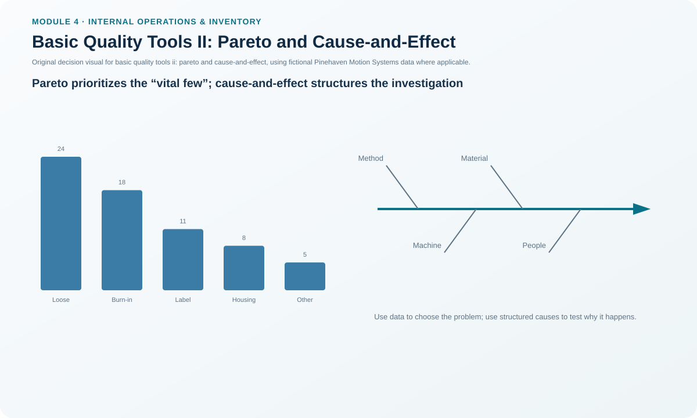
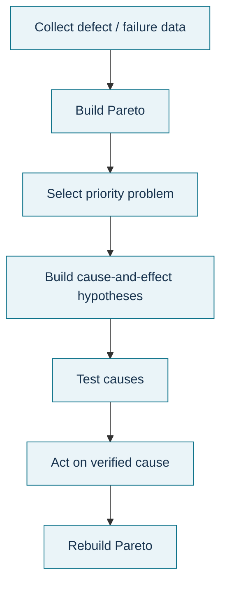

# 7. Basic Quality Tools II: Pareto and Cause-and-Effect

## Learning objectives

After this topic, you should be able to:

- build and interpret a Pareto view of categorized losses;
- use a cause-and-effect diagram to organize root-cause hypotheses;
- apply the “vital few” idea without treating 80/20 as a rigid law; and
- avoid confusing a plausible cause with a verified root cause.

## Concept in plain English

A **Pareto chart** ranks categories from largest to smallest so an improvement team can focus attention where the largest share of loss, defects, time, or cost occurs. Pareto's law or the 80-20 idea is a prioritization principle: a relatively small number of causes often account for a large share of the effect. The exact split does not need to be 80/20.

A **cause-and-effect diagram** (fishbone/Ishikawa) does something different. It organizes possible causes of an observed effect under useful categories such as people, method, material, equipment, measurement, and environment. The diagram expands hypotheses; it does not prove them. The team must collect evidence and often ask repeated “why” questions until it reaches a cause that can be tested and controlled.

The tools therefore work well together: Pareto helps decide **where to investigate**, while cause-and-effect helps structure **what might be causing it**.

## Why it matters

Improvement resources are limited. A team that attacks every defect category equally spreads effort thin. A team that fixes the first explanation it hears risks correcting a symptom. Combining prioritization with disciplined root-cause investigation improves the odds that effort produces a durable result.

## Decision model and workflow

### Evidence retained through the workflow

Retain category definitions, observation period, counts/cost/time by category, ranking and cumulative share, selected priority, cause-and-effect hypotheses, evidence used to test each hypothesis, verified root cause, corrective action, and before/after result.

## Practical process flow

## Realistic example — Pinehaven Motion Systems

The locked Pinehaven defect data contain **66** events. Loose connectors account for **24 (36.4%)**, burn-in failures for **18 (27.3%)**, and label mismatches for **11 (16.7%)**. The first three categories together represent about **80.3%** of observed defects.

That does not prove the first three share one cause. It tells Pinehaven where investigation will probably produce the largest payoff. For loose connectors, the fishbone might include torque method, tool calibration, fixture condition, connector lot, operator standard work, and measurement method. Evidence must then confirm or reject those hypotheses.

Use [`quality-tools-data.csv`](../../assets/data/module-4/quality-tools-data.csv).

All names and values in this example are fictional and independently selected for learning purposes.

## Applied decision artifact

Create a **Pareto/root-cause worksheet** with: defect category, count/cost, cumulative share, selected priority, possible causes by category, evidence required, test result, verified root cause, containment, permanent correction, and control. Do not allow “operator error” as the final root cause without investigating why the system allowed or encouraged the error.

## Decision logic

- Stratify and rank the effect before launching many corrective actions.
- Choose the highest-value problem that is actionable and strategically relevant.
- Brainstorm causes broadly, then test them with evidence.
- Use repeated why-questions to move from symptom toward controllable cause.
- Verify that the corrective action reduces the prioritized effect without creating another failure.

## Trade-offs

Pareto focus increases impact but can neglect low-frequency high-severity events, so safety/regulatory risks may need priority regardless of count. Fishbone diagrams encourage broad thinking but can become speculation if hypotheses are not tested.

## Commonly confused with

A **Pareto chart** ranks observed categories. A **histogram** shows the distribution of continuous measurement data. A **cause-and-effect diagram** organizes possible causes. None of the three, by itself, proves causality.

## Common mistakes

- Treating 80/20 as a mandatory numerical rule.
- Prioritizing by count when severity or cost should dominate.
- Calling the fishbone branch a proven root cause.
- Stopping at “training issue” or “operator error” without system evidence.
- Mixing categories that are defined inconsistently.

## Original knowledge check

**Question.** Pinehaven’s top defect category is “loose connector.” What should the team do next?

A. Declare operator error as the root cause.

B. Use evidence-based root-cause analysis on the prioritized category.

C. Build a histogram of supplier prices.

D. Increase every inspection equally.

Answer and rationale

### Correct answer

**B. Use evidence-based root-cause analysis on the prioritized category.**

### Why it is correct

Pareto identifies the priority category; the next step is to investigate and verify its causes rather than assume one.

### Why the other answers are wrong

- **A.** The cause is not yet known.
- **C.** Supplier-price distribution does not address the observed defect.
- **D.** Equal inspection does not focus on the prioritized cause and may only add appraisal effort.

## Practitioner perspective

For safety, compliance, and catastrophic-risk items, add a severity override to Pareto priority. Frequency is powerful for routine improvement but must not outrank mandatory risk controls.

## Related concepts

- [Basic Quality Tools I: Process Maps and Control Charts](./06-basic-quality-tools-i-process-maps-and-control-charts.md)
- [Basic Quality Tools III: Histogram, Check Sheet, and Scatter Chart](./08-basic-quality-tools-iii-histogram-check-sheet-and-scatter-chart.md)
- [Internal Operations and Inventory Formula Sheet](../../calculations/internal-operations/formula-sheet.md)

---

[Previous](./06-basic-quality-tools-i-process-maps-and-control-charts.md) · [Next](./08-basic-quality-tools-iii-histogram-check-sheet-and-scatter-chart.md)
