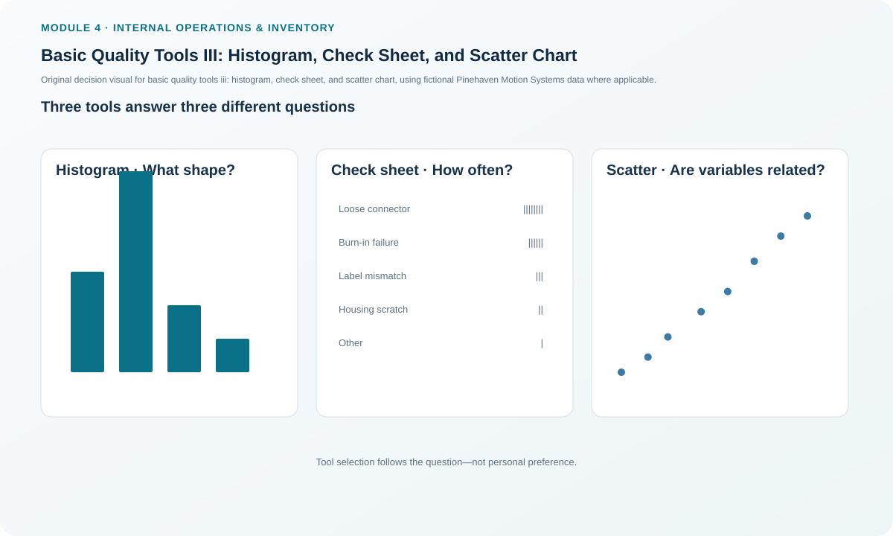
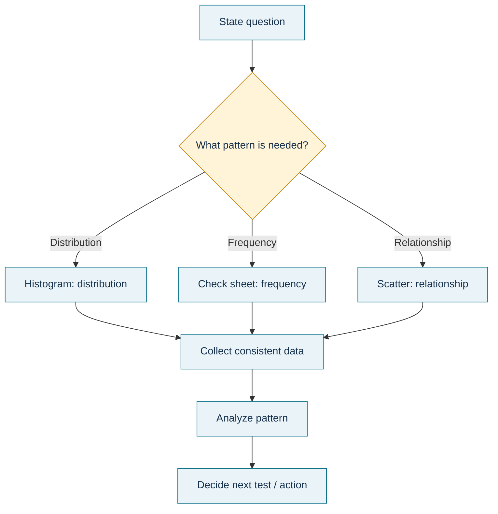

# 8. Basic Quality Tools III: Histogram, Check Sheet, and Scatter Chart

## Learning objectives

After this topic, you should be able to:

- choose among a histogram, check sheet, and scatter chart based on the question;
- interpret a distribution without confusing it with categorical frequency;
- design representative check-sheet data collection; and
- interpret correlation as association rather than proof of causation.

## Concept in plain English

Three basic quality tools answer different questions. A **check sheet** is a structured way to collect event counts at the source. A **histogram** shows how continuous measurement values are distributed across ranges. A **scatter chart** plots paired x-y observations to show whether two variables move together and how strongly.

The tools often form a sequence. A team can collect observations with a check sheet, summarize a measurement distribution with a histogram, and test a possible relationship with a scatter plot. Tool choice should follow the question: **How often does each event occur? How is this measurement distributed? Do these two variables appear related?**

A correlation does not prove one variable causes the other. A third variable, selection bias, or coincidence may explain the pattern. Scatter evidence is therefore a hypothesis-strengthening tool, not a substitute for controlled investigation.

## Why it matters

Quality problems become harder when teams collect data that cannot answer the decision question. A check sheet that mixes machines or shifts without identification may hide the source. A histogram can show spread but not sequence over time. A scatter plot can suggest a relationship but does not establish cause. Selecting the right tool protects both effort and interpretation.

## Decision model and workflow

### Evidence retained through the workflow

Retain the question being tested, data definition, source/entity, observation period, sampling method, raw observations, grouping/bin rule where used, scatter-variable definitions, correlation/relationship interpretation, and follow-up test.

## Practical process flow

## Realistic example — Pinehaven Motion Systems

Pinehaven's scatter dataset compares humidity with solder-defect percentage across eight observations. The illustrative Pearson correlation is about **0.998**, a very strong positive association in this small fictional sample.

That result is not enough to declare humidity the cause. Pinehaven should verify measurement quality, examine confounding factors such as material lot or shift, and run a controlled investigation before changing environmental limits.

The same dataset also contains time-ordered shaft measurements that can be binned into a histogram and defect observations that could have been gathered through a check sheet. This demonstrates why one dataset can support different tools for different questions.

All names and values in this example are fictional and independently selected for learning purposes.

## Applied decision artifact

Use a **quality-tool selection card**: (1) decision question, (2) data type, (3) tool, (4) collection rule, (5) interpretation limit, and (6) next test. For a check sheet, define categories before collection. For a histogram, define measurement units and bin logic. For scatter, define x and y and explicitly write “association does not prove causation.”

## Decision logic

- Use a check sheet when the immediate need is consistent event collection.
- Use a histogram to study shape, center, spread, skew, or multiple peaks in continuous data.
- Use a scatter chart to explore the relationship between paired variables.
- Stratify data when machines, shifts, suppliers, products, or conditions could differ.
- Do not infer cause from correlation alone; plan a confirming test.

## Trade-offs

Simple check sheets are fast but depend on disciplined observation. Histograms reveal distribution shape but discard time sequence. Scatter charts show relationships but can be misleading with small samples, restricted ranges, or hidden variables.

## Commonly confused with

A **Pareto chart** ranks categories. A **histogram** groups continuous measurements into ranges. A **control chart** preserves the order of measurements over time. A **scatter chart** compares paired variables. These charts may all use dots or bars, but they answer different questions.

## Common mistakes

- Collecting categories that overlap or change during the study.
- Building a histogram from categorical defect names.
- Using a scatter plot as proof of cause.
- Ignoring subgroup differences such as shift or equipment.
- Choosing the chart first and the question second.

## Original knowledge check

**Question.** A team wants to know whether higher humidity is associated with more solder defects. Which tool is the best first visual?

A. Check sheet only.

B. Scatter chart.

C. Activity network diagram.

D. ABC analysis.

Answer and rationale

### Correct answer

**B. Scatter chart.**

### Why it is correct

A scatter chart is designed to display paired values for two variables and show whether an association may exist.

### Why the other answers are wrong

- **A.** A check sheet could collect events but would not by itself show the paired relationship.
- **C.** An activity network shows task dependencies.
- **D.** ABC analysis prioritizes inventory/value categories.

## Practitioner perspective

Store the raw data with the visualization. Re-created charts without original observations are difficult to audit, re-bin, stratify, or test under a different hypothesis.

## Related concepts

- [Basic Quality Tools II: Pareto and Cause-and-Effect](./07-basic-quality-tools-ii-pareto-and-cause-and-effect.md)
- [New Quality Tools I: Affinity, Tree, and Matrix Diagrams](./09-new-quality-tools-i-affinity-tree-and-matrix-diagrams.md)
- [Internal Operations and Inventory Formula Sheet](../../calculations/internal-operations/formula-sheet.md)

---

[Previous](./07-basic-quality-tools-ii-pareto-and-cause-and-effect.md) · [Next](./09-new-quality-tools-i-affinity-tree-and-matrix-diagrams.md)
