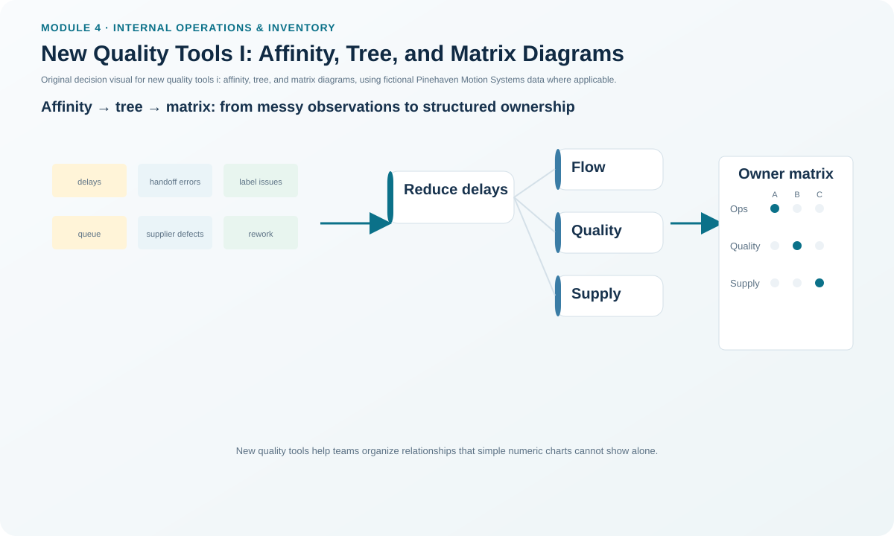
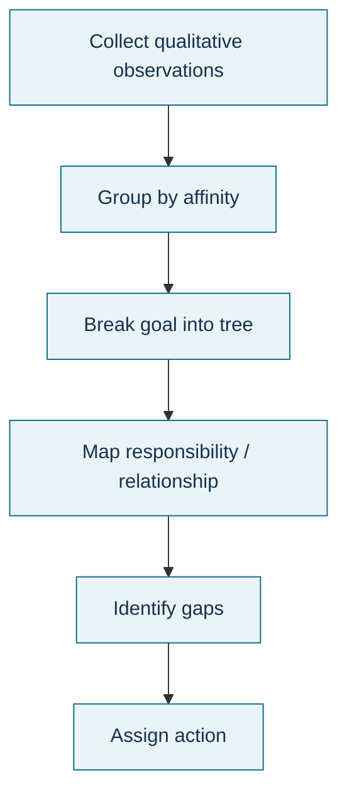

# 9. New Quality Tools I: Affinity, Tree, and Matrix Diagrams

## Learning objectives

After this topic, you should be able to:

- use affinity diagrams to organize many ideas into themes;
- use tree diagrams to decompose a goal into progressively detailed actions;
- use matrix diagrams to show relationship strength between groups; and
- select among the three tools based on the type of management question.

## Concept in plain English

The newer management and planning tools help teams structure complex, less-numeric information. An **affinity diagram** groups a large set of brainstormed observations into themes so a problem space becomes understandable. A **tree diagram** starts with a goal and decomposes it into increasingly specific tasks, causes, or requirements. A **matrix diagram** compares two or more groups and shows whether relationships are strong, weak, or absent.

These tools are especially useful before the team has enough quantitative evidence for statistical analysis. They turn unstructured knowledge into a form that can guide data collection, requirement design, or project planning. They can also be chained: affinity themes can become branches of a tree, and a matrix can then test which solutions address which requirements.

## Why it matters

Supply-chain improvement often starts with fragmented knowledge from customers, operators, engineers, suppliers, and service teams. Without structure, the loudest opinion can dominate. These tools make the reasoning visible and expose gaps such as a customer requirement with no corresponding action or a proposed solution that addresses only one theme.

## Decision model and workflow

### Evidence retained through the workflow

Retain the original brainstorm statements, grouping rationale, affinity headers, tree goal/branches/tasks, matrix row and column definitions, relationship scale, reviewers, unresolved gaps, and decision made from the analysis.

## Practical process flow

## Realistic example — Pinehaven Motion Systems

Pinehaven receives many comments about order delays. The improvement team first groups the comments into themes such as planning, material availability, burn-in capacity, label/release errors, and shipment coordination. It then builds a tree under the goal “reduce order lead time” to identify actions under each theme. Finally, a matrix compares proposed actions—setup reduction, buffer control, supplier-quality action, scan-to-print labeling, and schedule discipline—against customer and process requirements.

The important output is not a pretty diagram. It is a transparent view of which needs are covered, which are unsupported, and where more evidence is required.

All names and values in this example are fictional and independently selected for learning purposes.

## Applied decision artifact

Create an **affinity/tree/matrix decision pack**. Preserve the raw ideas before grouping, then document theme names and the logic used. In the matrix, define relationship strength explicitly (for example strong/medium/weak/none) before scoring so the team does not change the scale to favor a preferred solution.

## Decision logic

- Use affinity when the problem space contains many unstructured ideas.
- Use a tree when a goal or issue needs hierarchical decomposition.
- Use a matrix when the decision depends on relationships between two defined groups.
- Carry unresolved items forward instead of forcing every idea into a category.
- Validate the structure with people who know the process and customers.

## Trade-offs

Qualitative tools enable rapid structure and participation but can reflect facilitator bias. More detailed trees improve completeness but become hard to manage. Numeric matrix scores can create false precision unless the relationship scale has clear meaning.

## Commonly confused with

An **affinity diagram** groups ideas by natural relationship. A **tree diagram** decomposes one goal into levels. A **matrix diagram** compares relationships across groups. A relationship/interrelationship diagram, covered next, emphasizes directional influence among causes rather than row-column coverage.

## Common mistakes

- Discarding inconvenient brainstorm ideas during grouping.
- Writing affinity headings before seeing the ideas and forcing responses to fit.
- Creating a tree so detailed that ownership and priorities disappear.
- Using matrix symbols without defining what each symbol means.
- Treating qualitative relationship scores as measured performance data.

## Original knowledge check

**Question.** A team has 80 anonymous improvement ideas and wants to discover natural themes before prioritizing. Which tool fits best?

A. Affinity diagram.

B. Control chart.

C. EOQ model.

D. Activity network diagram.

Answer and rationale

### Correct answer

**A. Affinity diagram.**

### Why it is correct

Affinity analysis is designed to organize many brainstormed ideas into meaningful groups without requiring a pre-existing hierarchy.

### Why the other answers are wrong

- **B.** A control chart requires ordered process measurements.
- **C.** EOQ is an inventory lot-sizing model.
- **D.** An activity network sequences project tasks rather than organizing raw ideas.

## Practitioner perspective

Photographing sticky notes is not enough for auditability. Transcribe the raw statements, preserve the mapping to themes, and record who validated the grouping. That lets the analysis be challenged later without repeating the workshop.

## Related concepts

- [Basic Quality Tools III: Histogram, Check Sheet, and Scatter Chart](./08-basic-quality-tools-iii-histogram-check-sheet-and-scatter-chart.md)
- [New Quality Tools II: PDPC, Relationship, Matrix Data, and Activity Network](./10-new-quality-tools-ii-pdpc-relationship-matrix-data-and-activity-network.md)
- [Internal Operations and Inventory Formula Sheet](../../calculations/internal-operations/formula-sheet.md)

---

[Previous](./08-basic-quality-tools-iii-histogram-check-sheet-and-scatter-chart.md) · [Next](./10-new-quality-tools-ii-pdpc-relationship-matrix-data-and-activity-network.md)
