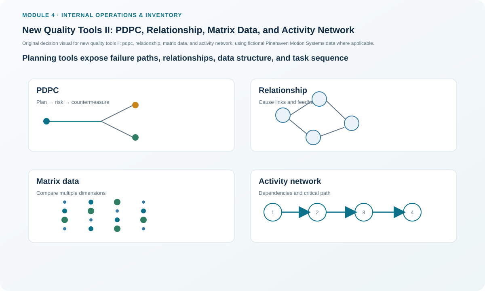
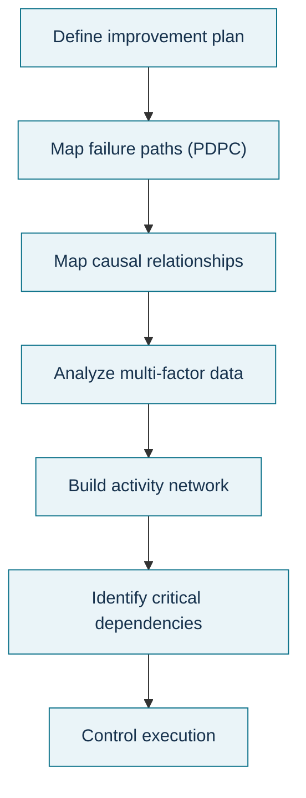

# 10. New Quality Tools II: PDPC, Relationship, Matrix Data, and Activity Network

## Learning objectives

After this topic, you should be able to:

- use a process decision program chart (PDPC) to anticipate failure paths;
- use a relationship diagram to identify influential and highly connected factors;
- explain the role of matrix-data views for multi-variable comparison; and
- use an activity network to sequence dependent tasks and expose the critical path.

## Concept in plain English

These planning tools help when an improvement effort must move from ideas to execution. A **PDPC** asks what could go wrong as the plan unfolds and what preventive or contingency action would protect the objective. A **relationship diagram** maps directional influence among factors so the team can see major drivers and highly connected issues. A **matrix data analysis chart** positions alternatives against two or more measured features. An **activity network diagram** shows task dependencies, sequence, parallel work, and the path that controls project duration.

The common theme is planning under complexity. The tools do not replace project management or risk analysis; they make dependencies and relationships visible before the team commits resources.

## Why it matters

Improvement programs often fail at handoffs rather than at the main technical idea. A change may depend on fixture readiness, validation units, test completion, engineering approval, and training. If the dependencies are invisible, a team can report many tasks “green” while the controlling path is late. PDPC and relationship analysis add risk and causal structure around that schedule.

## Decision model and workflow

### Evidence retained through the workflow

Retain the objective, foreseeable failure paths, preventive/contingency actions, relationship arrows and rationale, compared variables and measurements, task list, predecessor logic, duration basis, critical-path calculation, schedule owner, and status changes.

## Practical process flow

## Realistic example — Pinehaven Motion Systems

The locked Pinehaven activity-network data contain five dependent tasks: prepare fixture (2 h), load validation units (1 h), run thermal profile (4 h), analyze results (2 h), and approve the parameter change (1 h). In the illustrative data they form one dependency chain, so the network duration is **10 hours**.

A PDPC around the same project might ask what happens if the fixture is not ready, validation units fail incoming checks, the thermal profile is invalid, or approval evidence is incomplete. A relationship diagram can then show how fixture condition, test repeatability, queue pressure, and approval delay influence one another.

All names and values in this example are fictional and independently selected for learning purposes.

## Applied decision artifact

Build a **project-planning control pack** with four sheets: PDPC risk branches, relationship/influence map, matrix-data comparison where measured alternatives exist, and activity network. Every activity requires an owner, predecessor, duration basis, and completion evidence. Any task on the controlling path receives an explicit escalation trigger.

## Decision logic

- Use PDPC before execution to anticipate failure and response.
- Use relationship mapping when many causes influence one another.
- Use matrix-data comparison when alternatives can be positioned on measured dimensions.
- Use an activity network when sequence and dependency determine completion time.
- Recalculate the controlling path whenever task duration or dependencies change.

## Trade-offs

More contingency planning improves resilience but can make a project overengineered. Relationship diagrams reveal complexity but can become unreadable if every weak influence is drawn. Activity networks improve schedule logic but rely on realistic durations and dependencies.

## Commonly confused with

A **tree diagram** decomposes a goal hierarchically. An **activity network** represents execution dependencies over time. A **relationship diagram** shows influence among factors, while a **cause-and-effect fishbone** organizes possible causes into categories.

## Common mistakes

- Building a schedule with dates but no predecessor logic.
- Treating every possible risk as equally important.
- Drawing influence arrows without agreeing on direction or evidence.
- Assuming the initial critical path will remain critical after a delay or scope change.
- Using a matrix-data chart when the variables are not actually measured.

## Original knowledge check

**Question.** An improvement project has many tasks, but management mainly needs to know which dependent sequence determines the earliest completion date. Which tool is most appropriate?

A. Activity network diagram.

B. Affinity diagram.

C. Check sheet.

D. Histogram.

Answer and rationale

### Correct answer

**A. Activity network diagram.**

### Why it is correct

An activity network is designed to show task dependencies and identify the sequence that controls project completion.

### Why the other answers are wrong

- **B.** Affinity diagrams group ideas, not schedules.
- **C.** Check sheets collect occurrence data.
- **D.** Histograms show distributions.

## Practitioner perspective

Project software can draw a network automatically, but the value still depends on the predecessor logic. Review dependencies with the people doing the work; software cannot repair a logically wrong network.

## Related concepts

- [New Quality Tools I: Affinity, Tree, and Matrix Diagrams](./09-new-quality-tools-i-affinity-tree-and-matrix-diagrams.md)
- [Lean Waste, Objectives, and Five Principles](./11-lean-waste-objectives-and-five-principles.md)
- [Internal Operations and Inventory Formula Sheet](../../calculations/internal-operations/formula-sheet.md)

---

[Previous](./09-new-quality-tools-i-affinity-tree-and-matrix-diagrams.md) · [Next](./11-lean-waste-objectives-and-five-principles.md)
