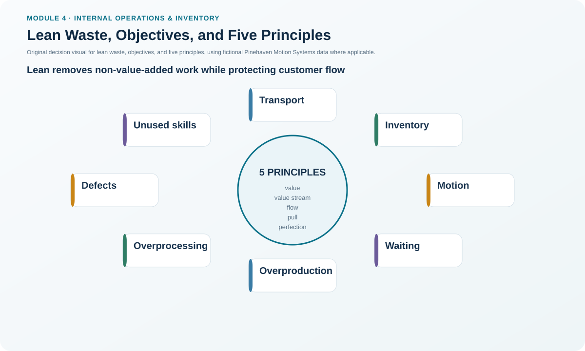
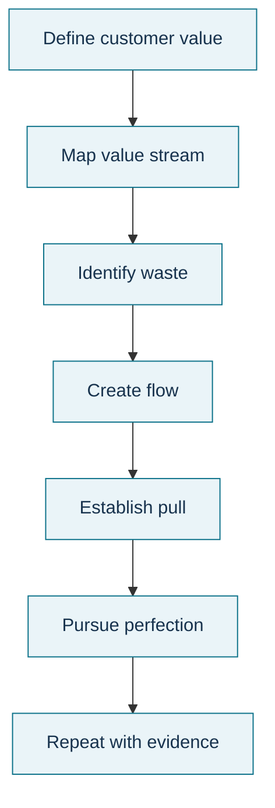

# 11. Lean Waste, Objectives, and Five Principles

## Learning objectives

After this topic, you should be able to:

- identify the eight major categories of lean waste used in this learning system;
- connect lean objectives to customer value, flow, working capital, and quality;
- apply the five lean principles to an end-to-end value stream; and
- explain why overproduction can create multiple downstream wastes.

## Concept in plain English

Lean asks a simple but demanding question: **does this activity create value the customer is willing to pay for, or is it waste that should be reduced or eliminated?** The eight waste categories used here are unnecessary processing, transportation/movement of product, unnecessary operator motion/methods, defects, waiting, overproduction, excess inventory, and unused people skills.

Lean is broader than waste spotting. Its objectives include meeting customer demand, increasing velocity, reducing working-capital needs, increasing inventory turns, improving profitability and quality, and developing the workforce. Five principles provide the operating logic: define customer value, identify the complete value stream, create flow, pull based on demand, and pursue perfection through continued removal of waste.

Overproduction deserves special attention because it can create excess inventory, handling, storage, waiting, hidden defects, and working-capital consumption. Making something early or in excess is not automatically productive if the next customer does not need it.

## Why it matters

Local efficiency can create enterprise waste. A machine can run continuously and still lower system performance if it produces ahead of demand. Lean shifts the decision boundary from “keep every resource busy” to “make value flow at the rate and mix required by the customer.”

## Decision model and workflow

### Evidence retained through the workflow

Retain the value-stream boundary, customer value definition, current-state steps, process/wait/queue/setup/WIP data, waste classification, cause, future-state change, expected customer and financial effect, owner, and follow-up result.

## Practical process flow

## Realistic example — Pinehaven Motion Systems

Pinehaven's locked flow contains **15.7 minutes of processing time per unit** across six steps but also **55 minutes of batch waiting** across those steps. Burn-in alone has a **24-minute wait**, **40 queued units**, and **64 units of WIP**.

The improvement opportunity is not to label every minute of processing “value added” and stop. The team asks which work actually changes the product in a way the customer requires, which time is necessary but non-value-adding, and which delay can be removed. It then protects the system constraint while reducing upstream release, queue, movement, setup, and rework.

Use [`lean-flow.csv`](../../assets/data/module-4/lean-flow.csv).

All names and values in this example are fictional and independently selected for learning purposes.

## Applied decision artifact

Create a **lean waste walk/value-stream checklist**. For every step record customer value, process time, wait, queue, setup, WIP, defects/rework, movement, information delay, and workforce observations. Mark each issue with a waste category and an evidence-based improvement hypothesis. Preserve necessary controls even when they are not customer-value-adding; lean does not mean deleting compliance or safety steps blindly.

## Decision logic

- Define value from the customer perspective.
- Map the end-to-end value stream, not only one department.
- Make delays, queues, handoffs, inventory, rework, and information waiting visible.
- Create flow where possible and use demand pull rather than schedule-driven overproduction.
- Remove successive layers of waste while protecting quality, safety, and service.
- Re-measure working capital, lead time, throughput, inventory turns, and customer outcome.

## Trade-offs

Reducing buffers exposes problems faster but also reduces protection from unresolved variability. Smaller lots improve flow and quality feedback but require lower setup and ordering cost. High utilization can conflict with smooth flow when the resource is not the constraint.

## Commonly confused with

Lean is not “cost cutting” and it is not “zero inventory at any price.” Lean seeks customer value with less waste across the value stream. Some inventory or control steps can be necessary until variability, lead time, or risk is reduced.

## Common mistakes

- Calling people or headcount “waste” instead of identifying waste in the work.
- Optimizing one work center while queues grow elsewhere.
- Removing buffers before the causes of variability are controlled.
- Treating all non-value-added work as immediately removable even when it is legally or operationally necessary.
- Running a one-time waste event without a system for continued improvement.

## Original knowledge check

**Question.** A nonconstraint workstation produces ahead of customer demand so its utilization remains high. Which lean waste is most directly created first?

A. Overproduction.

B. Undertraining.

C. Benchmarking.

D. Appraisal.

Answer and rationale

### Correct answer

**A. Overproduction.**

### Why it is correct

Producing more or earlier than required is overproduction, and it often drives inventory, handling, waiting, and hidden quality problems.

### Why the other answers are wrong

- **B.** Training may or may not be related.
- **C.** Benchmarking is a comparison method, not a waste category.
- **D.** Appraisal is a quality-cost category.

## Practitioner perspective

When mapping ERP-driven processes, include information flow. A physical cell may look lean while planning changes, approvals, master-data corrections, and exception messages wait for days in digital queues.

## Related concepts

- [New Quality Tools II: PDPC, Relationship, Matrix Data, and Activity Network](./10-new-quality-tools-ii-pdpc-relationship-matrix-data-and-activity-network.md)
- [Lean Operating System: House of Toyota, VSM, Kaizen, 5S, Setup Reduction, TPM, Muda/Mura/Muri](./12-lean-operating-system-house-of-toyota-vsm-kaizen-5s-setup-reduction-tpm-muda-mura-muri.md)
- [Internal Operations and Inventory Formula Sheet](../../calculations/internal-operations/formula-sheet.md)

---

[Previous](./10-new-quality-tools-ii-pdpc-relationship-matrix-data-and-activity-network.md) · [Next](./12-lean-operating-system-house-of-toyota-vsm-kaizen-5s-setup-reduction-tpm-muda-mura-muri.md)
