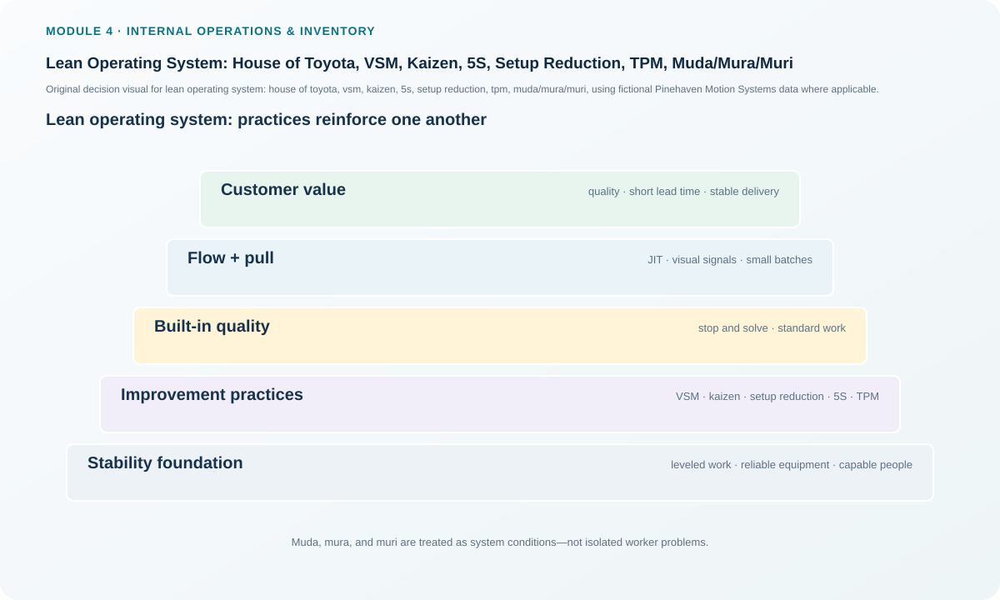
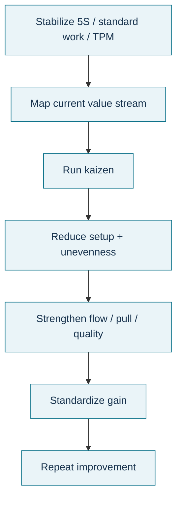

# 12. Lean Operating System: House of Toyota, VSM, Kaizen, 5S, Setup Reduction, TPM, Muda/Mura/Muri

## Learning objectives

After this topic, you should be able to:

- explain the logic of the House of Toyota/lean operating system without reproducing source artwork;
- apply value-stream mapping, kaizen, 5S, setup reduction, and TPM to operational problems;
- distinguish muda, mura, and muri; and
- select a lean tool based on the underlying waste mechanism rather than fashion.

## Concept in plain English

A lean operating system combines customer-focused flow with a stable foundation. The familiar “house” metaphor is useful because fast pull flow cannot stand on unstable equipment, inconsistent work, poor quality, or an untrained workforce. Common elements include built-in quality, just-in-time flow, standardized work, visual management, stable processes, capable people, and continuous improvement.

Several tools support that system. **Value-stream mapping** compares current and future flow. **Kaizen** is ongoing improvement; a kaizen event is a focused cross-functional effort, while a kaizen blitz is an especially rapid, narrow intervention. **5S** organizes and sustains the workplace. **Setup reduction** separates internal and external changeover work, converts what can be done while the machine runs, and streamlines the remainder. **TPM** expands responsibility for equipment effectiveness beyond a maintenance department alone.

Lean also distinguishes **muda** (waste), **mura** (unevenness), and **muri** (overburden). Repeated fire-fighting often begins with uneven demand or scheduling, creates overburden, and then generates defects, downtime, waiting, and rework.

## Why it matters

Tools used in isolation can improve one symptom while the operating system remains unstable. 5S without standard work becomes housekeeping. Setup reduction without demand logic can simply increase the rate of overproduction. TPM without flow priorities can improve noncritical equipment while the constraint still limits output. The lean system connects the tools to customer flow.

## Decision model and workflow

### Evidence retained through the workflow

Retain current/future-state maps, kaizen charter and results, 5S standard and audit evidence, changeover observations split into internal/external work, setup-time result, TPM condition/maintenance evidence, identified muda/mura/muri, owner, and sustainment trigger.

## Practical process flow

## Realistic example — Pinehaven Motion Systems

Pinehaven's setup time is **37 minutes** against a **22-minute target**. The lean response begins by observing the changeover rather than telling the operator to move faster. Tools and fixtures can be staged while the prior job is still running, adjustments can be standardized, and fastening/connection work can be simplified.

At Burn-in Test, the queue is **124 units**. Adding more upstream output would increase muda. The team checks whether uneven release (mura) is overloading the test area (muri) and creating waiting/WIP (muda). TPM is aimed at keeping the true constraint reliable, while kaizen and setup reduction improve flow around it.

All names and values in this example are fictional and independently selected for learning purposes.

## Applied decision artifact

Use a **lean operating-system audit** with six sections: stability, standard work, visual management, flow/pull, equipment reliability, and people/CI. Attach a changeover observation sheet, 5S sustainment check, and current/future-state value-stream map. A tool is approved only when the team states which waste mechanism it is intended to reduce.

## Decision logic

- Stabilize the process before demanding faster flow.
- Use VSM to see material and information delays across the stream.
- Select kaizen/event/blitz scope based on risk and complexity.
- Reduce setup by externalizing and simplifying work, not by skipping quality/safety controls.
- Use TPM to improve reliable equipment availability and flow.
- Trace visible muda back to possible mura and muri so the deeper cause is not missed.

## Trade-offs

Rapid kaizen can build momentum but may oversimplify a complex issue. 5S and visual standards improve control but require discipline to sustain. Setup reduction and flexible equipment enable smaller lots but need engineering effort. TPM requires operator involvement without blurring technical maintenance qualifications.

## Commonly confused with

**Kaizen** is the ongoing philosophy of improvement. A **kaizen event** is a focused, time-bounded improvement project. A **kaizen blitz** is an especially rapid intervention in a limited area. **5S** organizes the workplace; it is not the whole lean system.

## Common mistakes

- Treating lean as a toolbox with no value-stream objective.
- Using a blitz for a high-risk process that needs deeper analysis.
- Reducing setup by removing required verification.
- Launching TPM on every asset equally instead of considering operational criticality.
- Treating muda without examining the unevenness or overburden creating it.

## Original knowledge check

**Question.** A plant repeatedly rushes at month-end, overloads people and equipment, then experiences defects and waiting. Which sequence best describes the lean diagnosis?

A. Muda creates all demand.

B. Mura can create muri, which then generates muda.

C. TPM automatically creates mura.

D. 5S eliminates all three without further analysis.

Answer and rationale

### Correct answer

**B. Mura can create muri, which then generates muda.**

### Why it is correct

Unevenness in workload or demand (mura) can overburden people/processes (muri), producing waste such as defects, waiting, and rework (muda).

### Why the other answers are wrong

- **A.** Waste does not create all demand.
- **C.** TPM targets equipment effectiveness, not uneven demand.
- **D.** 5S helps workplace control but is not a universal cure.

## Practitioner perspective

When applying lean in regulated manufacturing, classify a step as value-added, necessary non-value-added, or removable waste. That prevents a team from deleting required traceability, validation, or safety controls merely because the customer does not directly pay for them.

## Related concepts

- [Lean Waste, Objectives, and Five Principles](./11-lean-waste-objectives-and-five-principles.md)
- [Just-in-Time Production and Pull Execution](./13-just-in-time-production-and-pull-execution.md)
- [Internal Operations and Inventory Formula Sheet](../../calculations/internal-operations/formula-sheet.md)

---

[Previous](./11-lean-waste-objectives-and-five-principles.md) · [Next](./13-just-in-time-production-and-pull-execution.md)
