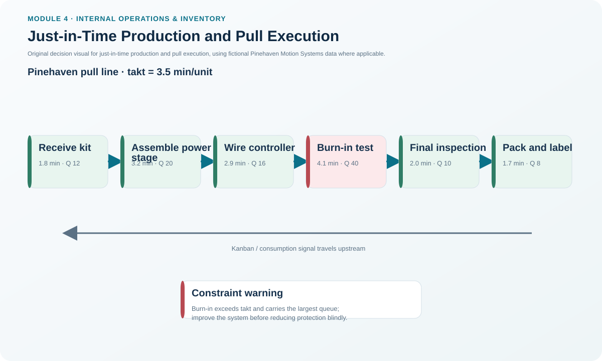
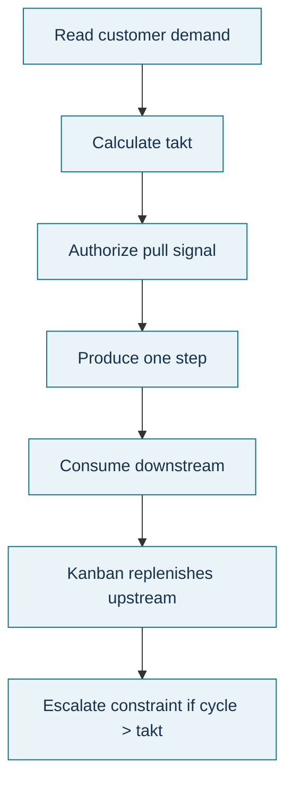

# 13. Just-in-Time Production and Pull Execution

## Learning objectives

After this topic, you should be able to:

- explain JIT as a flow and continuous-improvement philosophy rather than a delivery slogan;
- describe waste reduction, variability reduction, and pull as JIT basics;
- connect supplier behavior, cells/layout, small lots, setup reduction, and level scheduling; and
- calculate and interpret takt time from the locked Pinehaven data (3.5 min/unit).

## Concept in plain English

Just-in-Time (JIT) aims to have the right material arrive where and when it is needed while progressively removing waste and variability. It depends on quality, reliable processes, small lots, rapid changeovers, capable suppliers, clear schedules, flexible people, and demand pull. JIT is therefore not simply “deliver later” or “hold no stock.” Removing inventory buffers without improving the system makes failures more visible but can also stop production.

Three basics organize the approach: reduce waste, reduce variability, and **pull** material based on downstream need rather than pushing output according to an upstream schedule. Cellular layouts and smaller distances help flow. Level scheduling and kanban signals help synchronize production. Backflushing can reduce transaction effort when the bill of material and production records are sufficiently accurate.

**Takt time** expresses the customer-demand pace: available production time divided by customer demand for the same period. It is not actual cycle time. If a process cycle consistently exceeds takt, the process cannot meet demand without capacity, method, or demand changes.

## Why it matters

JIT exposes weak reliability, long setups, quality problems, and poor supplier performance that excess inventory can hide. When these causes are improved, the organization can reduce WIP, queues, lead time, and working capital while responding more directly to demand.

## Decision model and workflow

### Evidence retained through the workflow

Retain available production time, demand quantity and period, takt calculation, actual process cycle times, setup, wait, queue/WIP, kanban/pull status, supplier delivery/quality evidence, level-schedule rule, backflush accuracy controls, and exception-response ownership.

## Practical process flow

## Realistic example — Pinehaven Motion Systems

Pinehaven has **420 available production minutes per shift** and customer demand of **120 units per shift**.

`Takt time = 420 / 120 = 3.500 minutes per unit.`

The locked flow shows Burn-in Test at **4.1 minutes of process time per unit**, above the **3.5-minute takt pace**, with a red kanban status, a **24-minute batch wait**, and **64 units of WIP**. This does not mean every individual processing time must mechanically equal takt, but it clearly flags Burn-in Test as a flow risk requiring capacity/method/buffer control.

The full fictional stream is in [`lean-flow.csv`](../../assets/data/module-4/lean-flow.csv), and the formula is in the [`internal-operations formula sheet`](../../calculations/internal-operations/formula-sheet.md).

All names and values in this example are fictional and independently selected for learning purposes.

## Applied decision artifact

Use a **JIT readiness and pull-control checklist** covering supplier reliability/quality, setup/changeover capability, small-lot economics, cellular/flow layout, material-signal design, level-schedule logic, standard work, defect response, backflush/BOM accuracy, cross-training, and takt/cycle-time comparison. Do not remove a buffer until the risk it protects has an alternative control.

## Decision logic

- Calculate takt using consistent available-time and demand periods.
- Compare process capability/cycle with the required pace.
- Reduce setup, quality problems, and variability before aggressively removing inventory.
- Use pull signals tied to actual downstream consumption.
- Level the mix/volume where feasible to reduce unevenness.
- Keep supplier and information flows synchronized with the internal pull system.

## Trade-offs

Small frequent lots reduce WIP and feedback delay but increase ordering, transport, and setup frequency unless those costs are reduced. Low buffers improve visibility but make reliability requirements much stricter. Supplier consolidation can strengthen JIT relationships but may increase concentration risk.

## Commonly confused with

**Takt time** is the pace required by customer demand. **Cycle time** is how long the process actually takes. **Lead time** includes the elapsed time through the broader process, often including waiting. JIT is a philosophy/system; **kanban** is one pull-signaling method that may support it.

## Common mistakes

- Calling a delivery schedule “JIT” while keeping long internal queues.
- Reducing safety stock before fixing quality and reliability.
- Using takt and cycle time interchangeably.
- Backflushing against inaccurate BOMs or production reporting.
- Forcing every supplier into small frequent deliveries without considering transport economics and risk.

## Original knowledge check

**Question.** Pinehaven has 420 productive minutes available in a shift and demand for 140 units. What takt pace is required?

A. 2 minutes/unit.

B. 3 minutes/unit.

C. 3.5 minutes/unit.

D. 420 units/minute.

Answer and rationale

### Correct answer

**B. 3 minutes/unit.**

### Why it is correct

420 minutes divided by 140 units equals 3.0 minutes per unit. Takt uses available production time divided by customer demand for the same period.

### Why the other answers are wrong

- **A.** 2.0 would require 210 units of demand for 420 minutes.
- **C.** 3.5 corresponds to the locked 120-unit example, not 140 units.
- **D.** The units are inverted and the magnitude is not meaningful.

## Practitioner perspective

In ERP/MES environments, JIT works best when physical pull and digital records agree. Kanban signals, goods movements, component consumption, backflushing, and exception handling should be designed as one control loop rather than separate shop-floor and system processes.

## Related concepts

- [Lean Operating System: House of Toyota, VSM, Kaizen, 5S, Setup Reduction, TPM, Muda/Mura/Muri](./12-lean-operating-system-house-of-toyota-vsm-kaizen-5s-setup-reduction-tpm-muda-mura-muri.md)
- [Six Sigma and DMAIC](./14-six-sigma-and-dmaic.md)
- [Internal Operations and Inventory Formula Sheet](../../calculations/internal-operations/formula-sheet.md)

---

[Previous](./12-lean-operating-system-house-of-toyota-vsm-kaizen-5s-setup-reduction-tpm-muda-mura-muri.md) · [Next](./14-six-sigma-and-dmaic.md)
